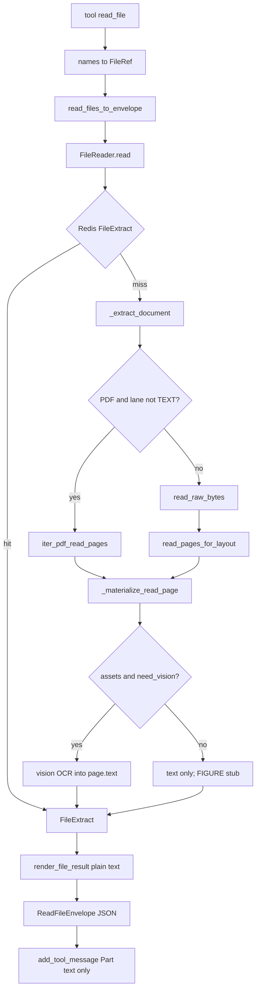

# Recursive / nested read_file

## Вердикт по идее

- **Markdown** в tool-результате — lossy view структуры (как Docling `export_to_markdown`), тип по-прежнему `str`.
- **Картинки/вложенности модель «видит»** только через A2A `Part(raw=…)` → codec [`extract_content_parts`](core/clients/llm/messages.py) → `image_url` + `data:…;base64,…` на wire. Строка `` внутри text Part vision **не** включает.
- **`data:` в md** — optional export для `create_file` / FileWriter, не default agent path.
- Параметр доставки вложенностей — **`nested_mode`** (не `image_mode`): любой nested `content_type` внутри контейнера.
- Пагинация уже есть: `page_start` / `page_end` / `budget` / `continuation`.

Риски: budget на chars и число nested; раздувание history при Parts; Redis extract-cache без bytes (rehydrate при cache hit).

---

## Текущий алгоритм `read_file` (as-is) — не стирать из головы



1. Tool [`apps/flows/tools/files/files.py`](apps/flows/tools/files/files.py) → envelope.
2. Extract (Redis 24h): PDF — PyMuPDF text + structure blocks + embedded images (`bytes_b64`) + raster если нет usable text; usable ≥40 chars / printable ≥0.85; PDF >20 стр. — vision только на окно.
3. Materialize: optional persist RAG; `need_vision = assets and (force_vision or not text_usable)`; FIGURE `[figure]`; bytes дальше не живут в tool.
4. Render: только `page.text` → `PageResult.result`.
5. Shop menu / `llm_vision` — **отдельный** путь (`Part.raw` на user message, `pdf_page_pngs` max 8) — вне этого изменения.

Пороги: `_PDF_MIN_*`, `VISION_FULL_READ_MAX_PAGES=20`, `MAX_READ_BUDGET=100_000` — в [`models.py`](core/files/reader/models.py) / [`service.py`](core/files/reader/service.py).

---

## Опыт Docling (сжато, для контекста)

Docling: DoclingDocument + backends + pipelines; lossy markdown export; PDF layout/TableFormer/OCR тяжёлые (torch). Архитектурно совпадает с нашим extract→render; **полный Docling в sync `read_file` не берём**.

Лёгкие альтернативы: свой `page_to_markdown`; spike **pymupdf4llm 1.28.x** `embed_images` под пин `pymupdf<2.0` (3.14t); PyMuPDF 2.0 недоступен из‑за пина; Marker/MinerU — не hot path.

Что берём из Docling без зависимости: structured extract → lossy md; pictures/nested first-class; optional enrichment pipeline (= наш `recursive` / vision lane).

---

## Multimodal Parts (платформа уже умеет)

Codec: `Part(raw=bytes, media_type=…)` → OpenAI `image_url` data URI ([`core/clients/llm/messages.py`](core/clients/llm/messages.py)).

Сейчас tool-result — только текст ([`add_tool_message`](apps/flows/src/runtime/runners/base_runner.py)). Цель при `nested_mode=parts`:

```python
Message(
    role=ROLE_AGENT,
    parts=[
        Part(text="# Салаты\n\nЦезарь — 450 ₽\n\n![p1_n1]\n\n![p1_n2]\n"),
        Part(raw=png_1, media_type="image/png", filename="menu.pdf#p1_n1"),
        Part(raw=png_2, media_type="image/png", filename="menu.pdf#p1_n2"),
    ],
    metadata={"tool_call_id": "…", "node_id": "…"},
)
```

`llm_vision` уже так инжектит в **user** message; здесь — в **tool** message.

Последовательная простыня md в history с ack-репликами («понял, принял file») — **не** канон; дороже и без пагинации.

---

## Параметры: `nested_mode` + `recursive`

Не `image_mode`: вложенность — любой `content_type` (сейчас image/* из PDF/DOCX/PPTX; позже вложенный pdf, email attachment, zip entry…).

```text
nested_mode: "refs" | "parts"   # default "refs"
recursive: bool                   # default false
```

| | `nested_mode=refs` | `nested_mode=parts` |
|---|---|---|
| **recursive=false** | md + якоря; nested → FileRef + `state.files`; агент сам `read_file` | md + якоря + `Part(raw, media_type=child.content_type)` |
| **recursive=true** | md + якоря + встроенный результат read каждого nested; FileRef тоже | **запрещено** (`raise_invalid`) |

`recursive` = один уровень авто-`read` по `content_type` ребёнка (image → vision/text lane; будущий pdf → pdf extract), не «всегда OCR картинок». Depth >1 — вне первого среза.

`forced_lane=TEXT` → nested не материализуем.

---

## Модель `NestedContent`

```text
anchor, original_name="{parent}#{anchor}"
content_type, bytes?, kind, checksum, width?, height?
```

Markdown:

- image/* → `![anchor]`
- иначе → `[anchor](nested:original_name)`

Backends (одна delivery): PDF embedded/raster, DOCX media, PPTX pictures, IMAGE = один nested; новый формат только наполняет список.

---

## Выход

- `FileExtract` — structured; Redis без nested bytes (rehydrate).
- Envelope: `nested_mode`, `recursive`, `results[].result` (md), `nested[]` `{anchor, original_name, file_id?, content_type, kind}`, `continuation`.
- Persist FileRef при refs и parts (якорь всегда дочитываем).
- Page-level hybrid (нет usable text → raster+OCR страницы) **сохраняем**; при богатом тексте + embedded — без auto-OCR каждого nested в `refs` (агент / recursive / parts).

Пагинация: nested только из `[page_start, page_end]`; `max_nested` + char budget; compress image/* перед Part/vision.

Optional: md+`data:` для FileWriter; `image_fetch` + `data:`.

---

## Потоки агента

1. Lazy: `read_file(..., nested_mode="refs")` → при нужде `read_file(names=["menu.pdf#p1_n1"])`.
2. Inline multimodal: `nested_mode="parts"`.
3. Авто-разбор вложенностей: `recursive=true`.

---

## Реализация

1. `NestedContent` + collect backends; bytes до render; strip/rehydrate cache.
2. `page_to_markdown`.
3. Switch `nested_mode` / `recursive`; persist + `state.files`.
4. `add_tool_message(Sequence[Part])`.
5. Budget / omitted stubs.
6. Optional writer data URI; spike pymupdf4llm.
7. `files.mdc` + тесты — см. раздел ниже.

---

## Тесты

База: существующие [`tests/core/files/test_read_file_pdf_hybrid.py`](tests/core/files/test_read_file_pdf_hybrid.py), corpus/fixtures; MockLLM для vision. Новые кейсы — рядом (`test_read_file_nested_*.py` или расширение hybrid). Фикстуры PDF генерировать детерминированно (как `golden/bytes.py`) или положить в `tests/core/files/fixtures/`.

### Фикстуры PDF (обязательный набор)

1. **Текст + embedded image** — born-digital text layer + картинка (маркер в тексте; образ отличим по checksum/size). Уже близко к `pdf_text_and_image.pdf`.
2. **Псевдотекст (текст картинкой)** — страница без usable text layer (или мусор &lt;40 chars), содержимое только в raster/скане; маркер читается только через vision/OCR (`MOCK_VISION` в merged md при recursive / page hybrid).
3. **Только текст** — regression: `nested_mode=refs` без лишнего vision; lane TEXT.
4. **Многостраничный** (≥3 стр., на разных страницах свои nested и/или псевдотекст) — для пагинации.

Дополнительно (тот же контракт nested, не только PDF): один DOCX с media — якорь `p0_n*` / `original_name` стабилен.

### Режимы `nested_mode` / `recursive`

| Кейс | Ожидание |
|---|---|
| `refs` + PDF текст+image | md с `![p…_n…]`; `nested[]` с `file_id`; child в `state.files`; **нет** `Part(raw)` в tool message; vision по embedded **не** вызывался |
| `refs` → второй `read_file(names=[child])` | IMAGE lane / описание; child резолвится по `original_name` |
| `parts` + PDF текст+image | md с якорями; tool message: `Part(text)` + `Part(raw, media_type=image/…, filename=parent#anchor)`; `message_to_openai` / `extract_content_parts` даёт `image_url` |
| `recursive=true` + PDF текст+image | под якорем блок OCR (`MOCK_VISION`); `read_lane` hybrid; FileRef детей есть |
| `recursive=true` + псевдотекст | page raster и/или nested; в md есть mock vision-текст маркера; не пустой result |
| `parts` ∧ `recursive=true` | validation error (`raise` / tool error), без partial success |
| `forced_lane=TEXT` | нет nested persist/Parts/recursive vision; только текстовый слой |

### Пагинация

| Кейс | Ожидание |
|---|---|
| `page_start=0, page_end=0` на 3-стр PDF | `results` только стр.0; `nested` только с этой страницы; `continuation.has_more` / `next_page_start=1` |
| Второй вызов `page_start=1` | другие якоря/nested; не дублировать стр.0 без запроса |
| `budget` меньше md+OCR | `omitted:budget` / truncated; stop_reason budget; continuation предлагает продолжение |
| PDF `pages_total > 20` (или фикстура с mock count / маленький порог в unit при необходимости) | vision/recursive только на запрошенном окне; warning про порог как сейчас |

### Прочее (коротко)

- Cache hit: после extract-cache повторный tool-вызов снова отдаёт nested bytes для `parts` (rehydrate).
- DOCX media: тот же `nested_mode=refs` контракт якорей/`state.files`.
- Writer optional: md с `data:` → html/docx без сети (если делаем флаг export).

Инварианты ассертов: не truthy-only; сравнивать структуру envelope (`nested`, `continuation`, якоря в `result`); для Parts — число raw parts и `filename`/`media_type`.

## Вне scope

- Docling/Marker/MinerU в sync path
- Подмена `shop_menu_agent` / `llm_vision`
- Recursive depth >1; zip/email ATTACHMENT до extract
- Авто ack-хоровод файлов в history
