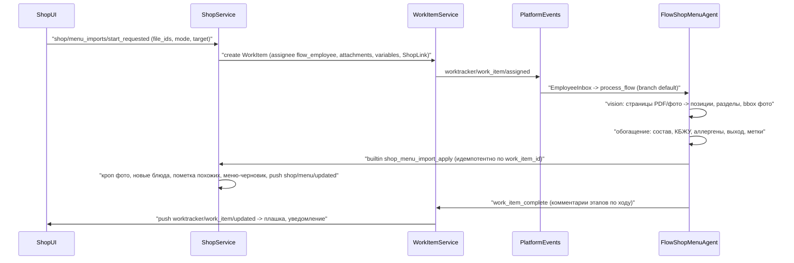

# Меню shop: каталог, несколько меню, импорт по фото и нейрообработка

## Зафиксированные решения

- Каталог блюд принадлежит заведению. Меню ссылается на блюда: одно блюдо может быть в нескольких меню, а цену и доступность можно переопределить в позиции меню.
- Категории `ShopCategory` превращаются в разделы конкретного меню (дерево, как сейчас).
- Связь `ShopMenu` -> `Shop` many-to-one. Статусы меню: `draft`, `active`, `archived`. На витрине несколько активных меню, каждое во вкладке.
- Правила статусов:
  - архивное меню можно вернуть в draft;
  - активное меню редактируется вживую;
  - меню можно удалить, блюда каталога при этом остаются;
  - блюдо, которое стоит в меню, удалить нельзя;
  - активировать можно только меню хотя бы с одной позицией.
- Перенос и копирование меню между заведениями не делаем. Данные создаются с нуля, миграции старых данных нет.
- Акция `category_qty` начинает ссылаться на раздел меню.
- Агент работает по паттерну worktracker. Создаётся `WorkItem` на `flow_employee_shop_menu_agent`, агент пишет результат builtin-тулами. Детерминированная запись (разделы, расчёт похожих блюд, кроп) живёт в сервисе shop. Шага проверки нет: результат сразу пишется в каталог и в меню-черновик.
- AI-данные помечаются флагом «не проверено». Владелец подтверждает их, а на витрине КБЖУ показывается с пометкой «ориентировочно».
- Похожие блюда подсвечиваются, но не блокируют импорт. Импорт всегда создаёт новое блюдо. Если в каталоге есть блюдо с похожим названием (pg_trgm, порог в настройках shop), новое помечается «похоже на X». Человек решает сам:
  - «Обновить существующее» — данные нового блюда (цена, описание, состав, КБЖУ, аллергены, выход, фото) переносятся в существующее, позиции меню переключаются на него, новое удаляется;
  - «Оставить новым» — пометка снимается.
- Подсветка работает в импорте по фото, в файловом импорте и в ручном создании или переименовании блюда (подсказка в модалке при вводе названия).
- Вход агента: до 20 фото или PDF за запуск. Фото блюд вырезаются из фото меню.
- Файловый импорт в формате Яндекс Еды (XLSX и JSON с группами модификаторов) работает параллельно агентному. Цели у него те же, что у фото. Битые строки попадают в отчёт, остальные импортируются. Опционально после импорта запускается дозаполнение через AI.
- Старый текстовый импорт (CSV-панель, `op_ai_parse_menu`, ветка `parse_menu`, `ShopAiMenuItem`) и синхронный `op_ai_describe_batch` удаляются. Их заменяют файловый импорт и агентное обогащение: второй способ запрещён принципом минимализма.

## Пользовательские истории

1. **Импорт по фото в новое меню.** Владелец загружает фото страниц бумажного меню и выбирает «Новое меню». Он уходит со страницы, а плашка показывает этапы: распознавание, обогащение, запись. По завершении приходит уведомление с кнопкой «Открыть меню». Результат: меню-черновик с разделами и порядком, как на фото, и блюда в каталоге с составом, КБЖУ, аллергенами и вырезанными фото.
2. **Импорт по фото только в каталог.** То же самое, но меню не создаётся.
3. **Импорт по фото в существующее меню.** Позиции добавляются в выбранное меню, разделы сопоставляются по названию или создаются.
4. **Шаблон меню из каталога.** Владелец выбирает блюда (или весь каталог) и пишет подсказку, например «барное меню». Агент собирает меню-черновик с разделами и порядком.
5. **Дозаполнение.** На странице каталога владелец выбирает блюда (или фильтр «незаполненные») и нажимает «Дозаполнить AI». Пустые поля заполняются и помечаются как непроверенные.
6. **Файл Яндекс Еды.** Владелец загружает XLSX или JSON и выбирает цель. Импорт проходит синхронно, затем показывается отчёт: создано, похожих на существующие, строки с ошибками. Галочка «Дозаполнить AI» запускает историю 5 для импортированных блюд.
7. **Жизненный цикл меню.** Владелец создаёт и переименовывает меню, меняет порядок вкладок, активирует, архивирует, восстанавливает и удаляет.
8. **Разбор похожих.** После импорта в каталоге и в редакторе меню блюда с пометкой «похоже на X» подсвечены. Владелец открывает сравнение двух карточек и нажимает «Обновить существующее» или «Оставить новым». При ручном создании блюда модалка показывает похожие, пока владелец вводит название, но сохранить можно в любом случае.
9. **Гость витрины.** Видит вкладки активных меню. В карточке блюда: выход, состав, КБЖУ (с пометкой «ориентировочно» для непроверенных данных), аллергены, метки. Цена берётся из позиции меню.

## Последовательность импорта по фото

## Модель данных (`apps/shop/models/`)

- `product.py` — `ShopProduct` (каталог). Поле `category_id` убирается, `portion` заменяется на `measure: int | None` и `measure_unit: ShopMeasureUnit` (`g`, `ml`, `pcs`, как у Яндекс Еды). Новые поля: `ingredients: list[str]`, `nutrition: ShopNutrition | None` (ккал, белки, жиры, углеводы на 100 г), `allergens: list[ShopAllergen]` (фиксированный enum), `ai_unverified: bool`, `similar_shop_product_id: str | None` (лучшее совпадение на момент создания). Запрос `find_similar_by_name` — `@classmethod` на pg_trgm `similarity` по существующему GIN-индексу `name`. Удаление при наличии позиций в меню — `PlatformConflictError` `product_in_menu`.
- `menu.py` — `ShopMenu`: `shop_menu_id`, `shop_id`, `name`, `status: ShopMenuStatus`, `sort`, `created_at`, `updated_at`.
- `menu_section.py` — `ShopMenuSection` вместо `category.py`: `shop_menu_section_id`, `shop_menu_id`, `parent_id`, `name`, `sort`.
- `menu_item.py` — `ShopMenuItem`: `shop_menu_item_id`, `shop_menu_id`, `shop_menu_section_id`, `shop_product_id`, `price_minor_override: int | None`, `is_available`, `sort`; `unique_together (shop_menu_id, shop_product_id)`.
- `order_item.py` получает `shop_menu_item_id`, чтобы цена разрешалась по меню, из которого блюдо добавлено.
- В `promo.py` условие `category_qty` переименовывается в `section_qty` с `shop_menu_section_id`.
- Миграция: новая `0001_initial` для базы `shop` (данные с нуля) через `makemigrations`.

## Команды (`apps/shop/realtime/` + REST-зеркало `apps/shop/api/`)

- Меню: `shop/menus/{list,create,update,reorder,set_status,remove}_requested`. Инварианты `set_status` (непустое меню при активации, restore только из archived) проверяет сервис.
- Разделы: `shop/menu_sections/{create,update,remove,reorder}_requested` вместо `categories_*`.
- Позиции: `shop/menu_items/{add,update,move,remove,reorder}_requested`.
- Каталог: существующие `products_*` и новые команды:
  - `shop/products/verify_requested` — снимает `ai_unverified`;
  - `shop/products/similar_list_requested` (`name`, `exclude_shop_product_id`) — подсказка в модалке;
  - `shop/products/merge_requested` (`shop_product_id` нового, `target_shop_product_id`) — перенос полей и позиций меню в существующее блюдо и удаление нового; если оба блюда стоят в одном меню, позиция нового удаляется;
  - `shop/products/dismiss_similar_requested` — снимает пометку.
  Создание и переименование блюда сами пересчитывают `similar_shop_product_id`.
- Агент:
  - `shop/menu_imports/start_requested` (`file_ids`, `target`: `catalog` / `new_menu` / `into_menu`, `shop_menu_id`);
  - `shop/menu_templates/build_requested` (`shop_product_ids`, `prompt`);
  - `shop/products/enrich_requested` (`shop_product_ids` или `only_incomplete`);
  - `shop/menu_imports/list_requested` (активные WorkItem заведения для плашки).
- Write-back агента: `shop/menu_imports/apply_requested` (плоский план разделов и позиций: при импорте позиция всегда новое блюдо с bbox кропа, в режиме шаблона — существующий `shop_product_id`) и `shop/products/enrich_apply_requested`. Обе идемпотентны по `work_item_id`.
- Файл: `shop/menu_file_imports/run_requested` (`file_id`, `format`: `xlsx` / `yandex_json`, `target`, `enrich_after`). Ответ — отчёт `created`, `similar`, `errors[{row, error_code}]`. Загрузка фото по URL ставится в TaskIQ shop.
- Сервисы: `apps/shop/services/menu_service.py` (меню, разделы, позиции, статусы), `menu_import_service.py` (создание WorkItem, apply, кроп через PIL/pymupdf, запись файлов через `FilesService`), `menu_file_import_service.py` (парсеры XLSX на `openpyxl` и JSON Яндекс Еды: typed boundary на Pydantic, модификаторы в существующие `ShopModifierGroup`/`ShopModifierOption`).
- `StorefrontService.build_snapshot` собирает активные меню по `sort` -> разделы -> позиции с итоговой ценой и доступностью.

## Интеграция с flows и worktracker

- Новый bundle `apps/flows/bundles/shop_menu_agent/` (`employee.enabled`, `public: true` в `apps/flows/registry.yaml`). Inbox всегда стартует ветку `default`, поэтому режим (`import`, `template`, `enrich`) передаётся в `WorkItem.variables.mode`, а маршрутизацию по нему делает condition-нода. Vision-разбор и обогащение — `llm_node` со structured output, промпты и схемы лежат в bundle.
- `core/clients/shop_client.py` — `ShopClient` (`ServiceClient`), модели аргументов — в `core/clients/shop_models.py`.
- `apps/flows/tools/shop/menu_tools.py` — builtin-тулы `shop_catalog_list` (для режимов шаблона и обогащения), `shop_menu_import_apply`, `shop_products_enrich_apply`, регистрация в `apps/flows/tools/builtin_specs.py`. Этапы агент пишет комментариями WorkItem существующими worktracker-тулами, завершение — `work_item_complete`.
- В union `WorkItem.links` добавляется `ShopLink(shop_id)` (`core/worktracker/models/work_item.py`), чтобы плашка находила задачи заведения. Это нужно проверить по контракту links на этапе реализации.
- Права: flow-сотрудник получает право редактирования заведения через OpenFGA (`apps/shop/authz/`), иначе вызов тула вернёт `forbidden`.
- Биллинг LLM и vision считается спанами flows автоматически. Pre-flight баланса делает flows при старте.

## Что отрисовать (`apps/shop/ui/`)

- Маршруты в `shop-app.ts`: `shop_catalog` (новый), `shop_menus` (список), `shop_menu` (`:shopId/menus/:menuId`, редактор вместо текущей страницы меню).
- `pages/shop-catalog-page.ts`: таблица блюд (фото, название, цена, выход, индикатор КБЖУ, аллергены, бейдж «AI, не проверено», подсветка «похоже на X» с кнопками «Обновить существующее» и «Оставить новым»). Фильтры: «не проверено AI», «без фото», «без КБЖУ». Массовые действия: «Дозаполнить AI», «Подтвердить», «Добавить в меню».
- `pages/shop-menus-page.ts`: карточки меню со статусом и счётчиками; создание, импорт, «Шаблон из каталога», активация, архив, восстановление, удаление; перетаскивание порядка вкладок.
- `pages/shop-menu-page.ts` (переработка): дерево разделов (`shop-category-tree` переименовывается в `shop-section-tree`), позиции с переопределением цены и доступности, модалка «Добавить из каталога», перетаскивание позиций между разделами.
- `modals/shop-menu-import-modal.ts`: источник «Фото/PDF» (до 20 файлов, порядок страниц) или «Файл Яндекс Еды» (XLSX/JSON и ссылка на шаблон); цель: каталог, новое меню (название) или существующее меню; галочка «Дозаполнить AI» для файла; отчёт файлового импорта.
- `modals/shop-menu-template-modal.ts`: выбор блюд и подсказка.
- `modals/shop-product-merge-modal.ts`: сравнение нового и существующего блюда по полям, кнопки «Обновить существующее» и «Оставить новым».
- `modals/shop-product-modal.ts`: новые поля `<platform-field>` — состав (`array`), КБЖУ (`number`), аллергены (multi-`enum`), выход и единица, кнопка «Подтвердить AI-данные». При вводе названия — список похожих блюд из `similar_list` (подсказка, сохранение не блокирует).
- Редактор меню подсвечивает позиции с пометкой «похоже на X» и открывает ту же модалку сравнения.
- `components/shop-agent-jobs-banner.ts`: активные задачи заведения из `shop/menu_imports/list` и push `worktracker/work_item/updated`. Показывает этапы; по завершении — toast и «Открыть меню», при ошибке — причина и «Повторить».
- Фабрики в `events/resources/shop.resource.ts` на `transport: 'ws'` с `restMirror`. Ключи i18n в `core/i18n/translations/{ru,en}/shop.json`, коды ошибок — в `platform:errors`.
- Витрина (`apps/shop/api/storefront_shell.py`): вкладки активных меню, в карточке блюда выход, состав, КБЖУ с пометкой «ориентировочно», аллергены.

## Правила и тесты

- Новое правило `.cursor/rules/shop.mdc`: модель каталога и меню, статусы, инварианты, агент и файловый импорт, гейты. Строки в навигации и таблице сервисов `main.mdc`; новые имена `shop_menu_id`, `shop_menu_section_id`, `shop_menu_item_id` — в § Именование.
- Тесты:
  - `tests/shop/`: инварианты статусов, блокировка удаления блюда, идемпотентность apply по `work_item_id`, пометка похожих, merge (поля, позиции, коллизия в одном меню), dismiss, кроп;
  - парсеры XLSX и JSON на фикстурах с битыми строками;
  - снимок витрины с несколькими меню;
  - `tests/realtime/test_shop_commands.py` — тождество WS и REST.
- Агентный сценарий проверяется через `MockLLM`.
- Готовность: `make lint` и `uv run pytest tests/shop/ -q` зелёные.