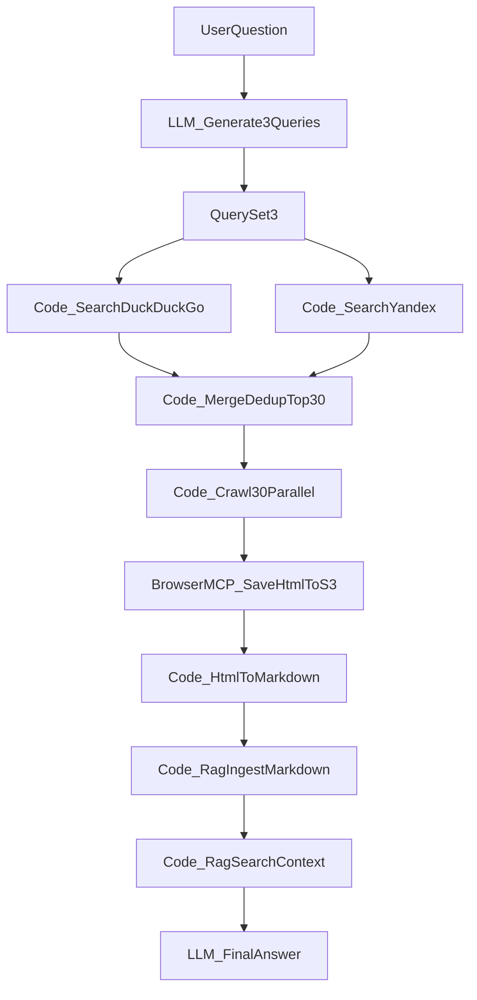

# Refactor simple_crawler под function-first pipeline

## Цель и границы
- Оставить LLM только в двух местах:
  - генерация 3 поисковых запросов из вопроса пользователя;
  - финальный ответ по найденному контексту.
- Все промежуточные шаги сделать кодом/инструментами без LLM.
- Поиск: `3 queries x 2 engines (Yandex + DuckDuckGo) x 5 links = 30 страниц`.
- Затем для каждой из 30 страниц запустить обход ссылок по первым кликабельным элементам из MCP, с параметрами `crawl_strategy` (`bfs|dfs`) и `crawl_depth` (default `2`).
- HTML сохранять как файл в S3 и передавать дальше только путь/идентификатор файла (не inline body).
- В RAG сохранять markdown-контент c корректной нарезкой через существующий pgvector pipeline.
- Для `html -> markdown` использовать готовую специализированную библиотеку `trafilatura` (без `craw4ai`).

## Текущая база (что переиспользуем)
- Bundle: [apps/flows/bundles/simple_crawler/flow.json](/Users/sombrero/agent-lab/agent-lab/apps/flows/bundles/simple_crawler/flow.json) — сейчас содержит LLM в поиске и page-step.
- Browser MCP API: [apps/browser/api/mcp.py](/Users/sombrero/agent-lab/agent-lab/apps/browser/api/mcp.py).
- Browser container (унаследует file/s3 слой): [apps/browser/container.py](/Users/sombrero/agent-lab/agent-lab/apps/browser/container.py).
- S3/File паттерн платформы:
  - [core/files/processors.py](/Users/sombrero/agent-lab/agent-lab/core/files/processors.py)
  - [core/files/file_repository.py](/Users/sombrero/agent-lab/agent-lab/core/files/file_repository.py)
  - [core/files/s3_client.py](/Users/sombrero/agent-lab/agent-lab/core/files/s3_client.py)
  - [core/config/models.py](/Users/sombrero/agent-lab/agent-lab/core/config/models.py)
- RAG ingestion/chunking:
  - [core/clients/rag_client.py](/Users/sombrero/agent-lab/agent-lab/core/clients/rag_client.py)
  - [apps/flows/tools/rag.py](/Users/sombrero/agent-lab/agent-lab/apps/flows/tools/rag.py)
  - [core/rag/providers/pgvector_provider.py](/Users/sombrero/agent-lab/agent-lab/core/rag/providers/pgvector_provider.py)

## Целевая архитектура

## Изменения по файлам

### 1) Пересобрать flow-граф simple_crawler
- Файл: [apps/flows/bundles/simple_crawler/flow.json](/Users/sombrero/agent-lab/agent-lab/apps/flows/bundles/simple_crawler/flow.json)
- Изменения:
  - Оставить `plan_queries` как `llm_node`.
  - Убрать промежуточные LLM-ноды поиска/парсинга страниц.
  - Добавить code-ноды:
    - `search_duckduckgo_batch` (3 запроса, по 5 ссылок);
    - `search_yandex_batch` (3 запроса, по 5 ссылок);
    - `merge_search_results_30` (детерминированный дедуп, итог ровно до 30 URL);
    - `crawl_pages_recursive` (gather по URL + recursive crawl с `crawl_strategy`, `crawl_depth`);
    - `html_to_markdown_batch` (отдельная нода после сохранения HTML, через готовый конвертер/экстрактор);
    - `rag_ingest_markdown_batch`;
    - `rag_context_for_answer`.
  - Оставить/добавить финальную `llm_node` для ответа.
  - Добавить/обновить переменные flow:
    - `crawl_strategy` (`bfs|dfs`, default `bfs`),
    - `crawl_depth` (default `2`),
    - лимиты поиска/crawl (`search_links_per_query=5`, `search_queries_count=3`).

### 2) Добавить в browser MCP tool для snapshot HTML -> s3_path
- Файл: [apps/browser/api/mcp.py](/Users/sombrero/agent-lab/agent-lab/apps/browser/api/mcp.py)
- Изменения:
  - Добавить async MCP tool, который делает снимок HTML текущей страницы и сохраняет его через file/s3 слой контейнера.
  - Возврат инструмента: `s3_path` (каноничный путь в bucket), чтобы flow оперировал путём, а не телом HTML.
  - Сигнатуры и формат ответов MCP синхронизировать с существующими browser tools (JSON-RPC контракт, валидация аргументов).
  - Гарантировать async path без блокирующих операций.

### 3) Уточнить browser-конфиг и DI для S3 (по аналогии с другими apps)
- Файлы:
  - [apps/browser/config.py](/Users/sombrero/agent-lab/agent-lab/apps/browser/config.py)
  - [apps/browser/container.py](/Users/sombrero/agent-lab/agent-lab/apps/browser/container.py)
  - при необходимости [apps/browser/main.py](/Users/sombrero/agent-lab/agent-lab/apps/browser/main.py)
- Изменения:
  - Проверить и при необходимости явно задокументировать/провалидировать обязательные `s3.*` и `database.shared_url` для browser-процесса.
  - Никаких кастомных S3-клиентов: использовать унаследованные `file_processor`/`s3_factory` из `BaseContainer`.

### 4) RAG ingestion: markdown-first, без сырого HTML в индекс
- Файлы:
  - [apps/flows/tools/rag.py](/Users/sombrero/agent-lab/agent-lab/apps/flows/tools/rag.py)
  - [core/clients/rag_client.py](/Users/sombrero/agent-lab/agent-lab/core/clients/rag_client.py) (без изменения API, если хватит текущего)
  - [core/files/reader/service.py](/Users/sombrero/agent-lab/agent-lab/core/files/reader/service.py)
  - [core/rag/parsing/parser_factory.py](/Users/sombrero/agent-lab/agent-lab/core/rag/parsing/parser_factory.py)
- Изменения:
  - Передавать в RAG уже markdown (после отдельной ноды преобразования).
  - В metadata прокидывать `source_url`, `crawl_depth_level`, `parent_url`, `strategy`, `origin_query`.
  - Использовать текущий pgvector chunking без форка алгоритма (т.е. reuse существующего `_chunk_text`).
  - Явно расширить существующий parse-файл/парсерный путь для `.html` (вместо отдельного ad-hoc конвертера в flow), чтобы HTML обрабатывался как поддерживаемый формат пайплайна.

### 4.1) Выбор готового решения для HTML -> Markdown
- Принятое решение: добавить зависимость `trafilatura` и использовать её как единственный конвертер HTML -> Markdown в отдельной code-ноде.
- Причины выбора:
  - специализирована на web extraction и очистке boilerplate;
  - популярна и активно поддерживается на GitHub;
  - подходит под узкую задачу подготовки markdown для RAG без тяжёлого crawl-фреймворка.
- Техническая форма внедрения: подключить `trafilatura` через расширение существующего parser/parse_file пути с добавлением полноценной поддержки `.html`.

### 5) Документация/правила при новом паттерне
- Если добавляется новый устойчивый паттерн в browser MCP (S3 file-path handoff), обновить соответствующий rule-файл в `.cursor/rules/` по требованиям репозитория.

## Детали реализации алгоритма обхода
- Поиск:
  - Генерируем 3 запроса LLM.
  - Для каждого запроса и движка берём топ-5.
- Формирование пула:
  - Объединение 30 ссылок с дедупом по canonical URL.
  - Детерминированный порядок для воспроизводимости тестов.
- Обход:
  - `asyncio.gather` на уровне стартовых 30 URL.
  - Для каждой страницы: получить кликабельные элементы из MCP, выбрать первые ссылки, обходить по `crawl_strategy` (`bfs`/`dfs`) до `crawl_depth`.
  - Для каждого посещения страницы вызывать новый MCP tool snapshot HTML -> `s3_path`, затем передавать путь дальше по пайплайну.
- Преобразование:
  - Отдельная code-нода конвертирует HTML в markdown.
  - Markdown ingested в RAG по namespace текущей сессии.

## Тест-план (включая интеграционные тесты)

### Unit/contract
- Flow graph contract для обновлённого bundle (`node types`, `edges`, обязательные переменные).
- Unit на merge/dedup/select логику 30 ссылок и на BFS/DFS обход (с фикстурными графами ссылок).

### Интеграционные
- Browser MCP JSON-RPC:
  - тест нового инструмента `save_html_to_s3` через browser MCP endpoint;
  - проверка, что возвращается `s3_path`.
- S3 integration:
  - после MCP-вызова объект реально существует в bucket.
- RAG integration:
  - markdown ingestion из pipeline, затем `rag_search` возвращает релевантные чанки.
- HTML->Markdown integration:
  - smoke на типовых HTML-страницах (текст, списки, таблицы, ссылки);
  - проверка, что markdown непустой и пригоден для индексации;
  - проверка стабильности извлечения основного контента (без лишнего boilerplate).
- End-to-end simple_crawler (smoke):
  - от вопроса пользователя до финального LLM-ответа с контекстом из RAG.

### Релевантные существующие тесты для reuse
- [tests/browser/test_e2e_browser_mcp_http_api.py](/Users/sombrero/agent-lab/agent-lab/tests/browser/test_e2e_browser_mcp_http_api.py)
- [tests/core/core_clients/test_s3_integration.py](/Users/sombrero/agent-lab/agent-lab/tests/core/core_clients/test_s3_integration.py)
- [tests/rag/test_rag_integration.py](/Users/sombrero/agent-lab/agent-lab/tests/rag/test_rag_integration.py)
- [tests/flows/integration/test_mcp.py](/Users/sombrero/agent-lab/agent-lab/tests/flows/integration/test_mcp.py)
- [tests/flows/api/test_reload_flow_from_bundle.py](/Users/sombrero/agent-lab/agent-lab/tests/flows/api/test_reload_flow_from_bundle.py)

## Риски и как закрываем
- Yandex parsing может быть нестабильным из-за верстки/антибота: делаем строгий fallback в рамках функции поиска (без LLM), логируем причину и продолжаем другими источниками.
- Большой объём crawl может раздувать индекс: вводим лимиты на число сохранённых документов/глубину/количество ссылок на уровень.
- Асинхронная конкуренция и таймауты: фиксируем таймауты и semaphore в code-ноды, чтобы не перегружать browser runtime.

## Критерии готовности
- Промежуточных LLM-нод нет.
- Работает `3x2x5` сбор ссылок, далее recursive crawl c `crawl_strategy`/`crawl_depth`.
- HTML передаётся через S3 path/file reference, не через inline blob.
- Markdown сохранён в RAG, финальная LLM отвечает по найденному контексту.
- Unit + интеграционные тесты зелёные.