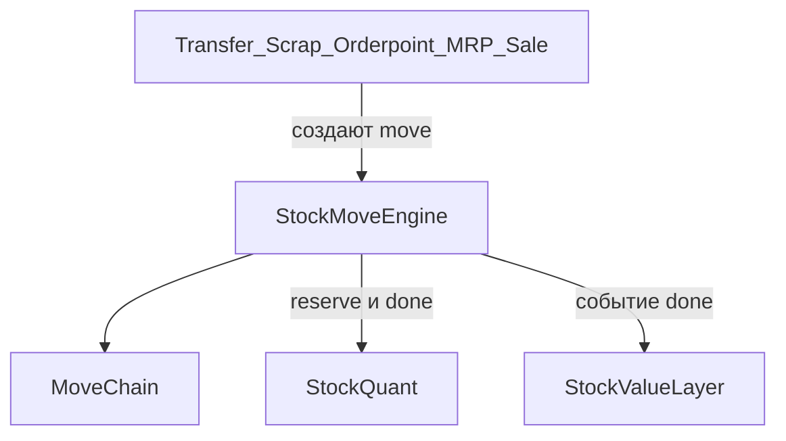
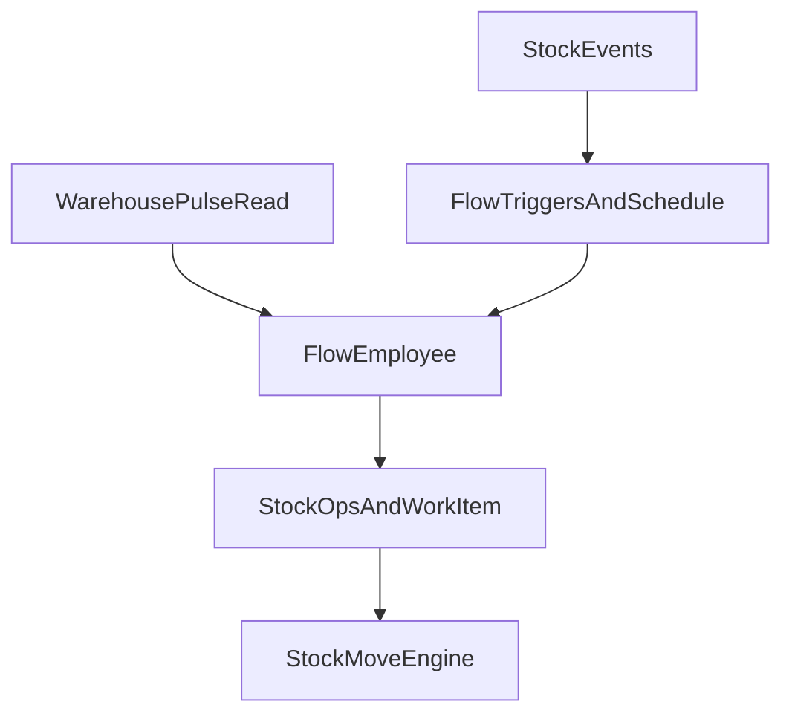

# Архитектура сервиса склада

Источник: [Odoo 19 `stock`](https://github.com/odoo/odoo/tree/19.0/addons/stock), [`stock_account`](https://github.com/odoo/odoo/tree/19.0/addons/stock_account) и соседние `stock*` (`stock_landed_costs`, `stock_picking_batch`, `stock_dropshipping`, `stock_delivery`, `stock_fleet`, `stock_maintenance`, `stock_sms`), плюс стыки `mrp`, `sale_stock`, `purchase_stock`, `product_expiry`. В платформе склада нет (есть только несвязанный `core/redis_inventory`).

## Что в Odoo является ядром, а что надстройкой

Odoo не заводит отдельную сущность «приходная накладная» и «списание». Любое изменение количества — это `stock.move`: продукт уходит из локации A и приходит в локацию B. `stock.quant` — баланс ключа `(product, location, lot, package, owner)`. `stock.move.line` — кусок исполнения (какая партия, какая упаковка, сколько зарезервировано и проведено).

Виртуальные локации делают операции одним механизмом. `usage` в [`stock_location.py`](https://github.com/odoo/odoo/blob/19.0/addons/stock/models/stock_location.py): `view`, `internal`, `supplier`, `customer`, `inventory`, `production`, `transit`.

- Приход — move `supplier → internal`
- Отгрузка — `internal → customer`
- Инвентаризация — `internal ↔ inventory` (`action_apply_inventory` создаёт move, черновик количества лежит на quant)
- Производство — `internal ↔ production` (модуль `mrp` своих остатков не заводит)
- Дропшип (`stock_dropshipping`) — маршрут `supplier → customer`, новых таблиц остатка нет
- Склад 1/2/3 шага — это данные склада: локации input/qc/stock/pack/output и правила `pull` / `push` / `pull_push`, а не ветки в `_action_done`

Состояния move, которые надо заморозить: `draft → confirmed → partially_available → assigned → done`, плюс `waiting` (ждёт предыдущее move в цепочке) и `cancel`. Quant меняют только резерв (`assigned`) и проведение (`done`). Черновик остаток не трогает.

Документы вокруг ядра, которые ядро не знают:

- `stock.picking` + `stock.picking.type` — пачка move для человека и тип операции (`incoming` / `outgoing` / `internal`) с локациями по умолчанию
- `stock.route` + `stock.rule` — граф пополнения данными
- `stock.warehouse.orderpoint` — min/max, порождает пополнение, не пишет quant
- `stock.scrap` — документ, который создаёт move в локацию `inventory`
- `stock.picking.batch`, перевозчик, флот, SMS, оборудование — группировка и побочные поля, леджер не меняется
- `stock_landed_costs` — деньги поверх уже проведённых move, количество не двигает

Оценка в Odoo 19 (`stock_account`): методы `standard` / `average` / `fifo`, режим `periodic` / `real_time`. Сумма и `remaining_qty` висят на самом `stock.move` через `_inherit`, а `product.value` — журнал ручных правок цены. Это как раз то, что раздувает move. В платформе деньги в move не кладём.

`_inherit` из `sale_stock` / `purchase_stock` / `mrp` / `stock_account` дописывает поля в `stock.move`. У нас этого нет: чужой модуль не меняет модель владельца. Стык — тип и id внешнего документа на move и событие `stock/move/done`.

## Инвариант, который дальше не меняется

Единственный писатель остатка — движок move.

- Новый процесс (закупка, производство, дропшип, брак, инвентаризация) добавляет документ или правило. Документ вызывает тот же `confirm` / `assign` / `done` / `cancel`.
- Новый «статус качества» или «зона отбора» — это локация, а не колонка в quant. Иначе ключ остатка придётся мигрировать.
- В ключе quant с первого дня: `company_id`, `product_id`, `location_id`, `lot_id`, `package_id`, `owner_entity_id`. Уникальность PostgreSQL `NULLS NOT DISTINCT`, чтобы пустая партия не плодила несколько балансов. Партия, упаковка и владелец (ответхранение, CRM `entity_id`, без SQL FK в чужую БД) — идентичность физической единицы. Их нельзя «добавить потом».
- Количество move хранится дважды: в ЕИ документа и в ЕИ продукта. История не пересчитывается при смене ЕИ.
- Состояние transfer — проекция его move. Пишет её только движок.
- Стратегии (снятие остатка, раскладка, оценка) — реестр реализаций по коду на локации или продукте. Нет реализации — `raise`. Снятие по умолчанию в ядре: `fifo` по `in_date` quant.
- ИИ не пишет quant и не вызывается из проведения. Он либо ранжирует кандидатов, которых собрало ядро, либо отдельным flow создаёт transfer через те же команды.

## Сущности сервиса `stock`

Отдельный HTTP-сервис по канону [`main.mdc`](.cursor/rules/main.mdc): `apps/stock`, порт `8026`, БД `platform_stock`, каталог `STOCK_OPERATIONS`. Компания — граница данных. Namespace платформы складом не дублируется: площадка — это `StockWarehouse`. Контрагент и владелец остатка — id CRM-сущности. Номенклатура живёт в складе: у CRM нет структурированных инвариантов партии, ЕИ и оценки, а quant не имеет права висеть на `attributes`.

Продукт — SKU, на который ссылаются move и quant (аналог `product.product`). Шаблон — родитель для будущих вариантов (аналог `product.template`): у шаблона сразу один вариант, move ссылается только на вариант. Так варианты не переписывают историю.

Ядро, без которого леджер лживый:

- `UnitOfMeasure` — категория и коэффициент к опорной единице категории
- `StockProductTemplate` — имя, категория, `tracking` (`none` / `lot` / `serial`), `is_storable`
- `StockProduct` — SKU, штрихкод, `uom_id`, `template_id`
- `StockLocation` — дерево, `usage` из семи значений Odoo, `removal_method`, штрихкод
- `StockWarehouse` — `view` + `internal` stock, типы операций приход / отгрузка / внутреннее, код склада
- `StockLot` — имя, продукт, штрихкод, `expiration_at` (колонка сразу, FEFO из `product_expiry` подключается сменой `removal_method`)
- `StockPackage` и `StockPackageType` — вложенность упаковки, штрихкод упаковки; в quant ключ уже есть
- `StockOperationType` — `incoming` / `outgoing` / `internal`, локации по умолчанию, политика резерва (`at_confirm` / `manual` / `by_date`), политика недогруза (`always` / `never`; `ask` не нужен на сервере)
- `StockTransfer` — документ-пачка, партнёр, владелец, штрихкод номера, цепочка backorder и возврата
- `StockMove` — продукт, количества, ЕИ, `location_id`, `location_dest_id`, состояние, `operation_type_id`, `origin_document_type`, `origin_document_id`, `returned_move_id`, предшественники и преемники
- `StockMoveLine` — партия, упаковка источник/результат, владелец, количество, `picked`
- `StockQuant` — `quantity`, `reserved_quantity`, `in_date`, черновик инвентаризации `inventory_quantity`

Доступный остаток — `quantity - reserved_quantity`, отдельной колонкой-истиной не хранится.

Оценка и маршруты в схему ядра не вшиваются полями move. Их место зафиксировано так:

- `StockValueLayer` (следующий шаг, аналог старого `stock.valuation.layer`, а не odoo-19 полей на move): append-only, `move_id`, `product_id`, `lot_id`, `quantity`, `unit_cost`, `value`, `remaining_quantity`, `remaining_value`, метод `standard` / `average` / `fifo`. Ручная переоценка и landed cost — слой с количеством 0, ссылка на исходные слои. Проводки бухучёта (`real_time`) появятся вместе с сервисом учёта и будут читать слои, не quant.
- `StockRoute` + `StockRule` (`pull` / `push` / `pull_push`, `make_to_stock` / `make_to_order` / `mts_else_mto`) — планировщик, который создаёт цепочку move. Движок проведения цепочку только проталкивает: done предшественника снимает `waiting` у преемника.
- `StockPutawayRule` — сужает допустимые ячейки до резерва. В `_action_done` раскладки нет. ИИ-размещение — точка `putaway`, не вторая раскладка внутри проведения.
- `StockOrderpoint` — min/max, создаёт пополнение через правила.
- `StockTransferBatch`, `StockScrap` — документы-обёртки. Брак в ядре уже возможен как move в локацию `inventory`.

На продукте метод оценки появится вместе со слоями и будет обязательным: `unvalued` — явное «денег нет», не подстановка по умолчанию в рантайме. Пока слоёв нет, колонки стоимости на продукте нет.

## Как наращивается код, не трогая ядро

- Закупка и продажа: создают transfer типа `incoming` / `outgoing`, пишут `origin_document_type` + `origin_document_id`. Свои остатки не считают.
- Производство: те же move в локацию `production`, документ производства — внешний.
- Дропшип и межсклад: правила и локация `transit`, не новый тип move.
- 2 и 3 шага склада: правило создаёт цепочку pick → pack → ship. Проведение одного шага уже умеет будить следующий.
- Партии и серии: `tracking` на шаблоне; серия — lot с количеством 0 или 1 на move line. Отдельной таблицы серийников нет.
- FEFO: реализация стратегии читает `StockLot.expiration_at`.
- Партии поставки, перевозчик, SMS, обслуживание: поля и подписчики события `stock/move/done` / `stock/transfer/done`.
- Landed cost и ручная переоценка: новые слои `StockValueLayer`, quant молчит.

События шины: `stock/quant/changed`, `stock/move/done`, `stock/transfer/done`. Чужой сервис не пишет в таблицы склада. В payload стабильные поля для уже существующего фильтра триггера: `warehouse_id`, `operation_code`, `state`, `product_id`, `location_id`, `transfer_id`. Новый тип триггера не заводится.

Виртуальные локации компании (`supplier`, `customer`, `inventory`, `production`, `transit`) создаёт явный `init_company_stock` из инициализации компании. Тихого «создать при первом движении» нет. Создание склада создаёт дерево `view` + `stock` и три типа операций на один шаг. Многошаговость включается появлением правил, а не флагом в проведении.

## Flow-сотрудник на событиях склада

Должности склад не знает. Нет ролей «директор» и «диспетчер», нет bundle, который их создаёт, нет порогов и лимитов, привязанных к должности. Компания собирает сотрудника так же, как любого другого: flow с `employee.enabled`, пользователь `flow_employee_{flow_id}`, кураторы ([`flow_employee.mdc`](.cursor/rules/flow_employee.mdc)). Как его зовут в интерфейсе и какие документы он берёт — настройка этого flow.

На что он реагирует, задаётся в редакторе flows, не в складе.

- Документы и факты склада — живой триггер `platform_event`: `event_type` из каталога и `filters` (`eq` / `ne` / `contains` по dot-path payload). Так компания выбирает, например, только `stock/transfer/done` нужного склада и типа операции. Тип `cron` в `FlowConfig.triggers` сейчас без runtime; периодический обход делается расписанием flow через scheduler, задача `execute_scheduled_task`, её компания создаёт в flows.
- Назначение работы — уже существующий inbox на `worktracker/work_item/assigned`.
- Сообщение человеку — inbox Sync, если на графе есть sync-инструменты.

Права — те же, что у человека-сотрудника. Flow-сотрудник состоит в компании и получает `viewer` / `editor` склада через OpenFGA. Отдельной матрицы «директору можно списывать до N» нет. Нельзя провести операцию — команда склада отвечает `forbidden`, как любому другому пользователю.

Склад даёт факты и команды, решения остаются в графе.

- События с полями, по которым фильтр триггера уже умеет отбирать документы.
- `op_warehouse_pulse` — снимок без оценок и без кодов «это отклонение». Transfer: тип, состояние, возраст, есть ли связанный `WorkItem`. Quant: продукт, локация, количество, время последнего движения. Задания склада: исполнитель, состояние, возраст. Пороги («дольше суток», «нет движения 30 дней») — variables flow, не колонки склада. Расписание снимка склад сам не заводит: его вызывает ход flow.
- Инструменты `stock_*` — тонкие `@tool` над теми же `op_*`, рядом с уже существующими `work_item_*`, `work_queue_*`, `sync_*`, `team_list_members`. Прямой записи quant нет. Граф может создать transfer, создать `WorkItem`, назначить его человеку или очереди. Кого выбрать, решает граф.

Задание человеку — `WorkItem` ядра. В [`core/worktracker/models.py`](core/worktracker/models.py) добавляются link kind `stock_transfer` и `stock_location`, чтобы граф и терминал ссылались на документ склада. Kind остаётся `generic`. Очередь — уже существующий `WorkQueue`, склад свою очередь не заводит.

## Рефлекс, пока человек ждёт ячейку

Размещение не ждёт периодического хода flow. Это отдельный темп, как в EWM: стратегия собирает допустимые ячейки, расширение только сортирует список ([разбор BAdI](https://wmexperts.online/blog-posts/enhance/enhance-put-bin-det.html)). На полу ответ нужен за секунды, зона остаётся правилом ([SCMR](https://www.scmr.com/article/can-ai-help-simplify-put-away-rule-configuration-in-wms)). Переписывание `StockPutawayRule` делает тот flow, которому компания это поручила; следующий приход идёт по правилам ([SAP slotting](https://help.sap.com/saphelp_SCM700_ehp02/helpdata/en/4b/c46aed5a304b41e10000000a42189e/content.htm)).

Между `confirm` и `assign` ядро собирает кандидатов. `_action_done` flow не вызывает. На типе операции компания указывает режим `rule` или `inline` и любой `flow_id`. Нет `flow_id` при `inline` — ошибка настройки. Ответ вне кандидатов, пустой ответ, таймаут — `raise`, move остаётся `confirmed`. Режим `shadow` записывает предложение flow в `StockDecision` и в остаток кладёт правило. Ручная смена ячейки проходит ту же проверку.

Точки рефлекса, ответ только из кандидатов ядра: `putaway`, `removal` (fifo — детерминированная реализация, flow — другая), `qc_route`, `receipt_lines`. Новую строку приёмки ответ не создаёт. Файл приёмки приходит через Files API; `validate` flow сам не нажимает, пока тип операции явно это не разрешил.

## ТСД, отдельно и позже

Кладовщик на полу работает с терминалом сбора данных: сканер штрихкода, список своих заданий, подтверждение ячейки и товара. Для этого будет отдельное Android-приложение. Оболочка [`mobile/`](mobile/README.md) — Capacitor вокруг PWA компании (`ru.humanitec.app`), в неё ТСД не встраивается: у терминала другой экран, аппаратный сканер и свой `applicationId`.

Приложение пишется следующим шагом. Сейчас в ядре фиксируется контракт, чтобы под него не пришлось менять леджер.

- Клиент ТСД ходит в те же `op_*` по REST, что консоль. Второй складской API нет. Действующее лицо скана — `user_id` кладовщика, вошедшего на терминале. Отдельной сущности «устройство» в ядре нет.
- Штрихкод есть у продукта, локации, упаковки, партии и номера transfer. В компании код уникален среди всех этих сущностей. Два носителя с одним кодом — ошибка записи, не выбор «первого подходящего».
- Одна команда `stock/barcode/resolve`: строка скана → ровно один типизированный адресат (`product`, `location`, `package`, `lot`, `transfer`). Пусто и неоднозначно — `raise`. Разбор GS1 и префиксов номенклатуры, как `barcode.nomenclature` в Odoo, живёт в этой команде. Приложение само код не интерпретирует: и клин камеры, и аппаратный wedge присылают одну строку.
- Список на экране терминала — `WorkItem` этого пользователя со ссылкой `stock_transfer` или `stock_location`. Подтверждение сканом — те же `assign` / правка move line / `validate`. Повтор скана по уже закрытой строке — `conflict`, второе списание не создаётся.
- Офлайн-очередь терминала в этот контракт не входит. Пока её нет, приложение работает онлайн. Идемпотентность повторной отправки той же команды остаётся за счёт состояния move, а не за счёт скрытого буфера на сервере.

## Права и команды

OpenFGA: объект склада, `viewer` / `editor` от компании. Проведение transfer и применение инвентаризации — `editor`. Check до чтения остатка. Flow-сотрудник проходит ту же проверку, что человек.

Команды ядра, один `op_*` на verb: продукты, локации, склады, пульс, `stock/barcode/resolve`, transfer (`create`, `confirm`, `assign`, `validate`, `cancel`), `stock/move/apply_decision`, привязка рефлекса на тип операции (`flow_id`), применение инвентаризации quant. UI — фабрики `transport: 'ws'` и REST-зеркало. На карточке transfer виден последний `StockDecision` и связанные `WorkItem`.

Канон имён и инварианты — новый [`.cursor/rules/stock.mdc`](.cursor/rules/stock.mdc) и строки глоссария в [`main.mdc`](.cursor/rules/main.mdc). Сервис в таблице сервисов, порт `8026`.

## Объём первой реализации

Первый код — ядро, которое уже нельзя будет развить «вторым способом списать товар»:

- модели и миграция `migrations/stock/0001_initial.py`
- движок: confirm, assign, unreserve, done, cancel, частичное проведение с backorder, возврат как move с `returned_move_id`
- ограничение tracking: `none` запрещает lot, `serial` запрещает количество не 0 и не 1
- инвентаризация через move в локацию `inventory`
- один шаг склада и снятие `fifo` как детерминированная реализация точки `removal`
- `op_warehouse_pulse` с фактами без порогов и без кодов отклонений
- link kind `stock_transfer` и `stock_location` на `WorkItem`
- рефлекс `putaway`: кандидаты ядра, отказ ячейки вне списка, на типе операции режим `rule` или `inline` с произвольным `flow_id`
- штрихкод на продукте, локации, упаковке, партии и transfer; уникальность в компании; `stock/barcode/resolve`
- события `stock/move/done`, `stock/transfer/done`, `stock/quant/changed` с полями под фильтр `platform_event` и тонкие `stock_*` tools
- инициализация виртуальных локаций компании
- тесты леджера на реальном Postgres: приход, расход, резерв, частичная отгрузка, серийник, корректировка, запрет прямой правки quant, пульс отдаёт возраст transfer и время последнего движения, ячейка вне кандидатов — ошибка

Графы сотрудников, их расписания и фильтры триггеров компания собирает в flows. Маршруты, слои оценки, orderpoint, batch — следом, без новых таблиц леджера. Списки остатков и карточка transfer входят в первый UI-срез. Android-приложение ТСД — отдельным шагом, не в оболочке `mobile/`.
