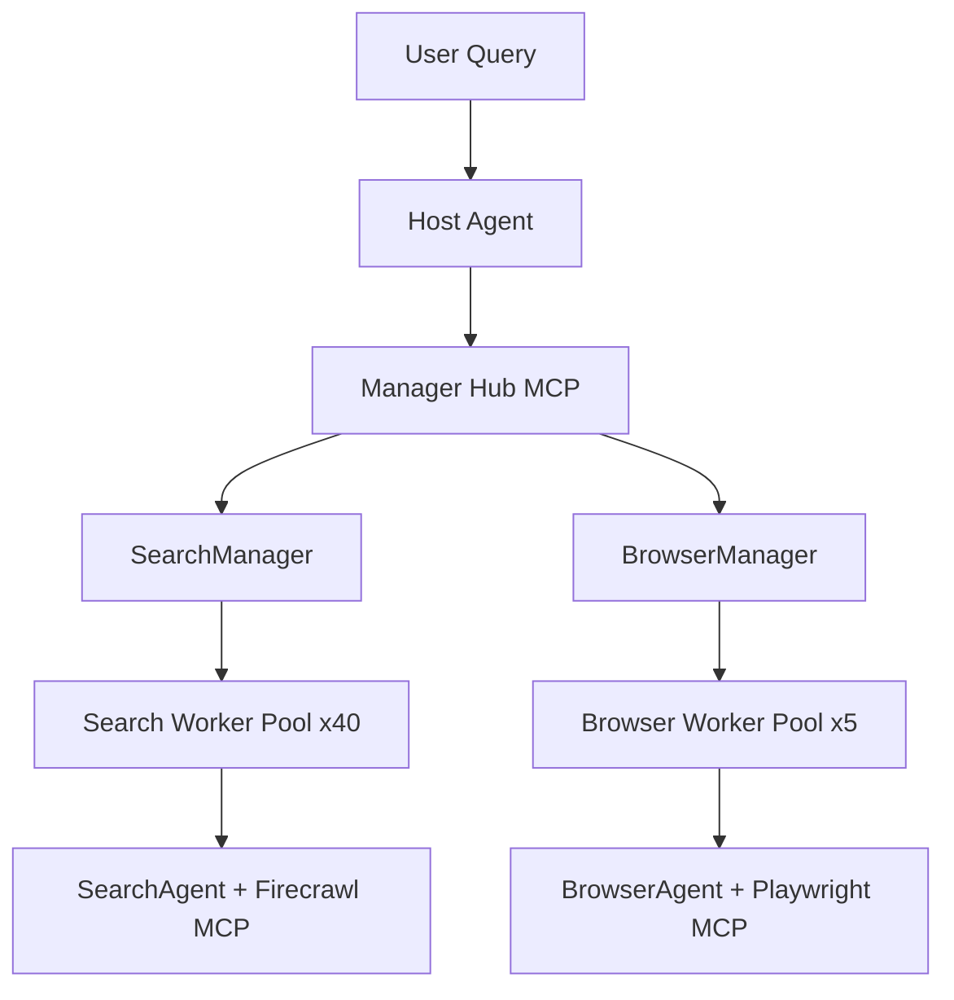

# ADR: InfoSeeker code study → Runet research orchestrator

**Status:** accepted (Phase 0c)  
**Date:** 2026-06-17  
**Context:** Phase 3–4 runet research (parallel gather + depth + sub-agents)  
**References:**

- [InfoSeeker paper](https://arxiv.org/html/2604.02971v1)
- [Memento-Teams/InfoSeeker](https://github.com/Memento-Teams/InfoSeeker)

## Резюме

InfoSeeker — hierarchical parallel agent framework: Host → Manager Hub → Worker Pools (search ×40, browser ×5). Мы **не копируем** LangChain stack, Firecrawl, MCP между всеми слоями. Заимствуем **паттерны**: decomposition, bounded fan-out, `asyncio.gather`, pool caps, retry на worker level.

## Архитектура InfoSeeker (из кода)

| Слой | Файл | Паттерн |
|------|------|---------|
| L1 orchestration | `agents/host_agent.py` | synthesis, routing к managers |
| L2 decomposition | `managers/search_manager_agent.py` | subtasks → `execute_subtasks` |
| L3 pools | `mcp_servers/search_worker_pool.py`, `browser_worker_pool.py` | semaphore + busy flag + gather |
| Config | `pool_config.yaml` | `max_pool_size` per pool type |

## Наблюдения из кода

### Search worker pool (`search_worker_pool.py`)

- **Lazy init** pool при первом `execute_subtasks`.
- **Validation:** 1 ≤ subtasks ≤ `max_pool_size` (40 default).
- **Concurrency:** `asyncio.gather` на N busy-free workers; `pool_lock` при выдаче агентов.
- **Retry:** до 5 попыток на subtask с `sleep(1)` между попытками.
- **Subtask contract:** self-contained natural language queries; дубликаты запрещены в prompt manager'а.
- **Isolation:** workers stateless — не видят результаты друг друга.

### Browser worker pool (`browser_worker_pool.py`)

- Pool size **5** (vs 40 search) — browser дороже по latency/memory.
- **Consent preamble** автоматически инжектится в каждый subtask (Google cookie dialog).
- Ошибки worker'а возвращаются в `failed[]`, не роняют весь batch (`gather` + per-worker try/except).

### Search manager (`search_manager_agent.py`)

- Decomposition strategy в system prompt: anchor & expand, discovery first, keyword reduction.
- **Batching rule:** заполнять `execute_subtasks` до `max_pool_size`, не дробить на мелкие вызовы.
- Fan-out ограничен размером pool, не бесконечный MapReduce.

## Маппинг → Humanitec runet

| InfoSeeker | Humanitec | Решение |
|------------|-----------|---------|
| Firecrawl open web | runet pointer-index + `IndexSearchProvider` | Curated index первым; SERP — fallback |
| Search pool ×40 | `LiveFetchService.gather_many` + httpx | **5–10** concurrent URL (top-N из index) |
| Browser pool ×5 | `BrowserFetchClient` | **3** concurrent (CDP cost); fallback only |
| Manager Hub MCP | `ResearchOrchestratorService` | In-process + TaskIQ, без MCP между слоями |
| Host synthesis | flows `runet_research` + LLM | Аналог |
| `pool_config.yaml` | `conf.json` → `services.search.runet.research` | ✅ добавлено |

## Рекомендуемые pool caps (prod)

Основано на InfoSeeker ratio search:browser ≈ 8:1, но с учётом нашего curated top-N (не open-web explosion):

| Параметр | InfoSeeker | Runet prod | Обоснование |
|----------|------------|------------|-------------|
| `fetch_concurrency` | 40 | **5** | top-10 URL из index; httpx primary |
| `browser_pool_size` | 5 | **3** | browser только fallback; CDP memory |
| `max_urls` | unbounded subtasks | **10** | discovery_limit alignment |
| `per_url_timeout_ms` | implicit | **8000** | p95 research budget |
| `max_depth` | recursion in host | **2** | >2 hop деградация в литературе |

Конфиг: `conf.json` → `services.search.runet.research`.

## Сознательные отличия

1. **Pointer-index first** — не open-web search worker на каждый sub-Q; sub-Q re-entry идёт в index или in-page focus.
2. **No Firecrawl** — trafilatura + существующий browser crawl path.
3. **Rerank on-the-fly** — cross-encoder на passages в памяти; InfoSeeker синтезирует из worker text dumps.
4. **No persist fetch** — ни один fetched body не в `vector_documents`.
5. **No MCP inter-layer** — TaskIQ sub-flows для Phase 4 depth; browser уже отдельный сервис `apps/browser`.

## Phase 4 checklist (из InfoSeeker)

- [ ] Planner: decompose query → sub-questions (паттерн `SearchManager` prompt).
- [ ] Sub-agent per URL / sub-Q через TaskIQ с isolated context.
- [ ] Pool semaphore + retry policy как в `search_worker_pool.py`.
- [ ] Termination: depth budget + duplicate URL + CRAG evaluator.
- [ ] Eval: RU golden L2 (30–50 multi-hop), не WideSearch/BrowseComp-ZH слепо.

## Решение

Принять InfoSeeker как **reference architecture** для Phase 3–4. Pool sizing и gather/retry patterns — в `RunetResearchPoolConfig`. Полная orchestration — отдельный эпик Phase 3–4 после Phase 0 eval gate.
