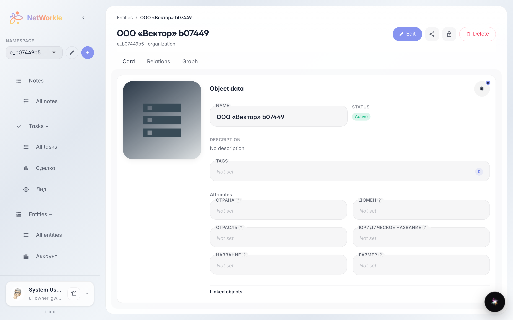
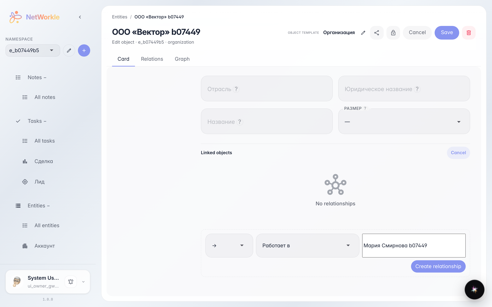
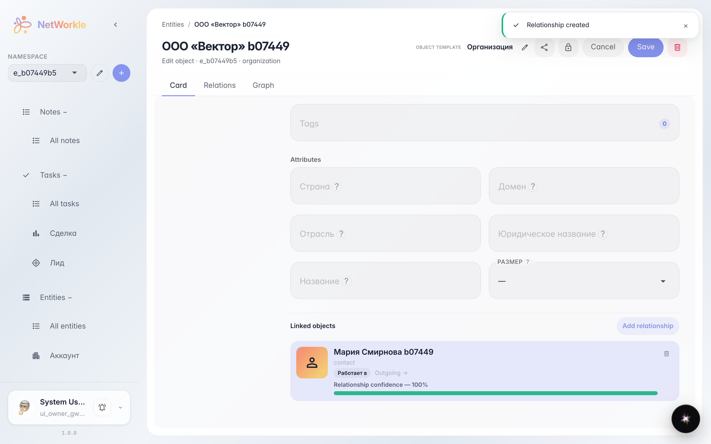

# Record card: fields and links to other records

**Purpose:** keep everything about a customer in one place — record fields and links to other records.

**Problems solved:** without links a card is just a table row. Linked records show the neighbourhood: a contact works at a company, a deal belongs to a project.

**Result:** the record card lists linked objects, and a new link takes half a minute to add.

## Step 1. Record card

The record card keeps everything in one place: name, status, template fields and the Linked objects block — who is linked to this record and how. The Relations tab shows the same as a list.

## Step 2. New link form

Click Edit, then Add relationship — the form opens: pick a link type (for example, Works at) and start typing a record name — matching cards are suggested. Then click Create relationship.

## Step 3. Record linked

Мария Смирнова b07449 now shows in the linked objects list with its link type and direction. Clicking a row opens the neighbour card — a handy way to walk the customer chain.

**Summary.** The record card is the centre of the card index: fields, links and a quick hop to neighbours.

