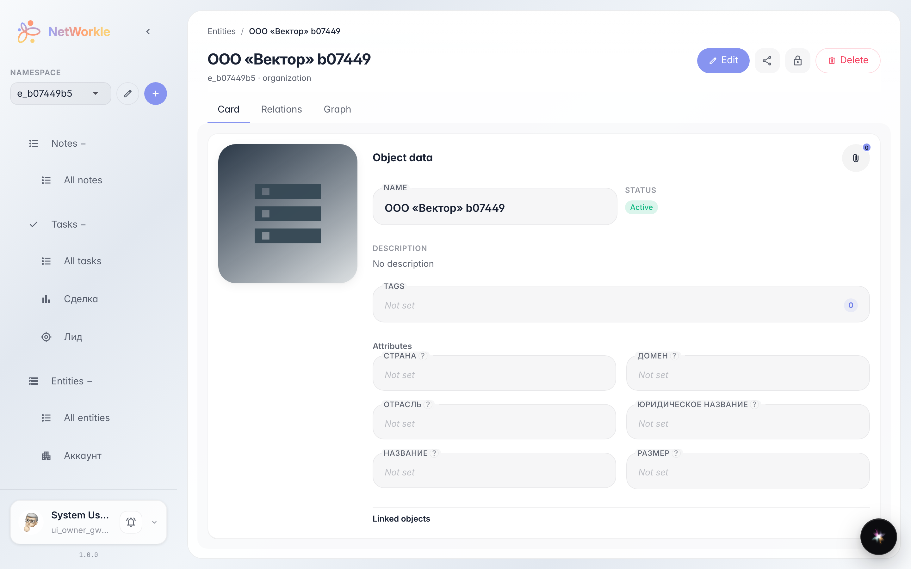
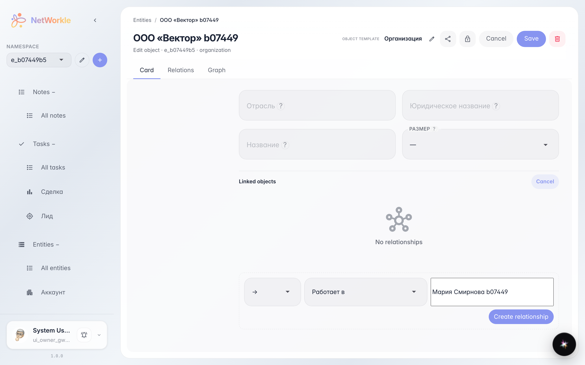
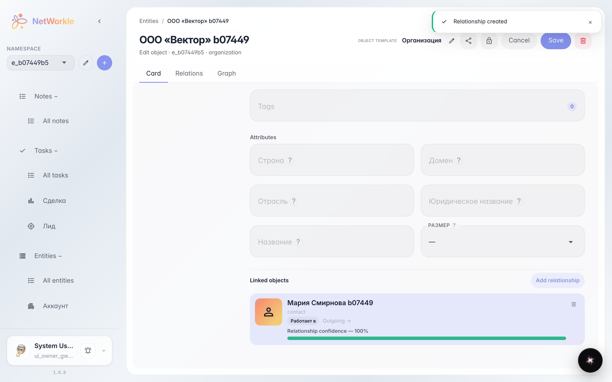

# Карточка записи: поля и связи с другими записями

**Для чего:** держать всю информацию о клиенте в одном месте — поля записи и связи с другими записями.

**Какие проблемы решает:** без связей карточка — просто строка в таблице. Связанные записи показывают окружение: контакт работает в компании, сделка относится к проекту.

**Результат:** в карточке записи виден список связанных объектов, а новую связь можно добавить за полминуты.

## Шаг 1. Карточка записи

Карточка записи собирает всё в одном месте: имя, статус, поля по шаблону типа и блок «Связанные объекты» — кто и как связан с этой записью. Вкладка «Связи» показывает то же самое списком.

## Шаг 2. Новая связь

Нажмите «Редактировать», затем «Добавить связь» — откроется форма: выберите тип связи (например, «Работает в») и начните вводить имя записи — подходящие карточки подставятся сами. Осталось нажать «Создать связь».

## Шаг 3. Запись связана

«Мария Смирнова b07449» появилась в списке связанных объектов с типом связи и направлением. Клик по строке открывает карточку соседа — так удобно ходить по цепочке клиентов.

**Итог.** Карточка записи — центр картотеки: поля, связи и быстрый переход к соседним записям.

