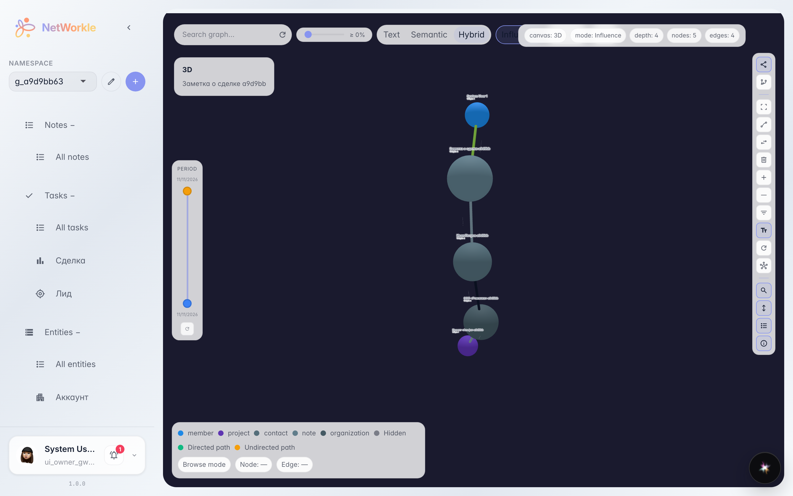
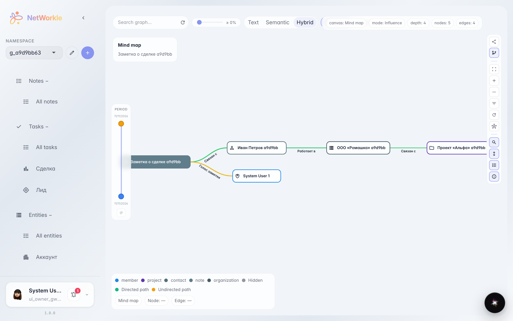
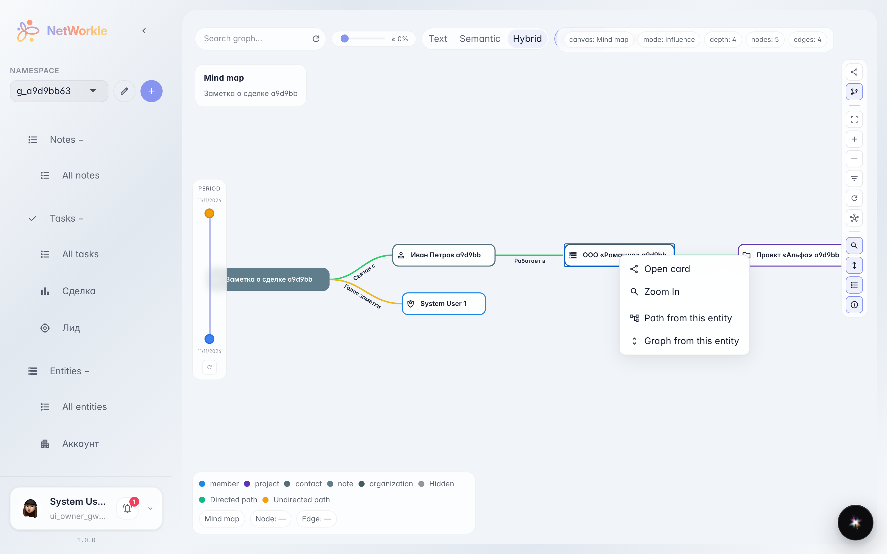
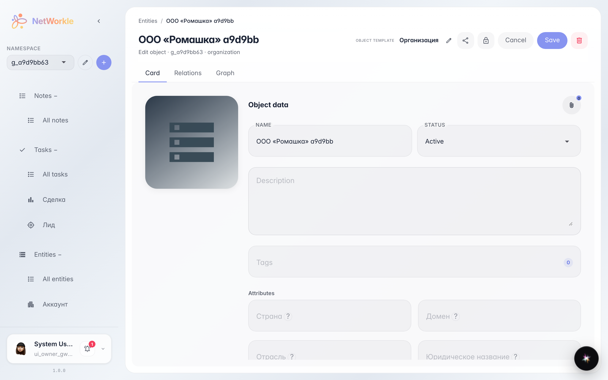

# Relation graph: who is linked to whom

**Purpose:** see the whole web of record links at once — who works at which company, which deal belongs to whom.

**Problems solved:** a single card does not show the customer neighbourhood. The graph draws records as nodes and links as edges: a 3D overview for the big picture and a mind map for reading the tree.

**Result:** you found the record on the graph and opened its card right from the picture.

## Step 1. Space relation graph

Open the Graph section — space records are drawn as nodes and their links as edges. The legend at bottom left shows record-type colours, the search pill is at top left.

## Step 2. Mind map mode

The Mind map button on the right-hand toolbar turns the graph into a tree: linked records unfold along branches with readable labels — easier to study a customer neighbourhood.

## Step 3. Node action menu

Right-click a node to open the menu: Open card, zoom to the node, build a path from it, or rebuild the graph around the chosen record.

## Step 4. Record card from the graph

Open card takes you to the record page: fields, links, notes and customer tasks.

**Summary.** The graph is a live map of the card index: find a node — and you are already in the card.

