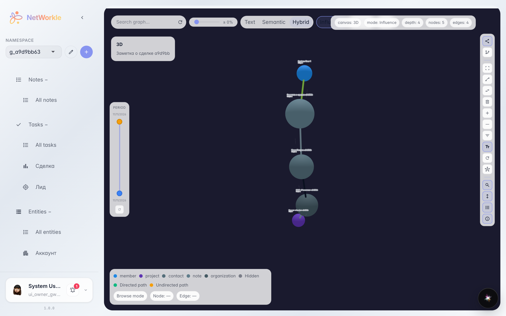
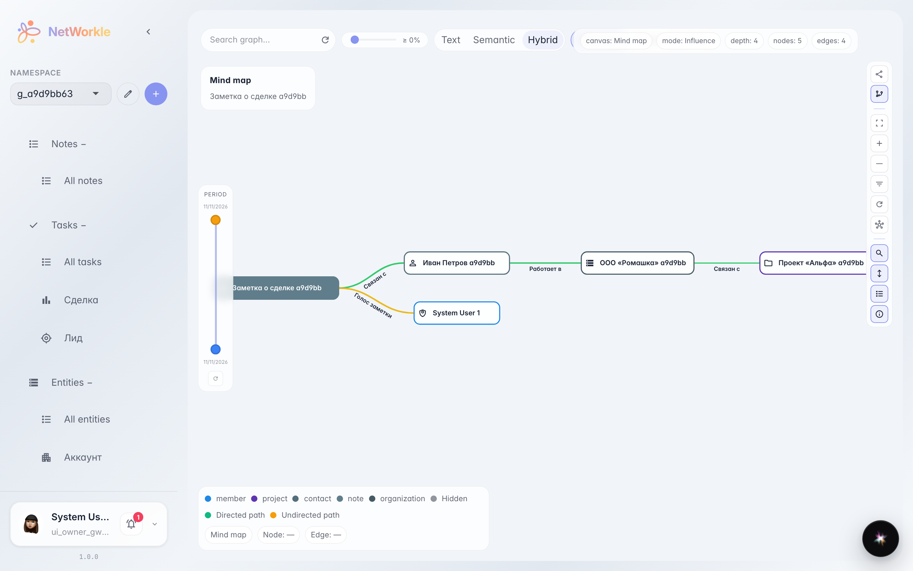
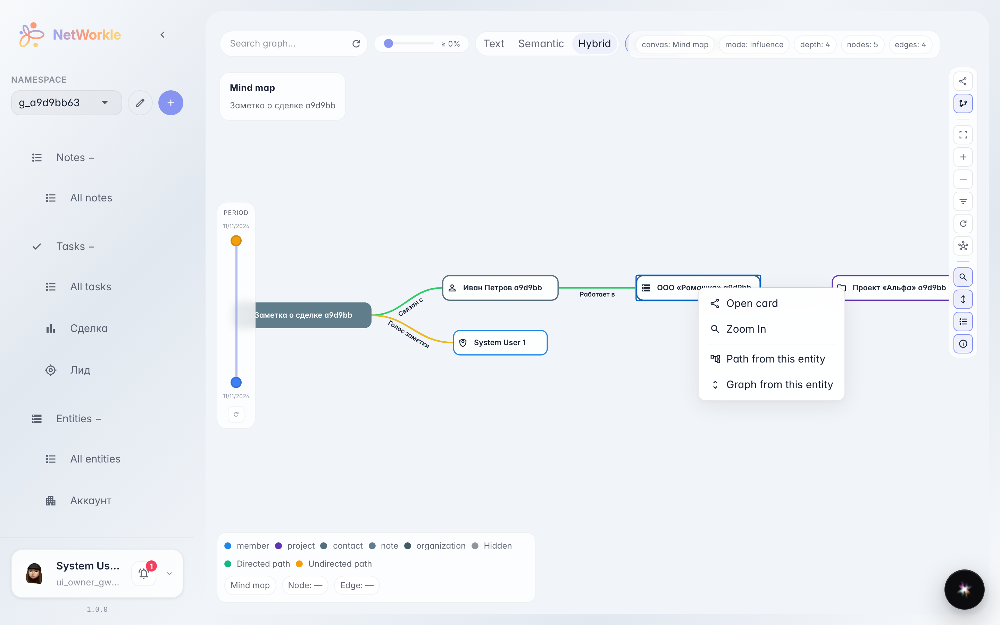
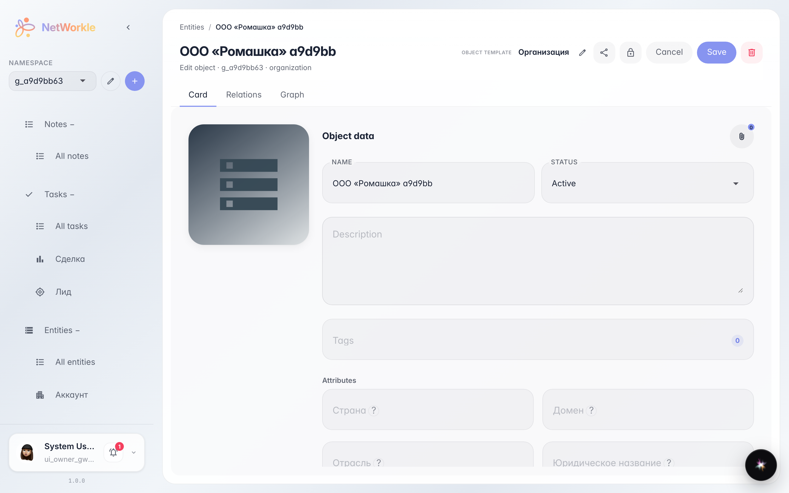

# Граф связей: кто с кем связан

**Для чего:** увидеть всю картину связей картотеки сразу — кто в какой компании работает, какая сделка к кому относится.

**Какие проблемы решает:** по одной карточке не видно окружения клиента. Граф показывает записи узлами, а связи — линиями: 3D-обзор для общей картины и «mind map» для чтения дерева.

**Результат:** вы нашли нужную запись на графе и открыли её карточку прямо из картинки.

## Шаг 1. Граф связей пространства

Откройте раздел «Граф» — записи пространства рисуются узлами, а связи между ними — линиями. Слева внизу — легенда цветов по типам записей, сверху слева — поиск по графу.

## Шаг 2. Режим «mind map»

Кнопка «Mind map» на панели справа переключает граф в дерево: связанные записи раскладываются по веткам с читаемыми подписями — так проще изучать окружение клиента.

## Шаг 3. Меню действий узла

Правая кнопка по узлу открывает меню: «Открыть карточку», приблизить узел, построить путь от него или перестроить граф вокруг выбранной записи.

## Шаг 4. Карточка записи из графа

«Открыть карточку» ведёт на страницу записи: поля, связи, заметки и задачи клиента.

**Итог.** Граф — это живая карта картотеки: нашли узел — и сразу в карточке.

