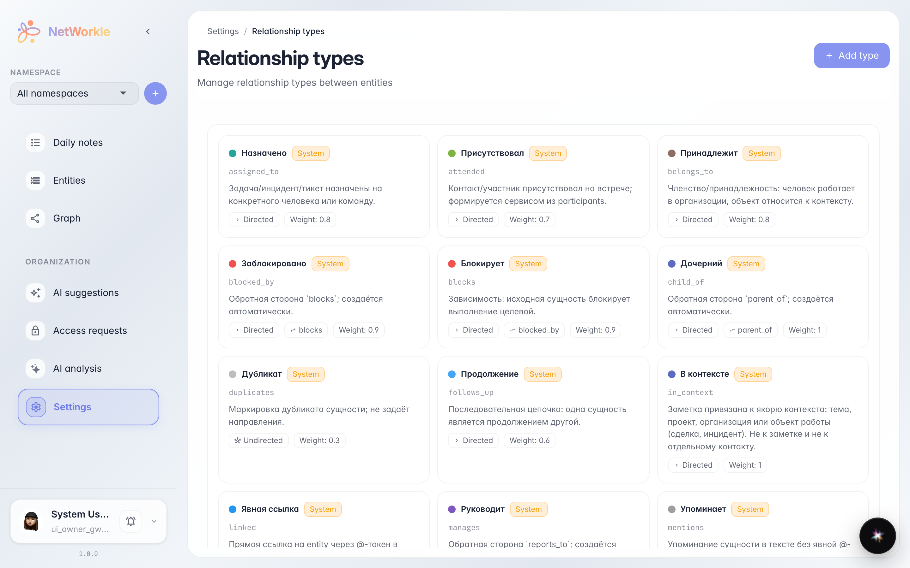
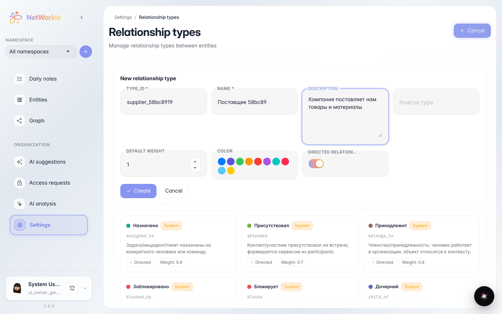
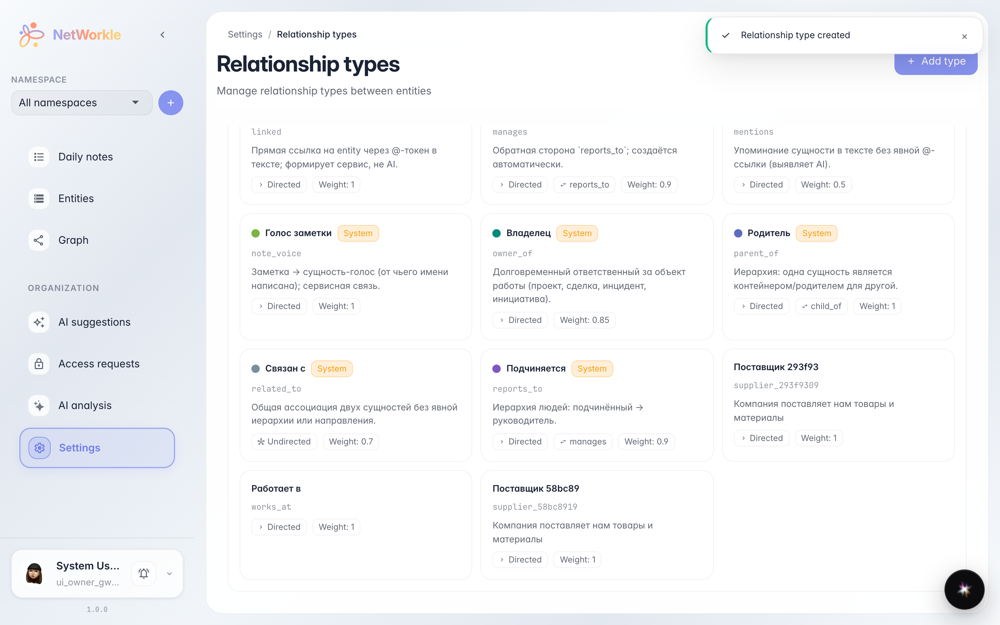

# Custom link types

**Purpose:** describe company links in your own words — Supplier, Partner, Referrer — when built-in types are not enough.

**Problems solved:** without a custom type a link is saved as miscellaneous and loses meaning. A custom type is visible on the card, the graph and link labels.

**Result:** your type appears in the link catalogue, ready to pick when linking records.

## Step 1. Link type catalogue

The Settings → Link types section lists every link kind: built-in (marked system) and the ones you added. Each type has a name, an identifier, a direction and a graph colour.

## Step 2. New link type

Add type unfolds a form: identifier (latin, e.g. `supplier`), a friendly name, a description, the inverse type (supplies ↔ buys from), a colour and direction. Weight affects how important the link looks on the graph.

## Step 3. Type created

Поставщик 58bc89 now sits in the catalogue next to built-in types — ready to pick when adding a link on a record card.

**Summary.** Custom link types make the card index sharper: every link reads in your business's own words.

