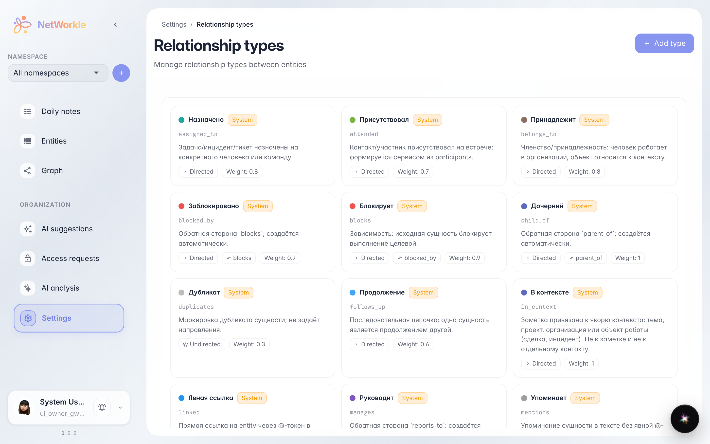
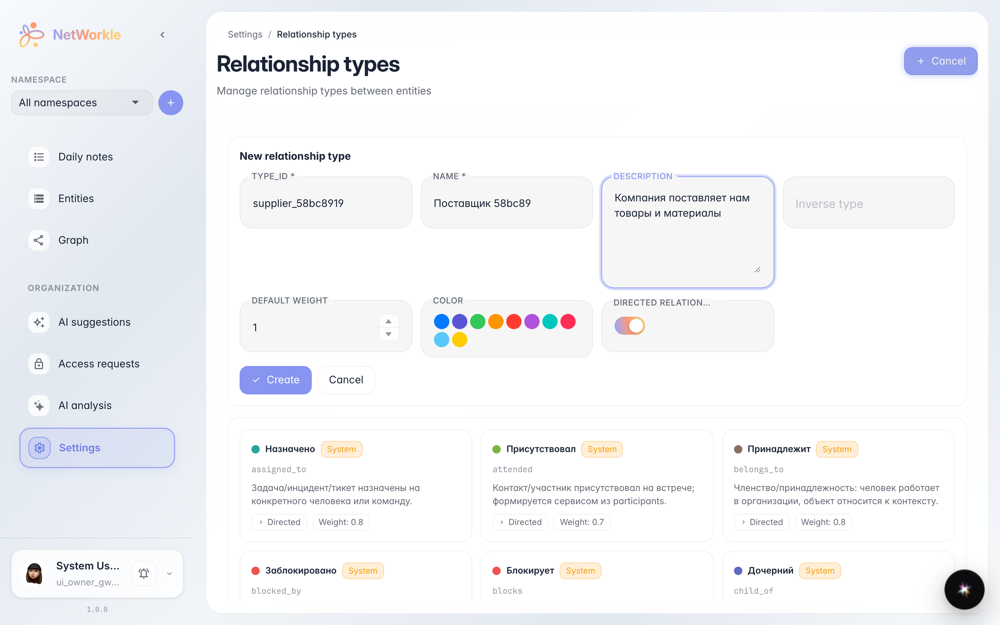
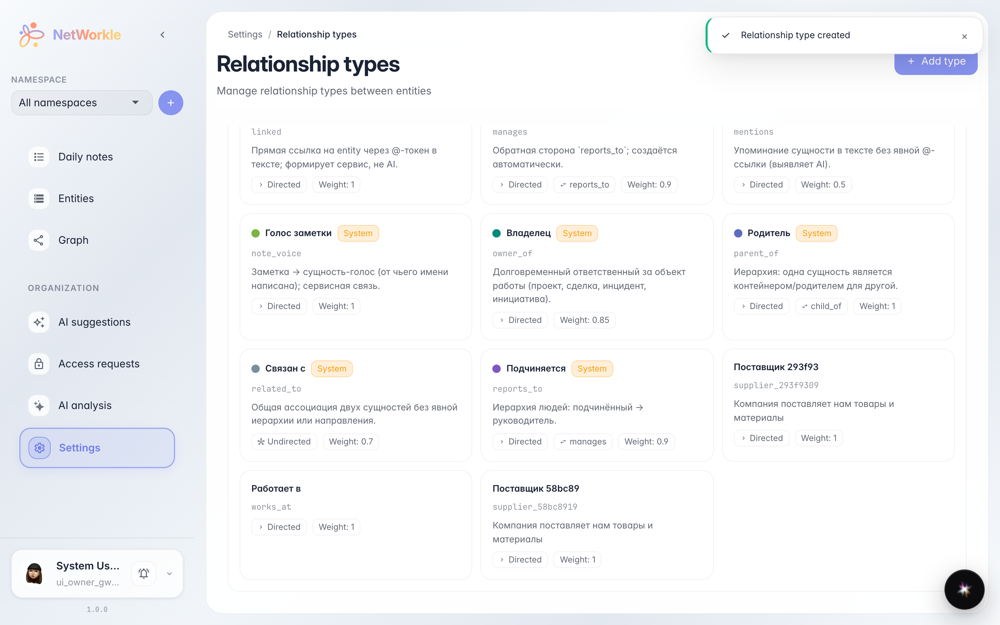

# Свои типы связей

**Для чего:** описать связи компании своими словами — «Поставщик», «Партнёр», «Рекомендатель» — когда встроенных типов не хватает.

**Какие проблемы решает:** без своего типа связь записывается как «прочее» и теряет смысл. Свой тип виден в карточке, на графе и в подписях связей.

**Результат:** в каталоге связей появился ваш тип, и его можно выбирать при связывании записей.

## Шаг 1. Каталог типов связей

Раздел «Настройки → Типы связей» показывает все виды связей: встроенные (с пометкой «системный») и добавленные вами. У каждого типа — имя, идентификатор, направление и цвет для графа.

## Шаг 2. Новый тип связи

«Добавить тип» раскрывает форму: идентификатор (латиницей, например `supplier`), понятное имя, описание, обратный тип («поставляет» ↔ «покупает у»), цвет и направление. Вес влияет на то, насколько важной связь выглядит на графе.

## Шаг 3. Тип в каталоге

«Поставщик 58bc89» появился в каталоге рядом со встроенными типами — теперь его можно выбирать при добавлении связи в карточке записи.

**Итог.** Свои типы связей делают картотеку точнее: каждая связь читается словами вашего бизнеса.

