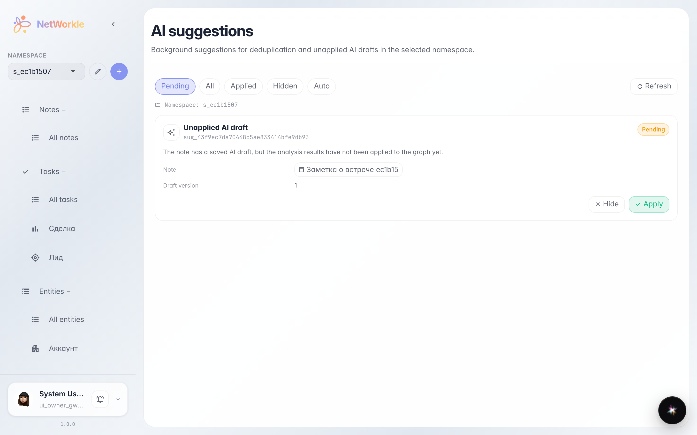
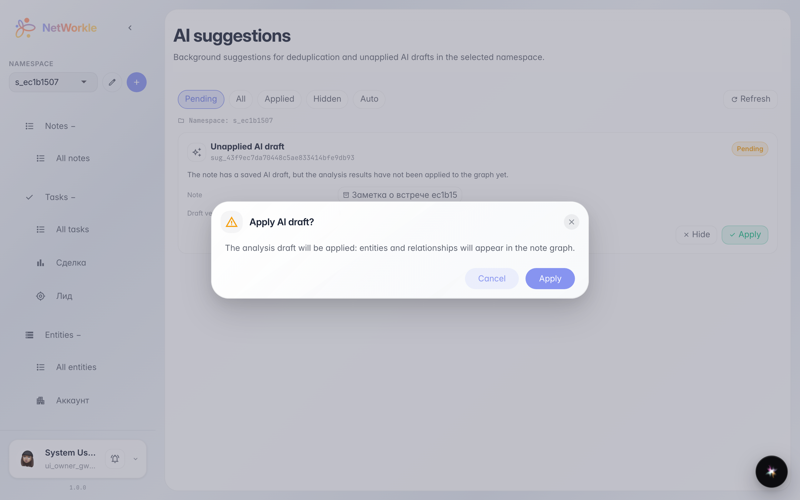
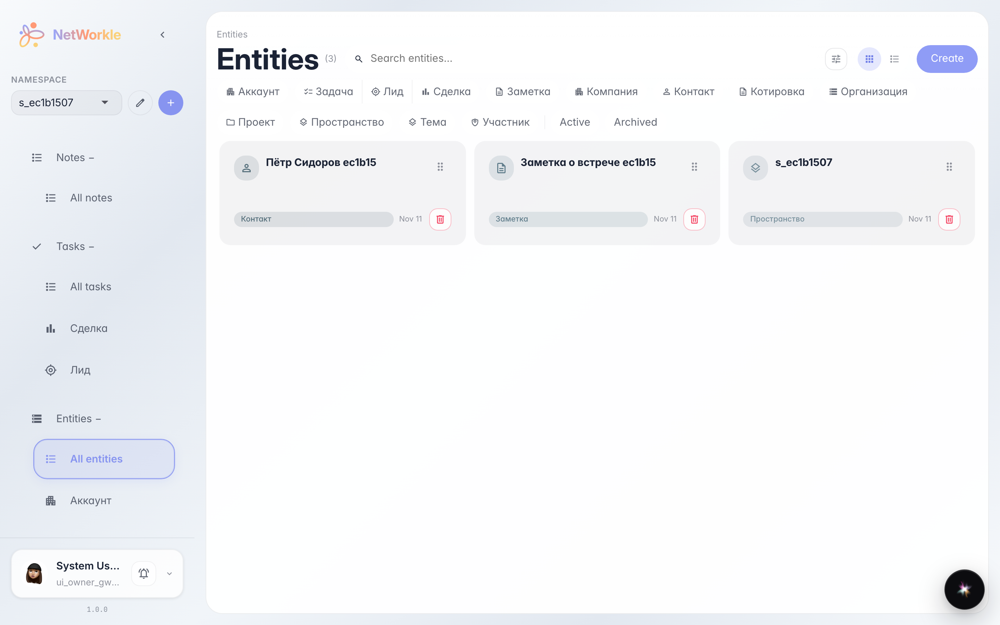

# AI suggestions: apply a note breakdown in one click

**Purpose:** the platform breaks notes into records and catches duplicates on its own — you only confirm.

**Problems solved:** after a note analysis its draft may stay unapplied — records never reach the card index. The AI suggestions queue surfaces these cases and lets you apply or dismiss each.

**Result:** the draft is applied — records from the note appear in the card index, and the suggestion is closed.

## Step 1. AI suggestions queue

The AI suggestions section collects the platform's background findings: unapplied note-analysis drafts and possible record duplicates. Each suggestion has two buttons: Apply and Dismiss.

## Step 2. Apply confirmation

Before applying, the platform shows exactly what will happen: the note draft unfolds into card-index records.

## Step 3. Draft records in the card index

The draft is applied: the record Пётр Сидоров ec1b15 appeared in the card index as a first-class object — you can open it, link it and track tasks against it.

**Summary.** AI suggestions turn notes into a live card index with a single confirmation.

