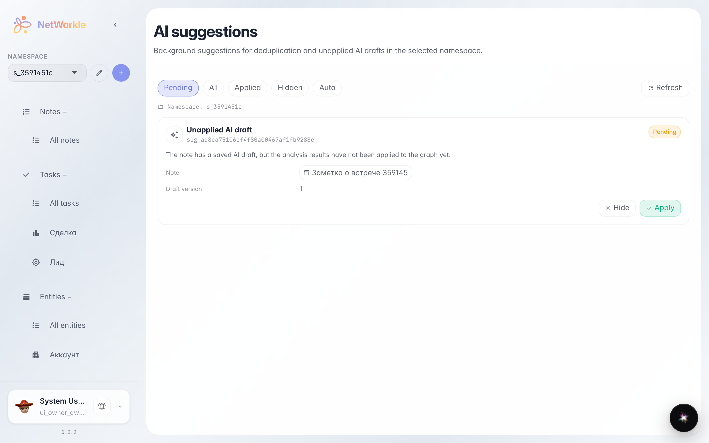
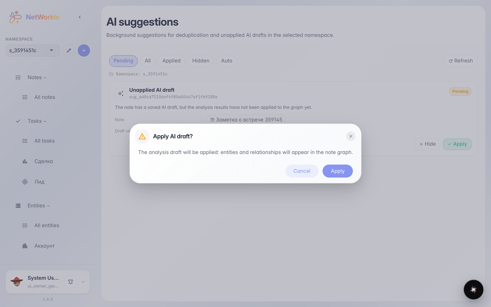
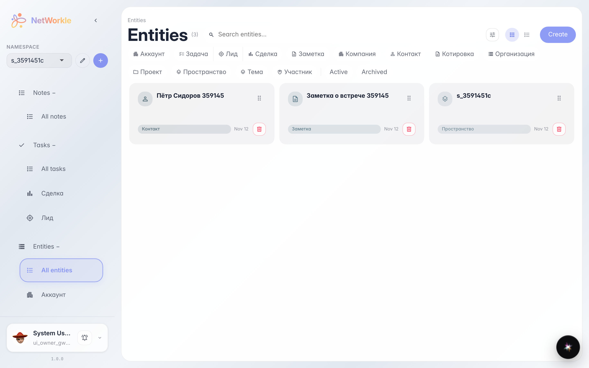

# AI-предложения: применить разбор заметки одной кнопкой

**Для чего:** платформа сама разбирает заметки на записи и дубли — остаётся только подтвердить.

**Какие проблемы решает:** после анализа заметки её черновик может остаться неприменённым — записи не появятся в картотеке. Очередь AI-предложений показывает такие случаи и позволяет применить или скрыть каждый.

**Результат:** черновик применён — записи из заметки появились в картотеке, а предложение закрылось.

## Шаг 1. Очередь AI-предложений

Раздел «AI-предложения» собирает фоновые находки платформы: неприменённые черновики разбора заметок и возможные дубли записей. У каждого предложения — две кнопки: «Применить» и «Скрыть».

## Шаг 2. Подтверждение применения

Перед применением платформа показывает, что именно будет сделано: черновик заметки развернётся в записи картотеки.

## Шаг 3. Записи из черновика в картотеке

Черновик применён: запись «Пётр Сидоров 359145» появилась в картотеке как полноценный объект — её можно открыть, связать и вести по ней задачи.

**Итог.** AI-предложения превращают заметки в живую картотеку одним подтверждением.

