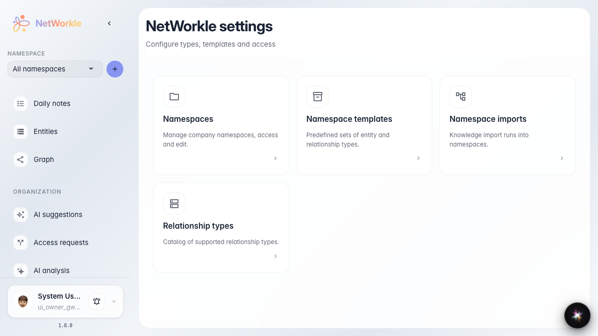

# NetWorkle: settings hub

Navigate to /crm/settings and verify settings-hub-page displays with cards.

## Step 1. NetWorkle settings section opened

## Step 2. NetWorkle settings hub is displayed with cards

