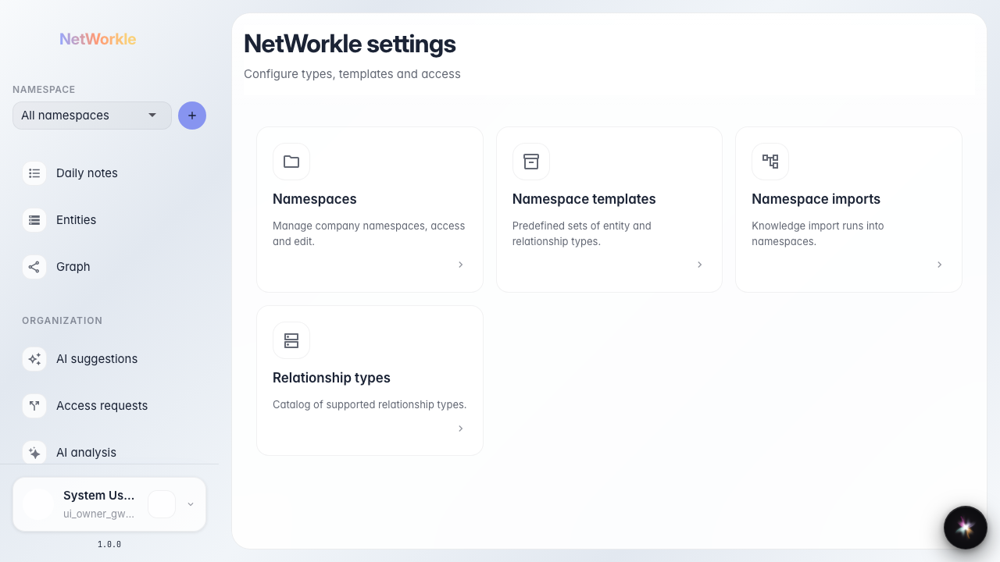

# NetWorkle: хаб настроек

Переход на /crm/settings и проверка отображения settings-hub-page с карточками.

## Шаг 1. Открыт раздел настроек NetWorkle

## Шаг 2. Хаб настроек NetWorkle отображен с карточками

