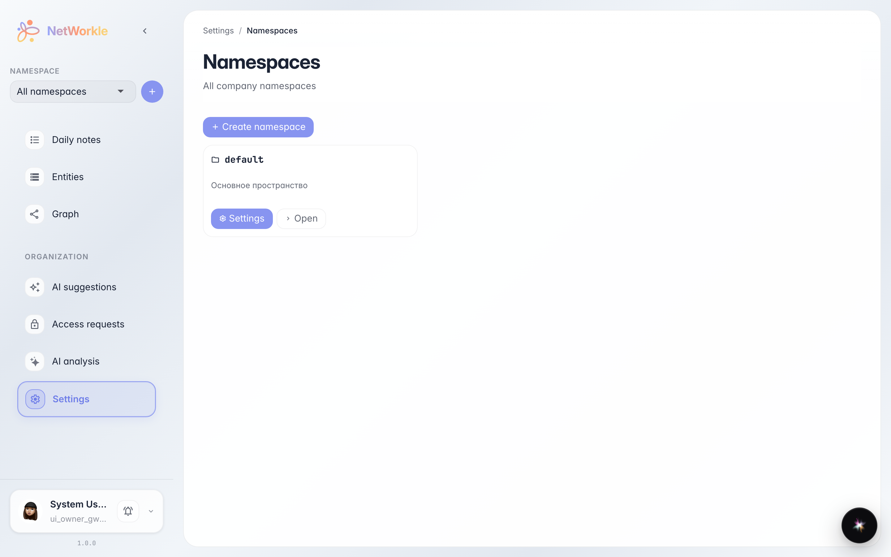
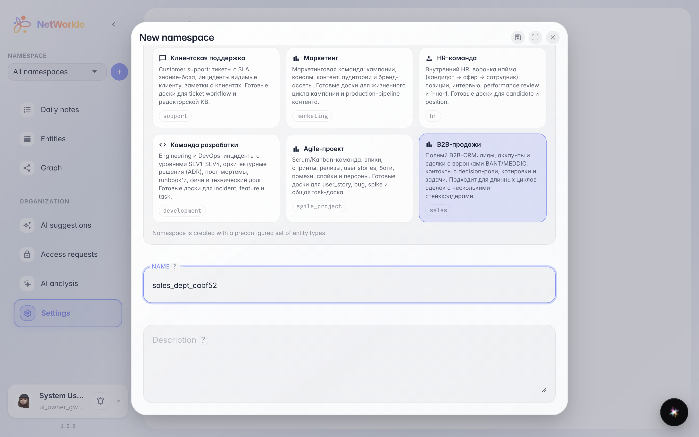
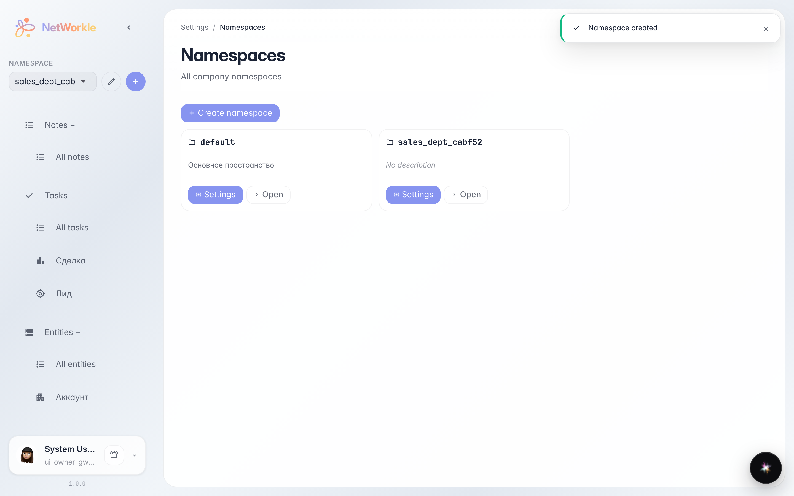
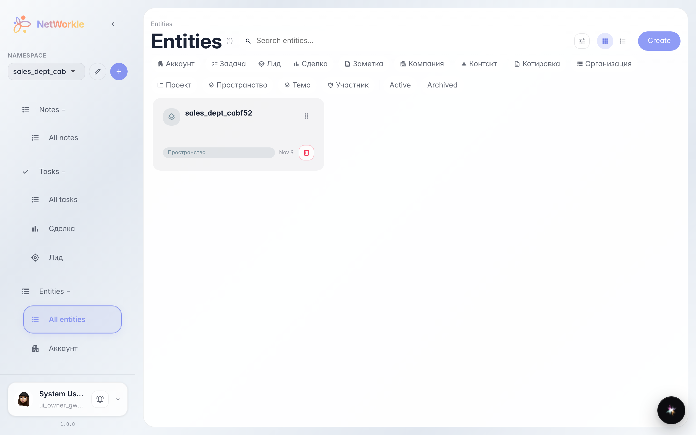
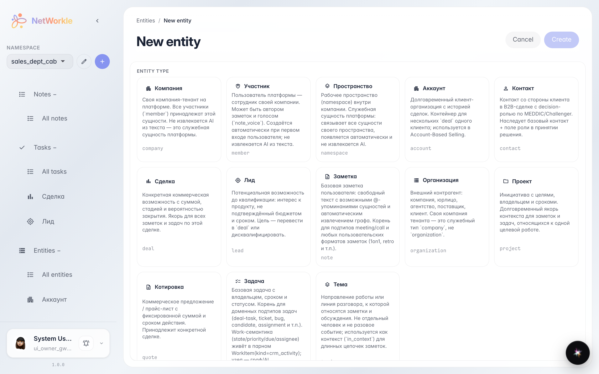
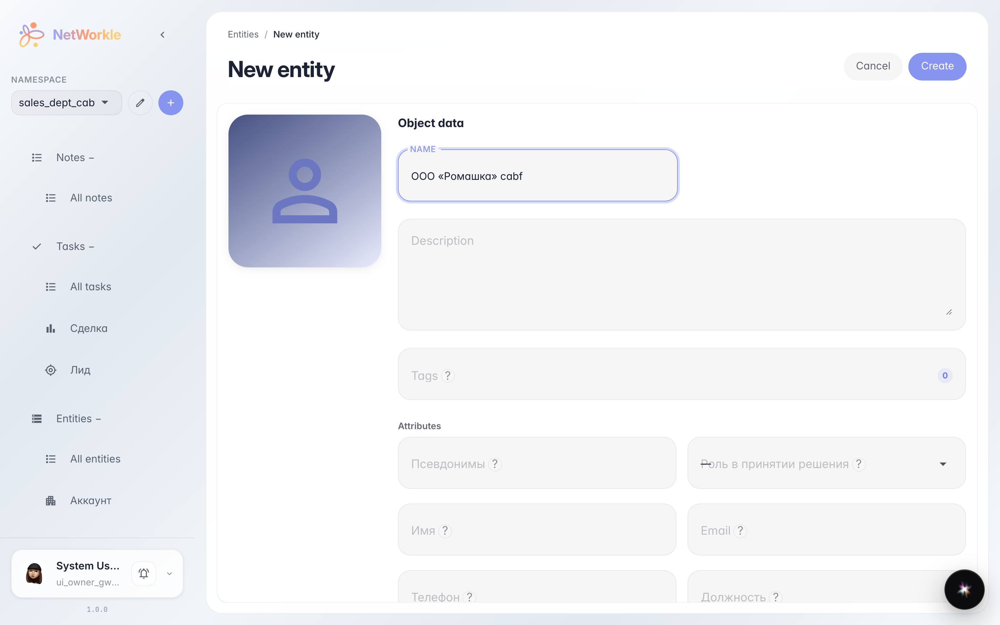
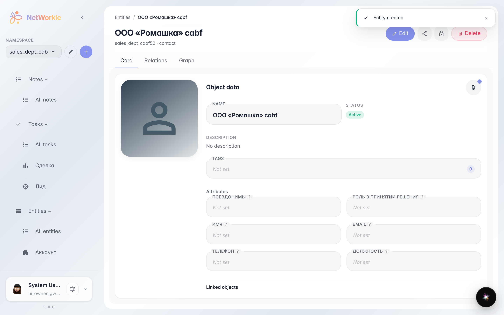

# First space and first record

**Purpose:** build your own base of contacts and deals — create a space from a ready-made template and add the first record.

**Problems solved:** customers scattered across spreadsheets and notes. Here you will see a structured card index with the right record types appear in a couple of minutes.

**Result:** a space with Lead, Account and Deal types — and the first customer record inside.

## Step 1. Company spaces list

Open NetWorkle — the Spaces section shows all company work areas. A space is a separate card index with its own record types. Click Create space.

## Step 2. Pick a template and a name

A template is a ready-made set of record types. B2B sales already includes Leads, Accounts and Deals — nothing to configure. The space name is a single lowercase latin word like sales_dept.

## Step 3. Space created

The space sales_dept_cabf52 appeared in the list — it already has record types from the template. Click Open to enter it.

## Step 4. Space records

The Records section is the card index itself. It is empty for now: click the create button to add the first record.

## Step 5. Pick a record type

First pick what the record is about: a contact, a company, a deal or a lead. Each type has its own fields. We pick Contact.

## Step 6. Fill in the card

Enter a name — that is enough for the first record. Other fields can be filled later right in the card. Click Create.

## Step 7. First record is ready

The record ООО «Ромашка» cabf is created and open. You can add notes, links to other records and tasks here — the whole customer history in one place.

