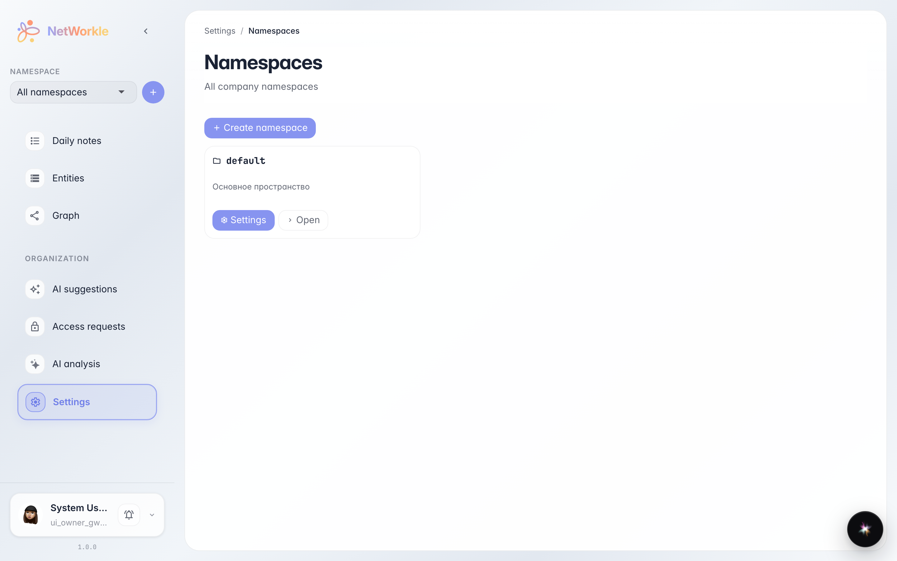
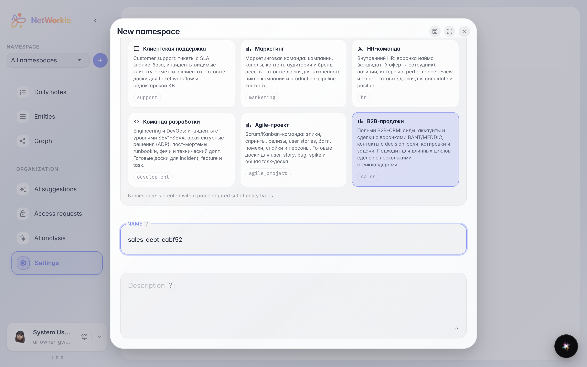
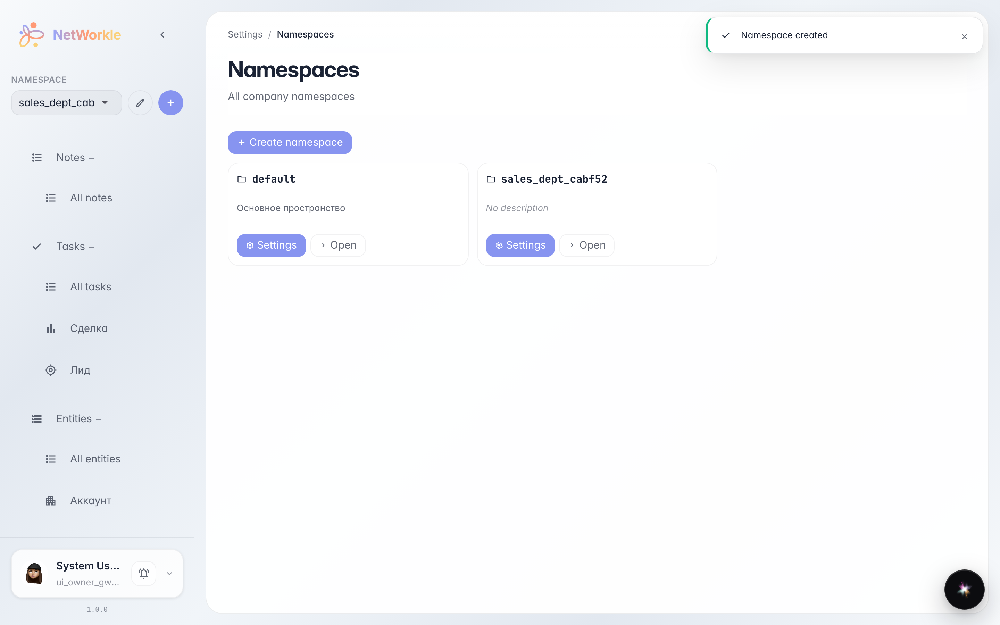
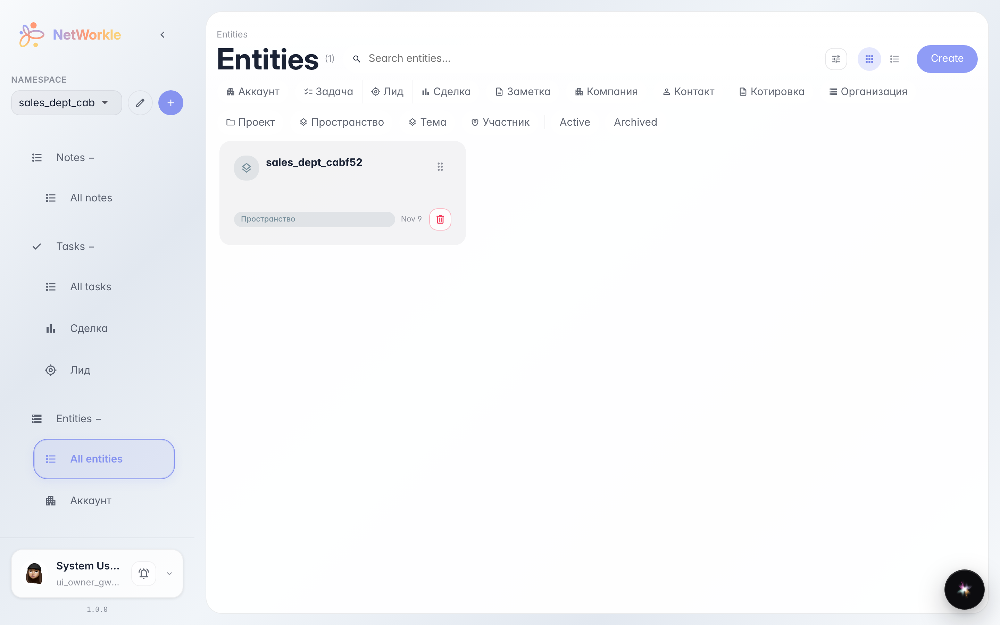
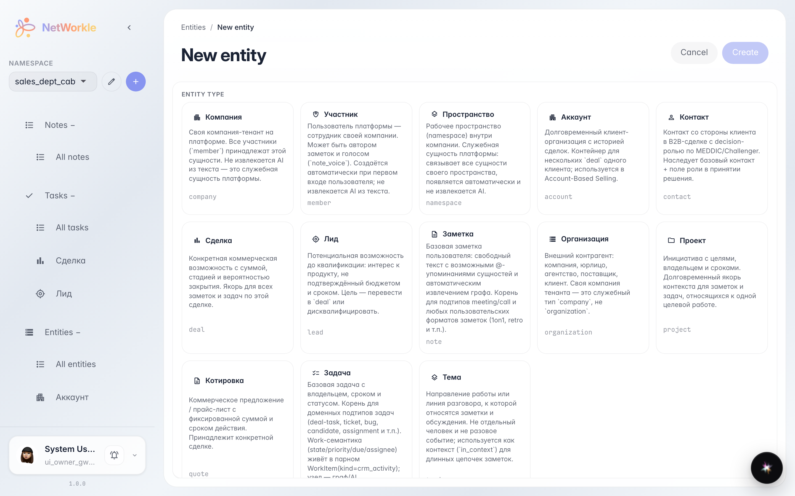
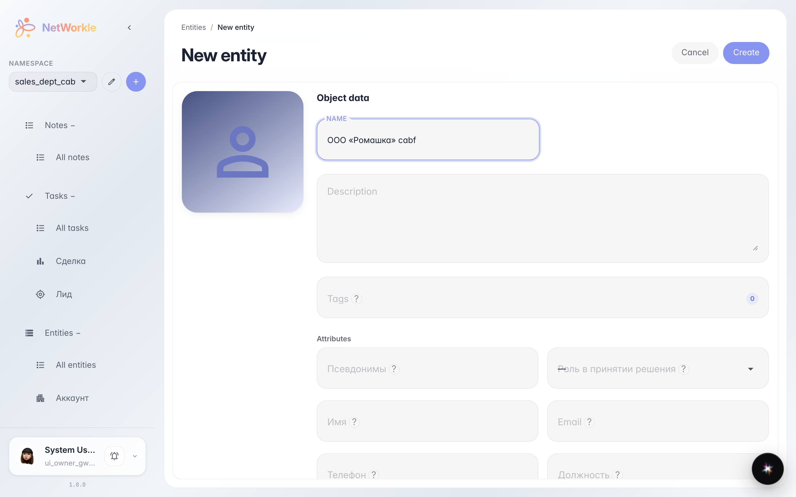
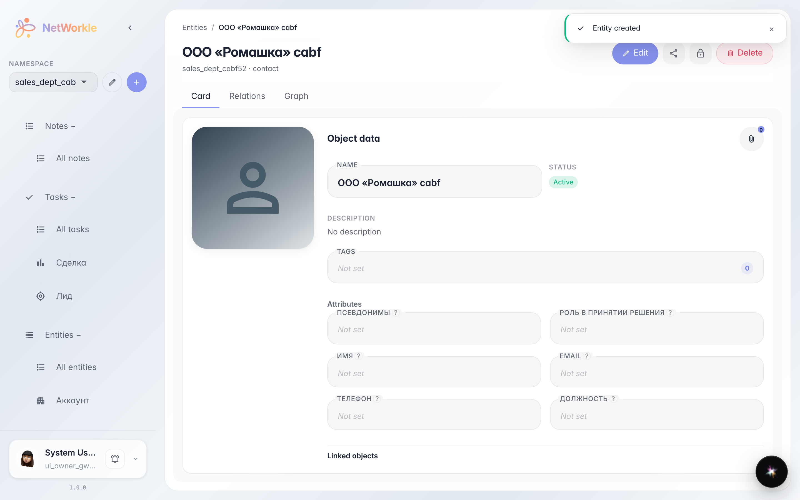

# Первое пространство и первая запись

**Для чего:** собрать свою базу контактов и сделок — создать пространство из готового шаблона и завести первую карточку.

**Какие проблемы решает:** клиенты в разрозненных таблицах и заметках. Здесь вы увидите, как за пару минут появляется структурированная картотека с нужными типами записей.

**Результат:** пространство с типами Лид, Клиент и Сделка — и первая карточка клиента внутри.

## Шаг 1. Список пространств компании

Откройте NetWorkle — раздел «Пространства» показывает все рабочие области компании. Пространство — это отдельная картотека со своими типами записей. Нажмите «Создать пространство».

## Шаг 2. Выбираем шаблон и имя

Шаблон — это готовый набор типов записей. «B2B-продажи» уже содержит Лидов, Клиентов и Сделки — ничего настраивать не нужно. Имя пространства пишется латиницей в одно слово, например «sales_dept» — так системе проще с ним работать.

## Шаг 3. Пространство создано

Пространство «sales_dept_cabf52» появилось в списке — внутри уже есть типы записей из шаблона. Нажмите «Открыть», чтобы войти в него.

## Шаг 4. Картотека пространства

Раздел «Записи» — сама картотека. Пока она пустая: нажмите кнопку создания, чтобы завести первую запись.

## Шаг 5. Выбираем тип записи

Сначала выберите, что за записью стоит: контакт, компания, сделка или лид. У каждого типа — свой набор полей. Берём «Контакт».

## Шаг 6. Заполняем карточку

Введите имя — этого достаточно для первой записи. Остальные поля можно заполнить позже прямо в карточке. Нажмите «Создать».

## Шаг 7. Первая запись готова

Карточка «ООО «Ромашка» cabf» создана и открыта. Сюда можно добавлять заметки, связи с другими записями и задачи — вся история клиента в одном месте.

