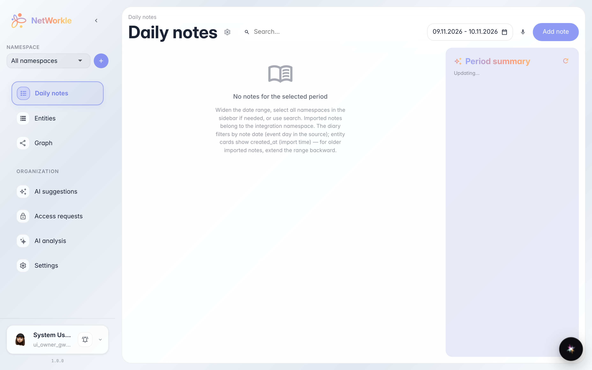
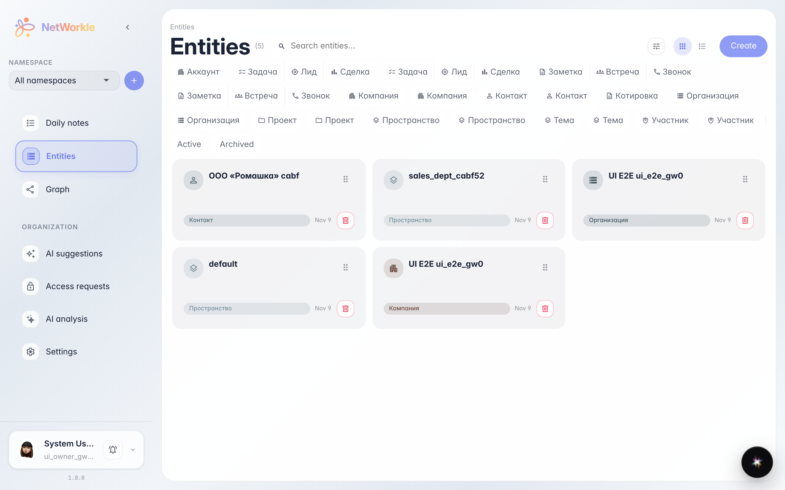
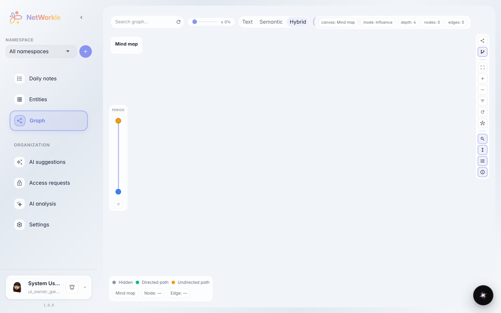
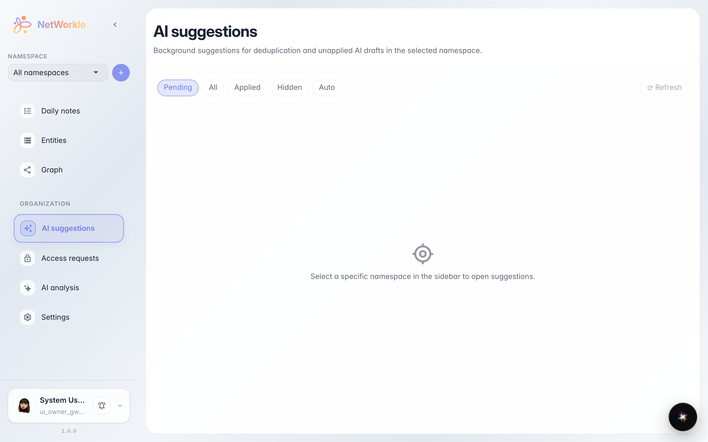

# What lives inside a space: sections tour

**Purpose:** understand where things live in NetWorkle — notes, records, the relation graph and AI suggestions.

**Problems solved:** after creating a space it is unclear where to go next. This tour shows every section in a minute and what it gives you.

**Result:** you know the space section map and can consciously pick where to do your work.

## Step 1. Daily notes

The Notes section is a working diary: short entries about customers, calls and tasks. A note can be linked to a record and stays in the customer history forever.

## Step 2. Records

The Records section is the card index: customers, deals, leads. Records can be searched, filtered by type and viewed as cards or a table.

## Step 3. Relation graph

The Graph draws links between records: who works at which company, which deal belongs to which customer. A convenient way to see the whole picture instead of single cards.

## Step 4. AI suggestions

Suggestions is where the platform hints at what it found in your notes: new contacts, meetings, tasks. Just confirm — and they become records.

