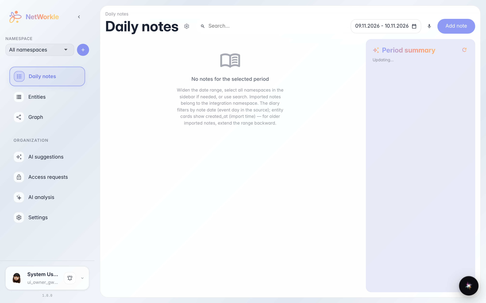
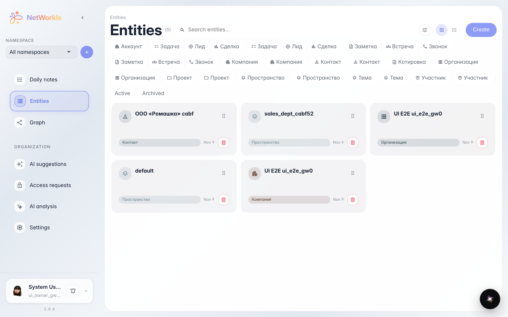
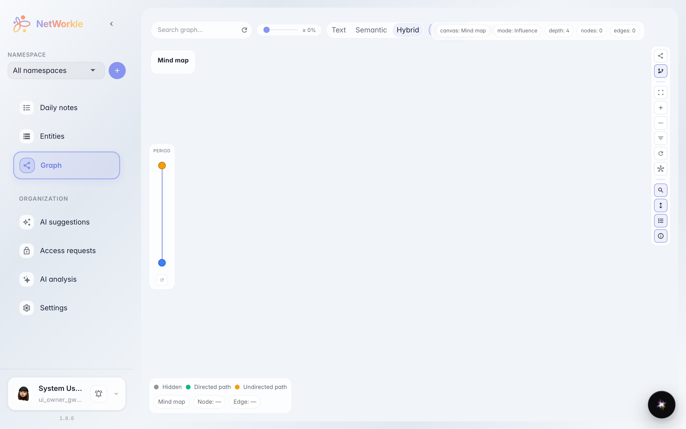
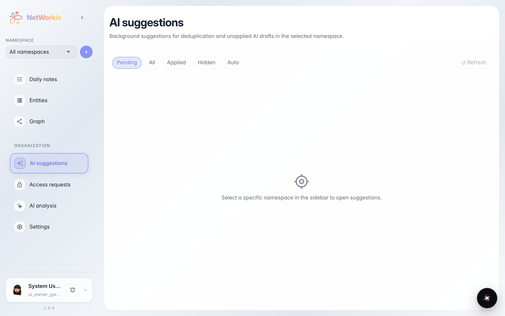

# Что живёт внутри пространства: обзор разделов

**Для чего:** понять, где в NetWorkle что лежит — заметки, записи, граф связей и AI-предложения.

**Какие проблемы решает:** после создания пространства непонятно, куда идти дальше. Этот тур за минуту показывает каждый раздел и что он даёт в работе.

**Результат:** вы знаете карту разделов пространства и можете сознательно выбрать, где вести свою работу.

## Шаг 1. Заметки дня

Раздел «Заметки» — рабочий дневник: короткие записи по клиентам, звонкам и делам. Заметку можно привязать к записи, и она останется в истории клиента навсегда.

## Шаг 2. Записи картотеки

Раздел «Записи» — картотека: клиенты, сделки, лиды. Записи можно искать, фильтровать по типам и раскладывать по карточкам или таблице.

## Шаг 3. Граф связей

«Граф» рисует связи между записями: кто в какой компании работает, какая сделка к какому клиенту относится. Удобно увидеть картину целиком, а не по одной карточке.

## Шаг 4. AI-предложения

«Предложения» — место, где платформа сама подсказывает, что нашла в заметках: новые контакты, встречи, задачи. Остаётся только подтвердить — и они станут записями.

