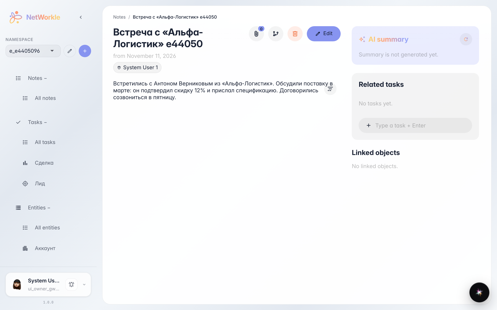
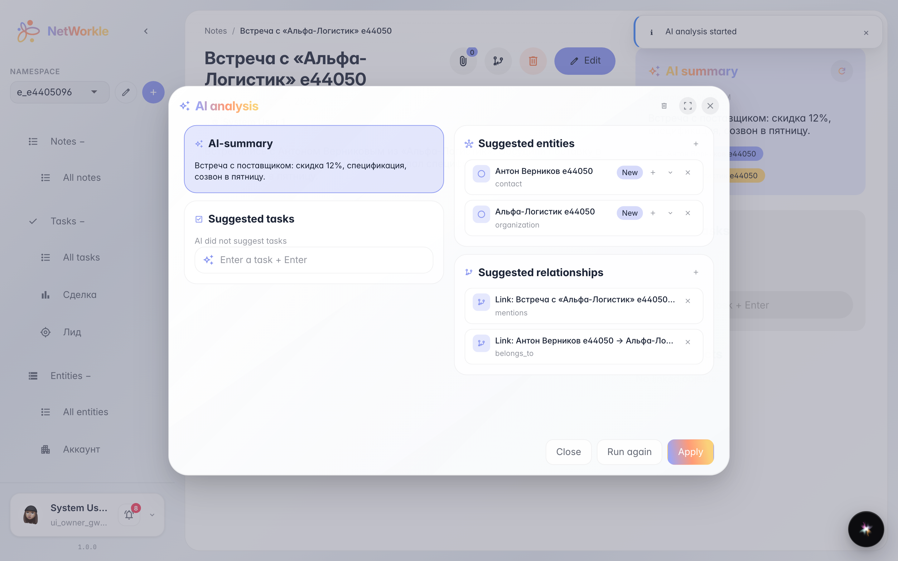
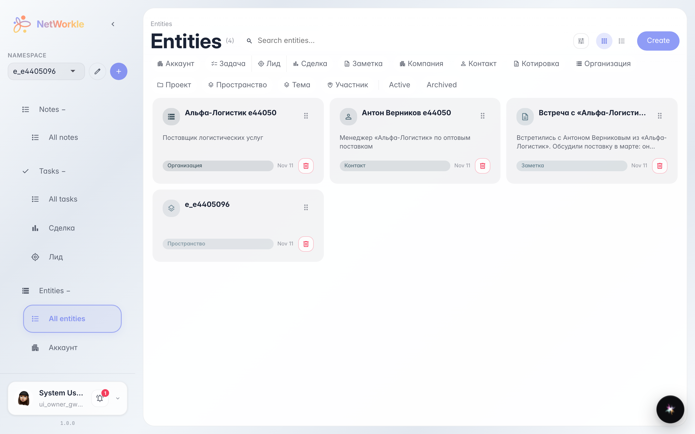

# AI note analysis: records and links from text

**Purpose:** write a note in free text and get ready-made card-index records — AI finds people, companies and links between them.

**Problems solved:** after a meeting nobody wants to file cards by hand — agreements sink into text and get lost. AI analysis proposes a ready record list: review it, apply in one click.

**Result:** records and links were created from the note, and the note got an AI summary.

## Step 1. Note after meeting

The note is written in plain text — no forms or cards. Next to the summary sits a round refresh button: it starts the AI analysis of the text.

## Step 2. AI found records and links

AI analysis shows what it understood from the text: a note summary, suggested records (contact, company) and links between them. Each row can be edited right here before the records reach the card index.

## Step 3. Records in the card index

Антон Верников e44050 is already in the card index — with the company and a link to the note. AI did the rough work, you only reviewed it.

**Summary.** Write notes the way you like — the card index fills itself in.

