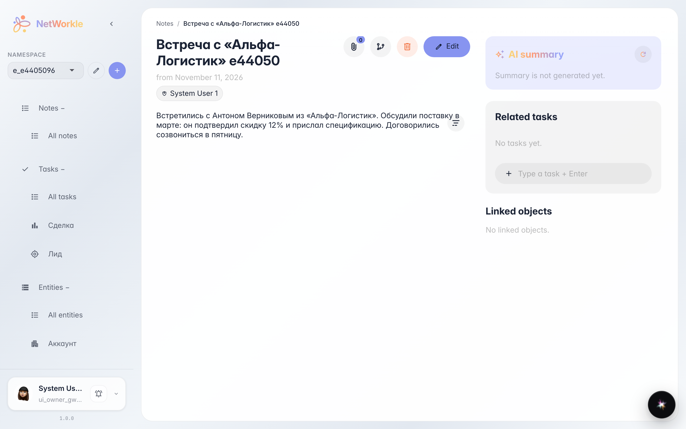
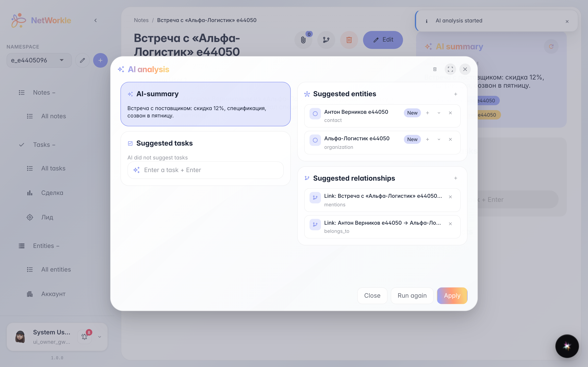
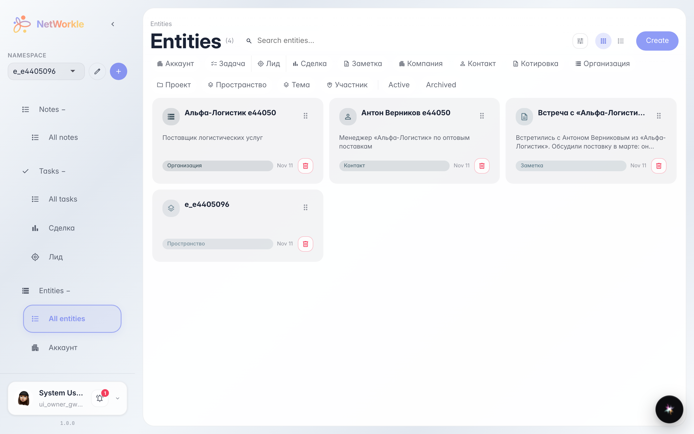

# AI-разбор заметки: записи и связи из текста

**Для чего:** написать заметку свободным текстом, а записи картотеки получить готовыми — AI сам находит людей, компании и связи между ними.

**Какие проблемы решает:** после встречи лень заводить карточки руками — договорённости оседают в тексте и теряются. AI-разбор предлагает готовый список записей: проверил — применил одним кликом.

**Результат:** из заметки созданы записи и связи, заметка получила AI-резюме.

## Шаг 1. Заметка после встречи

Заметка записана обычным текстом — без форм и карточек. Рядом с резюме — круглая кнопка обновления: она запускает AI-разбор текста.

## Шаг 2. AI нашёл записи и связи

AI-разбор показывает, что он понял из текста: резюме заметки, предложенные записи (контакт, компания) и связи между ними. Каждую строку можно поправить прямо здесь, прежде чем записи попадут в картотеку.

## Шаг 3. Записи в картотеке

«Антон Верников e44050» уже в картотеке — вместе с компанией и связью к заметке. AI сделал черновую работу, вы только проверили.

**Итог.** Пишите заметки как удобно — картотека заполнится сама.

