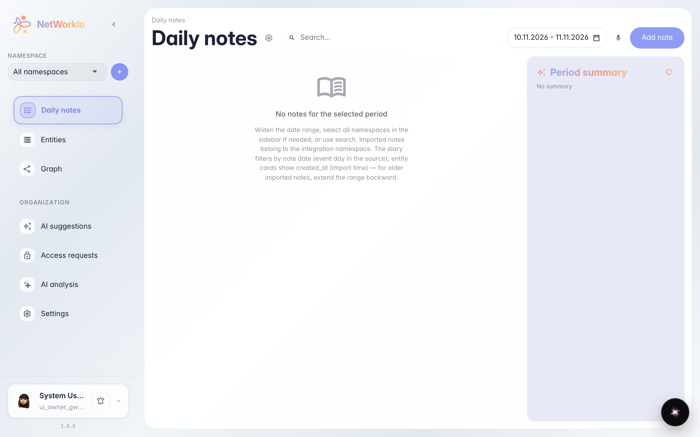
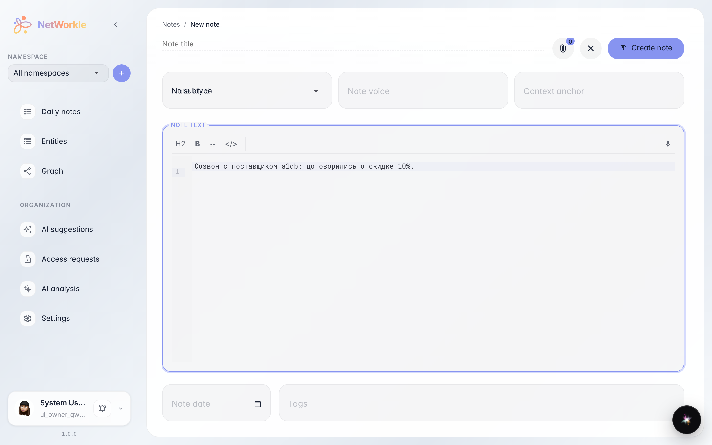
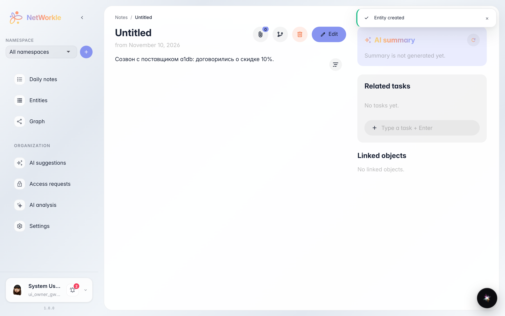
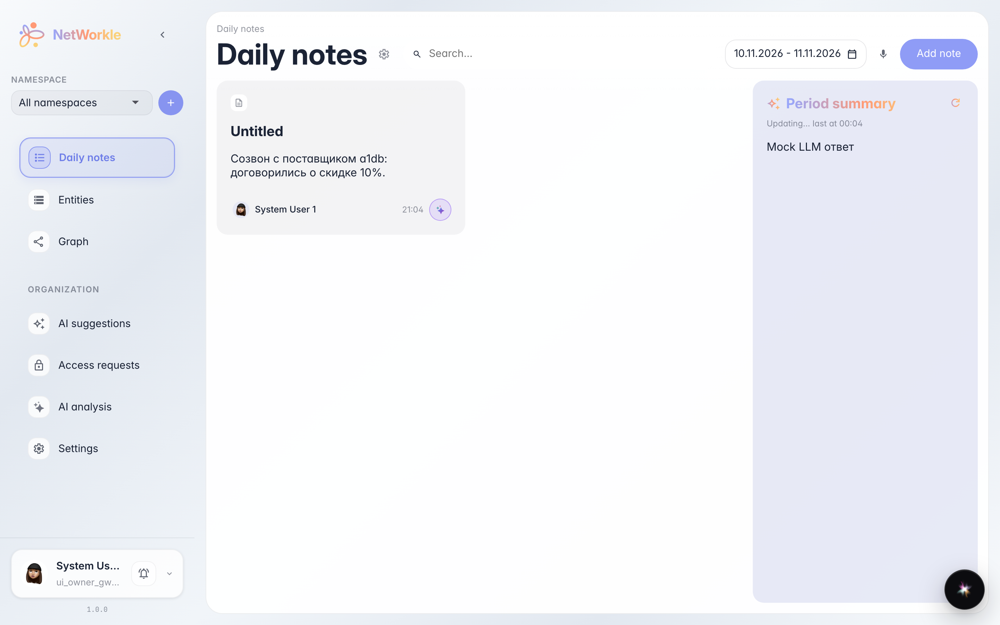

# Daily notes: working day diary

**Purpose:** capture the day's outcomes — calls, agreements, thoughts — while fresh, and find them later by date.

**Problems solved:** agreements get lost in chats and memory. A daily note takes a minute, then it is easy to recall what was discussed and when.

**Result:** the note is saved in the feed under its date — you can come back and link it to records.

## Step 1. Notes diary

The Notes section is a feed of entries by day. On top — a period picker and voice dictation; the Add note button opens the editor.

## Step 2. Writing a note

The editor supports markup: headings, lists, record links via @. Write like in a regular notepad — what was discussed, what was agreed, what to do tomorrow.

## Step 3. Note saved

After saving the note opens in read mode — the date is set automatically. Below you can link it to customer and deal records.

## Step 4. Note in the feed

The note appeared in the feed under its date. You can amend it, link it to a customer, or ask the platform to break it down into records.

