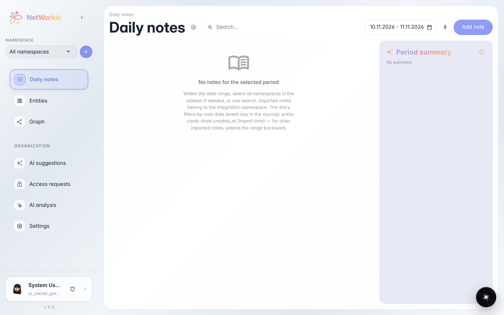
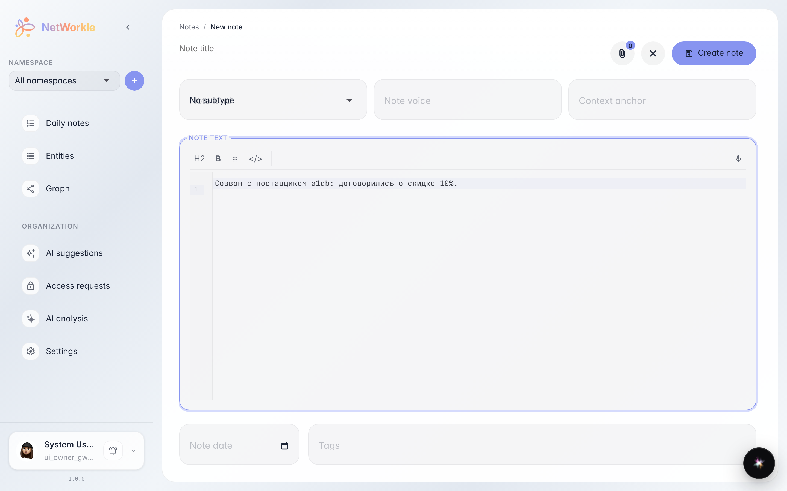
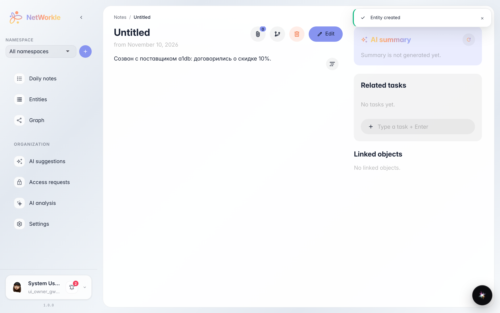
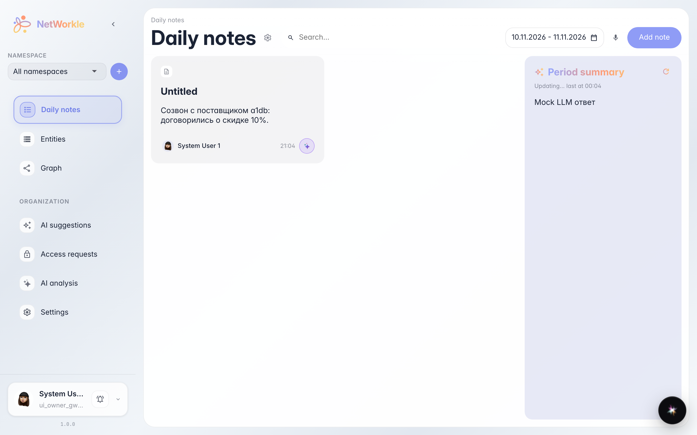

# Ежедневные заметки: дневник рабочего дня

**Для чего:** фиксировать итоги дня — звонки, договорённости, мысли — пока они свежие, и находить их потом по дате.

**Какие проблемы решает:** договорённости теряются в чатах и голове. Заметка за день занимает минуту, а потом легко вспомнить, что и когда обсуждали.

**Результат:** заметка сохранена и лежит в ленте за свою дату — к ней можно вернуться и привязать к записям.

## Шаг 1. Дневник заметок

Раздел «Заметки» — лента записей по дням. Сверху — выбор периода и диктовка голосом, кнопка «Добавить заметку» открывает редактор.

## Шаг 2. Пишем заметку

Редактор поддерживает разметку: заголовки, списки, ссылки на записи через «@». Пишите как в обычном блокноте — что обсуждали, о чём договорились, что сделать завтра.

## Шаг 3. Заметка сохранена

После сохранения заметка открывается в режиме чтения — дата проставлена автоматически. Ниже можно привязать её к записям клиентов и сделок.

## Шаг 4. Заметка в ленте

Заметка появилась в ленте под своей датой. Дальше её можно дополнить, привязать к клиенту или попросить платформу разобрать её на записи.

