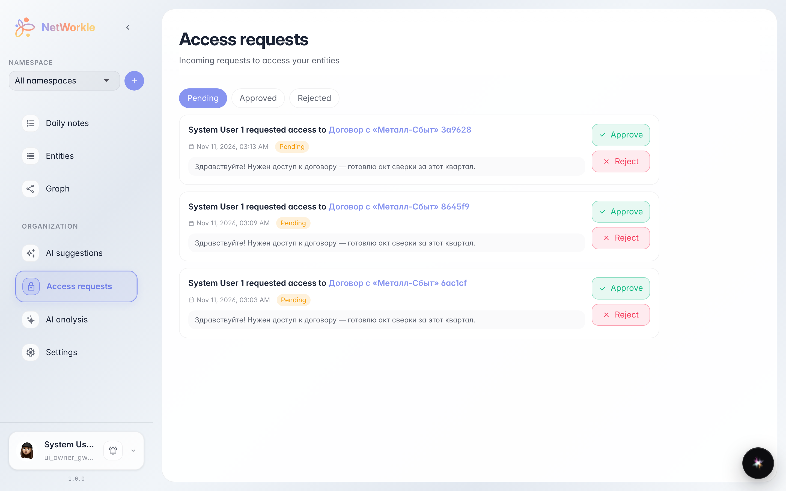
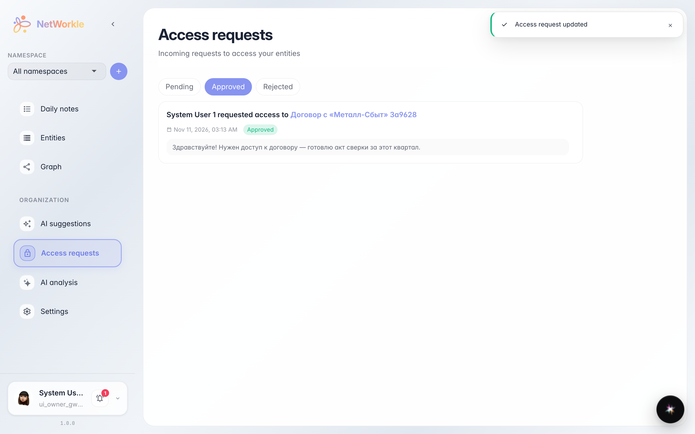

# Access requests to records

**Purpose:** handle colleagues' requests to open a restricted record — approve or reject in one click.

**Problems solved:** an employee sees a link to a record but has no access to it. They send a request with a note, and the owner decides — grant access or not. No chat threads needed.

**Result:** you know where incoming requests live and how to process them quickly.

## Step 1. Incoming requests

The Access requests section lists every request waiting for your decision. Each card shows who asks, which record they need and why. Clicking the record name opens its card so you can check what is inside.

## Step 2. Request approved

Approve immediately opens the record to the colleague — the request leaves the pending list and appears under the Approved tab with its status. Reject works the same way — the request lands in Rejected.

**Summary.** Access requests are a tidy access queue: the requester explains why they need the record, you decide in one click.

