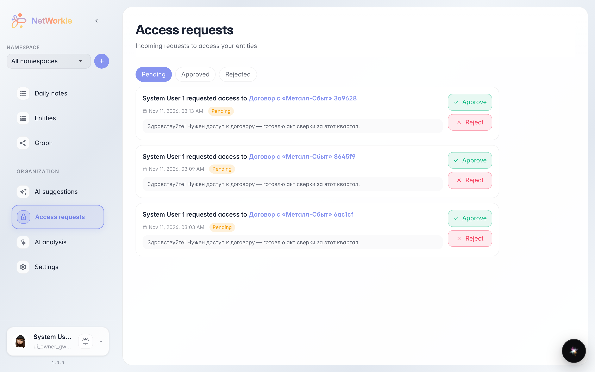
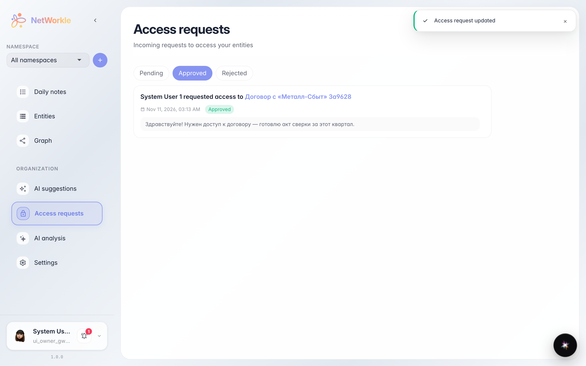

# Заявки на доступ к записям

**Для чего:** разбирать просьбы коллег открыть им закрытую запись — одобрить или отклонить в один клик.

**Какие проблемы решает:** сотрудник видит ссылку на запись, но не имеет к ней доступа. Он отправляет заявку с пояснением, а владелец решает — дать доступ или нет. Всё без переписки в чатах.

**Результат:** вы знаете, где лежат входящие заявки и как быстро их обработать.

## Шаг 1. Входящие заявки

Раздел «Запросы доступа» показывает все заявки, которые ждут вашего решения. На карточке — кто просит, к какой записи и зачем. Клик по названию записи открывает её карточку, чтобы проверить, что внутри.

## Шаг 2. Заявка обработана

«Одобрить» сразу открывает коллеге доступ к записи — заявка уходит из списка ожидания и появляется на вкладке «Одобренные» со статусом. «Отклонить» работает так же — заявка попадает в «Отклонённые».

**Итог.** Заявки — это аккуратная очередь доступа: проситель пишет зачем ему запись, вы решаете в один клик.

