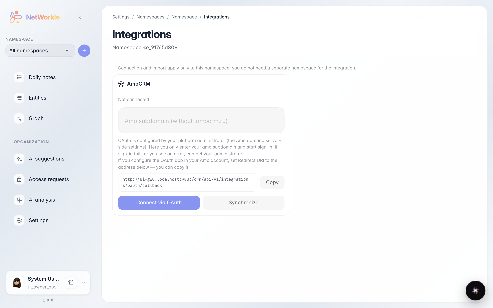
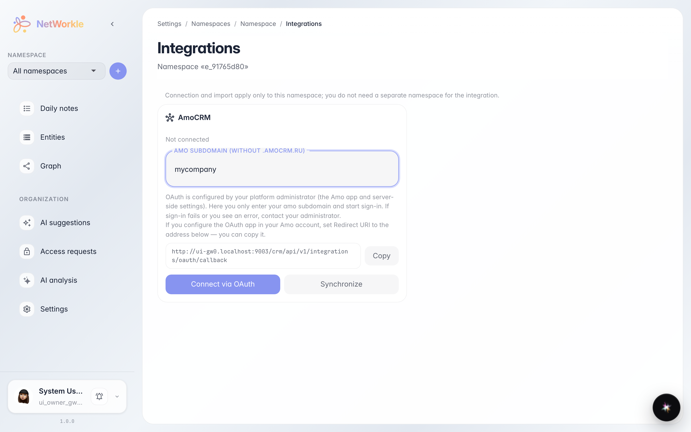

# Space integrations: connecting amoCRM

**Purpose:** link a space to an external CRM — records and fields sync automatically, and notes can be analysed by AI on a schedule.

**Problems solved:** data already lives in amoCRM and typing it by hand is slow. The integration pulls customers and deals into the space and keeps them up to date.

**Result:** you know where to connect amoCRM and which sync settings are available.

## Step 1. Space integrations

The Space → Integrations page lists available connections. For amoCRM you only need your account subdomain — the rest goes through OAuth: the Connect button takes you to amoCRM to confirm.

## Step 2. Connect by subdomain

Enter your amoCRM subdomain — for example, `mycompany` from `mycompany.amocrm.ru`. Below is the return address (OAuth callback) — already filled in; copy it into the integration settings on the amoCRM side.

**Summary.** Once connected, records and fields arrive in the space automatically; the sync schedule and AI note analysis are enabled by toggles on the same page.

