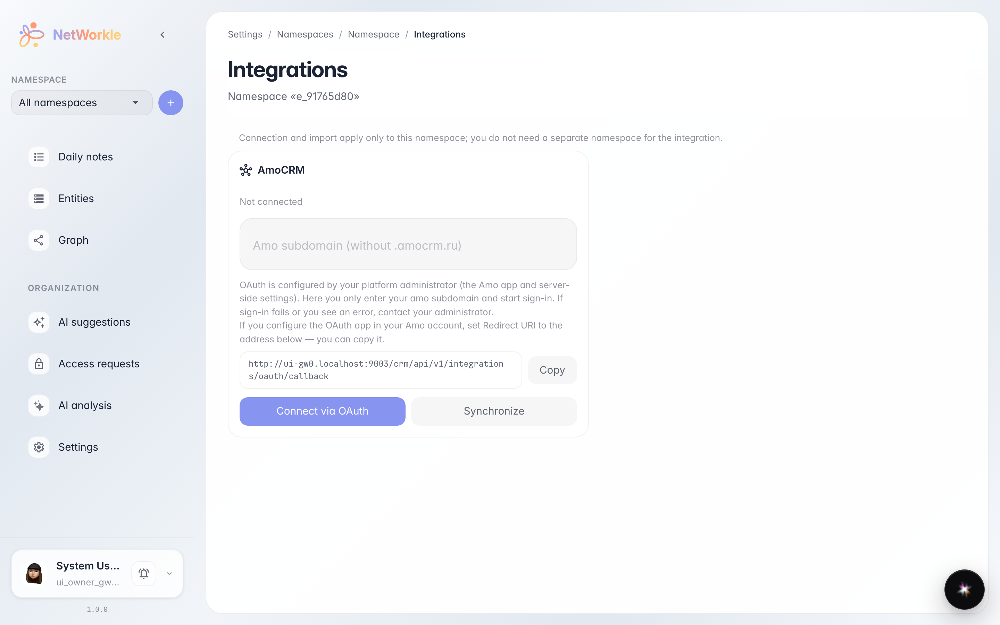
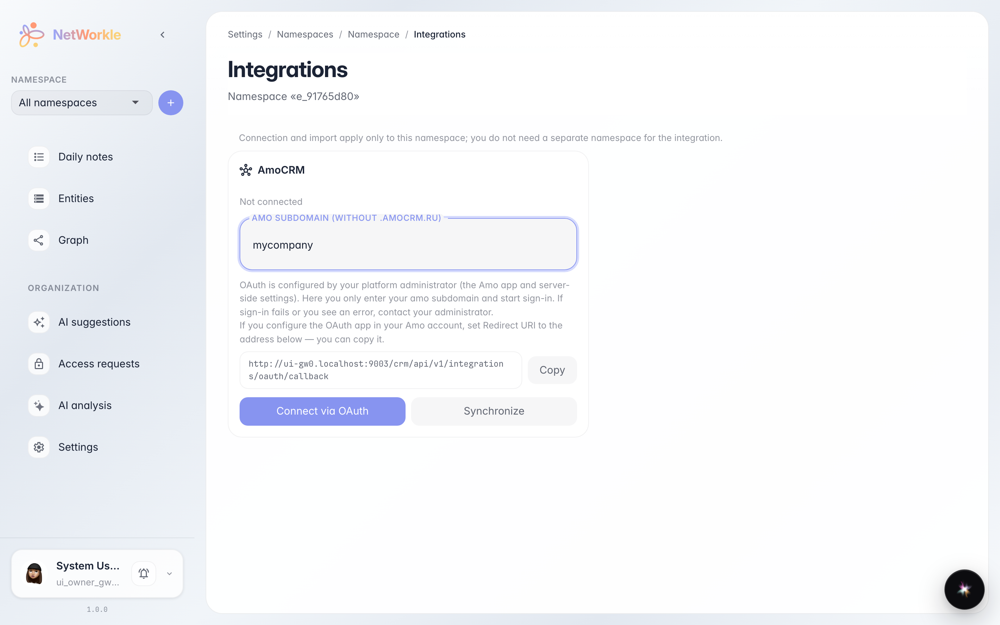

# Интеграции пространства: подключение amoCRM

**Для чего:** связать пространство с внешней CRM — записи и поля подтянутся автоматически, а заметки смогут разбираться AI по расписанию.

**Какие проблемы решает:** данные уже живут в amoCRM и заводить их руками долго. Интеграция забирает клиентов и сделки в пространство и держит их в актуальном состоянии.

**Результат:** вы знаете, где подключить amoCRM и какие настройки синхронизации доступны.

## Шаг 1. Интеграции пространства

Страница «Пространство → Интеграции» показывает доступные подключения. Для amoCRM нужен только поддомен вашего аккаунта — остальное система сделает через OAuth: кнопка «Подключить» переведёт вас в amoCRM для подтверждения.

## Шаг 2. Подключение по поддомену

Введите поддомен amoCRM — например, `mycompany` из адреса `mycompany.amocrm.ru`. Ниже показан адрес возврата (OAuth callback) — он уже заполнен, его нужно указать в настройках интеграции на стороне amoCRM.

**Итог.** После подключения записи и поля приезжают в пространство автоматически; расписание и AI-разбор заметок включаются здесь же переключателями.

