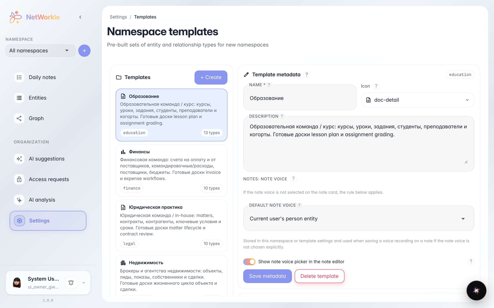
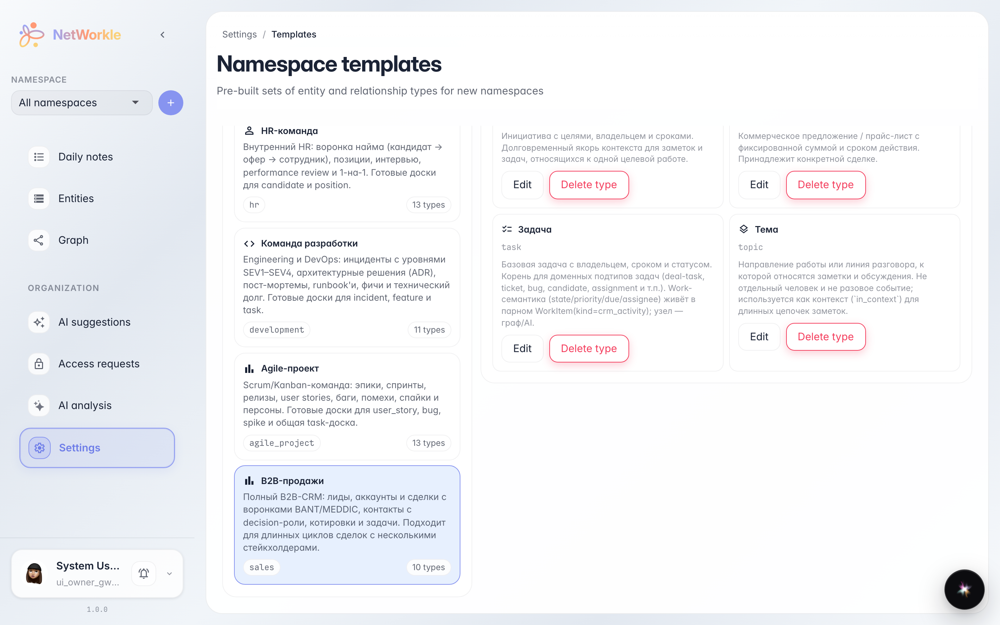
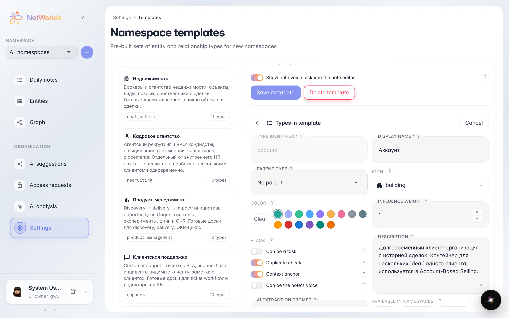

# Template library: what a space is made of

**Purpose:** see what a ready-made template brings to a new space — which record types and fields appear inside.

**Problems solved:** templates look like a black box. The library opens each one: the record-type list and their fields — so you can check the fit before creating a space.

**Result:** you know where to inspect a template's contents and how to verify a record type's fields beforehand.

## Step 1. Template library

The Settings → Templates section lists every ready-made space template. Each card shows a name, a description and how many record types it contains.

## Step 2. Template contents

Clicking a template unfolds its contents: the right panel lists all record types — Leads, Contacts, Deals and more. Chips under a type show which spaces already use it.

## Step 3. Record type fields

The Edit button on a type card opens its schema: name, icon and the record field set. This shows exactly what data the space will collect for each customer or deal.

**Summary.** A template is not magic — it is a transparent set of types and fields: check it upfront and there will be no surprises after creating the space.

