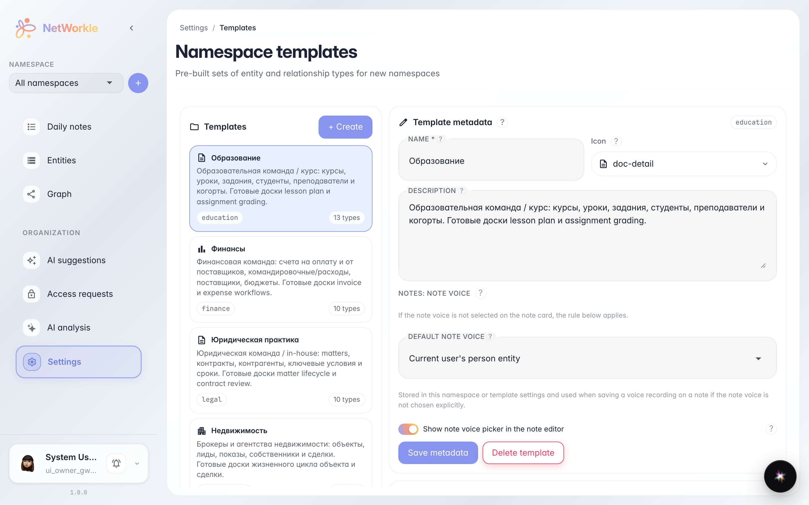
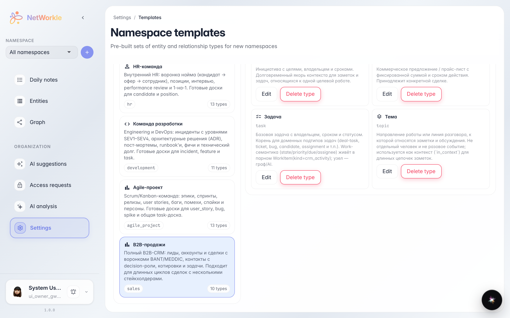
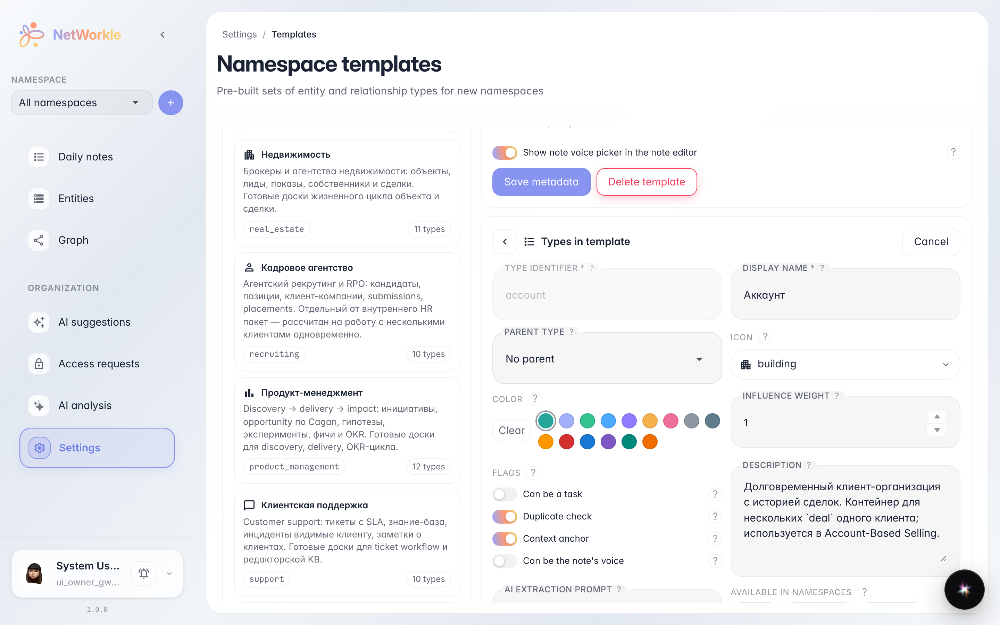

# Библиотека шаблонов: из чего собрано пространство

**Для чего:** понять, что даёт готовый шаблон при создании пространства — какие типы записей и поля появятся внутри.

**Какие проблемы решает:** шаблоны выглядят как «чёрный ящик». Библиотека показывает каждый шаблон изнутри: список типов записей и их поля — можно заранее убедиться, что шаблон подходит под свои задачи.

**Результат:** вы знаете, где посмотреть состав шаблона и как проверить поля типа записи до создания пространства.

## Шаг 1. Библиотека шаблонов

Раздел «Настройки → Шаблоны» показывает все готовые шаблоны пространств. На карточке — название, описание и число типов записей внутри.

## Шаг 2. Состав шаблона

Клик по шаблону раскрывает его состав: справа появляются все типы записей — Лиды, Контакты, Сделки и другие. Чипы под типом показывают, в каких пространствах он уже используется.

## Шаг 3. Поля типа записи

Кнопка «Редактировать» на карточке типа открывает его схему: имя, иконку и набор полей записи. Отсюда видно, какие данные пространство будет собирать по каждому клиенту или сделке.

**Итог.** Шаблон — это не «магия», а прозрачный набор типов и полей: проверили заранее — не будет сюрпризов после создания пространства.

