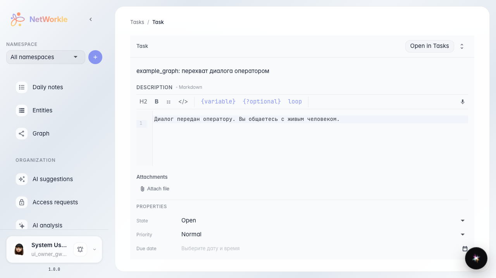
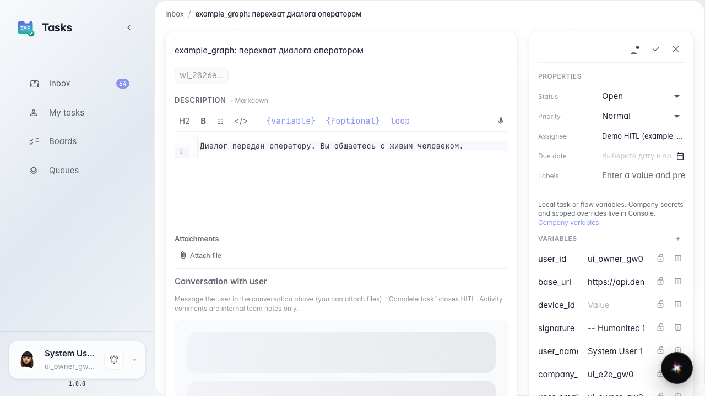
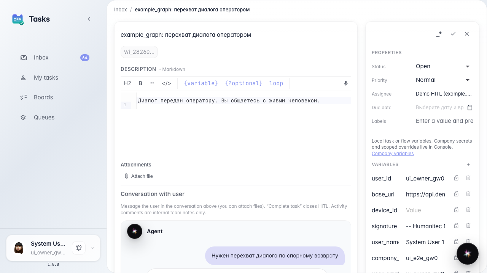
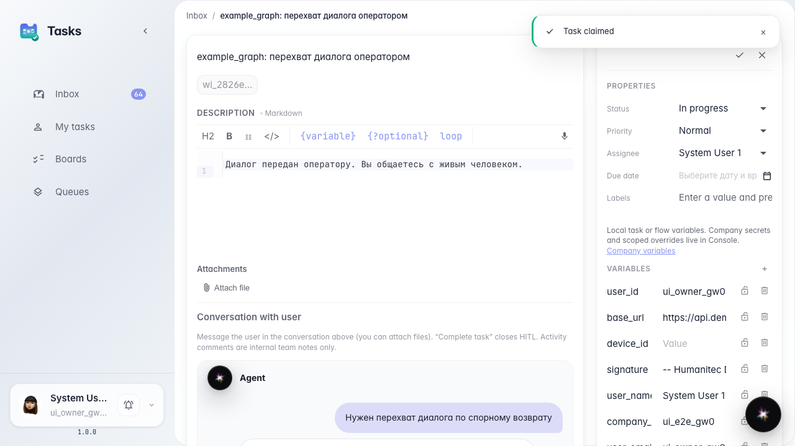

# Open an HITL task from CRM in Tasks

**What for:** this guide shows how to leave a CRM task card and open the full operator dialog in Tasks.

**Problems it solves:** CRM has no customer chat — a comment there never reaches the buyer.

**Result:** Open in Tasks takes you to the HITL card with the embedded chat.

## Step 1. Open the HITL card in CRM

Open the operator-handoff task in CRM via a direct link. There is no customer chat here — only task properties and a jump button.

## Step 2. Click Open in Tasks

The button takes you to Tasks, where the customer dialog lives. CRM has no HITL composer — reply there.

## Step 3. Check the chat in Tasks

The Tasks card shows the embedded customer dialog — this is where the operator replies.

## Step 4. Confirm the composer lives here

**Result demonstration.** After claim, the Tasks card shows the customer reply field. CRM did not have it.

**Summary.** From CRM you can jump to the HITL task and reply to the customer in Tasks.

