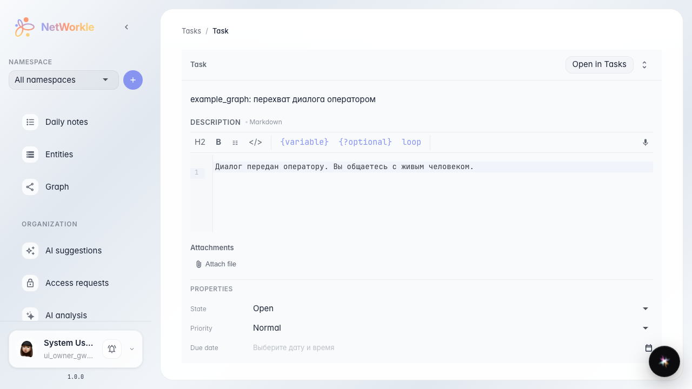
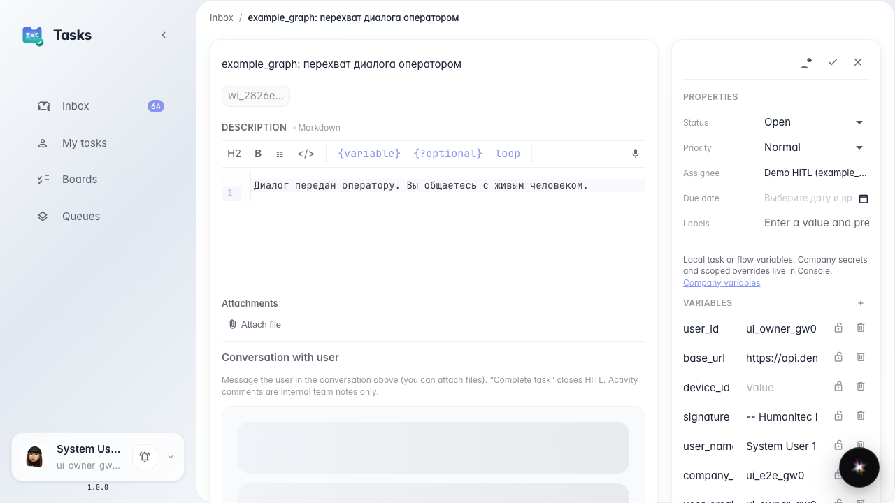
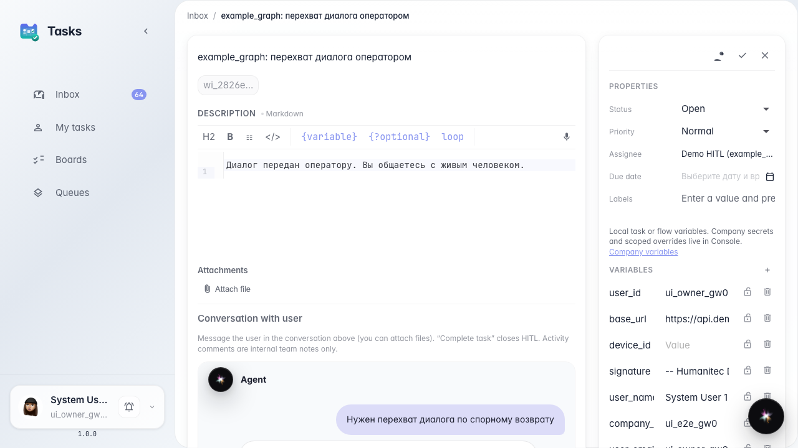
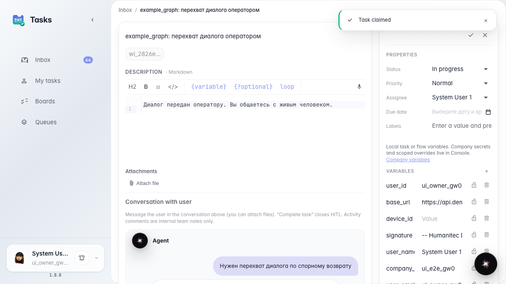

# Открыть HITL-задачу из CRM в разделе задач

**Для чего:** эта инструкция покажет, как из карточки задачи в CRM перейти в полноценный диалог оператора в разделе задач.

**Какие проблемы решает:** в CRM нет чата с покупателем — если ответить там комментарием, покупатель ничего не увидит.

**Результат:** кнопка «Открыть в задачах» ведёт на карточку HITL со встроенным чатом.

## Шаг 1. Откройте карточку HITL в CRM

По прямой ссылке откройте задачу передачи оператору в CRM. Здесь нет чата с покупателем — только свойства задачи и кнопка перехода.

## Шаг 2. Нажмите «Открыть в задачах»

Кнопка ведёт в раздел задач, где живёт диалог с покупателем. В CRM композера HITL нет — отвечать нужно там.

## Шаг 3. Проверьте чат в разделе задач

Карточка в задачах показывает встроенный диалог с покупателем — это место, откуда оператор отвечает.

## Шаг 4. Убедитесь, что композер только здесь

**Демонстрация результата.** После «Взять себе» в карточке задач появляется поле ответа покупателю. В CRM его не было.

**Итог.** Из CRM вы умеете перейти в HITL-задачу и отвечать покупателю в разделе задач.

