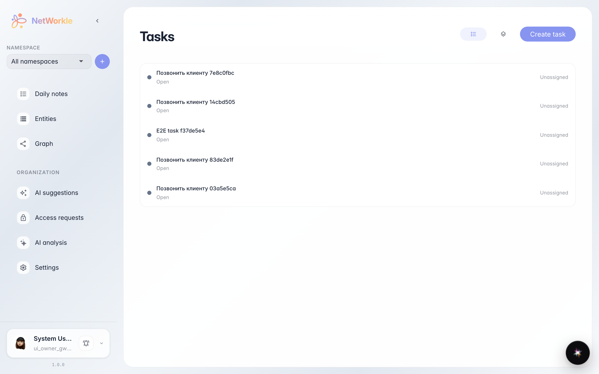
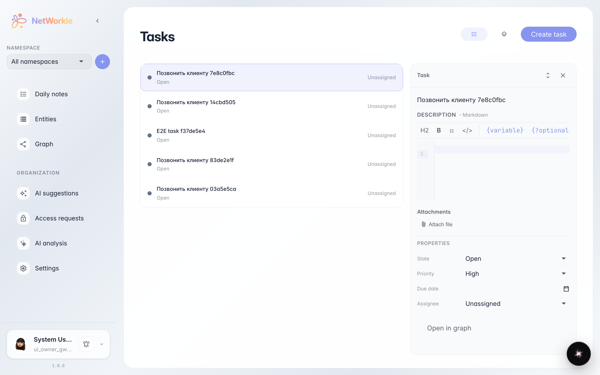
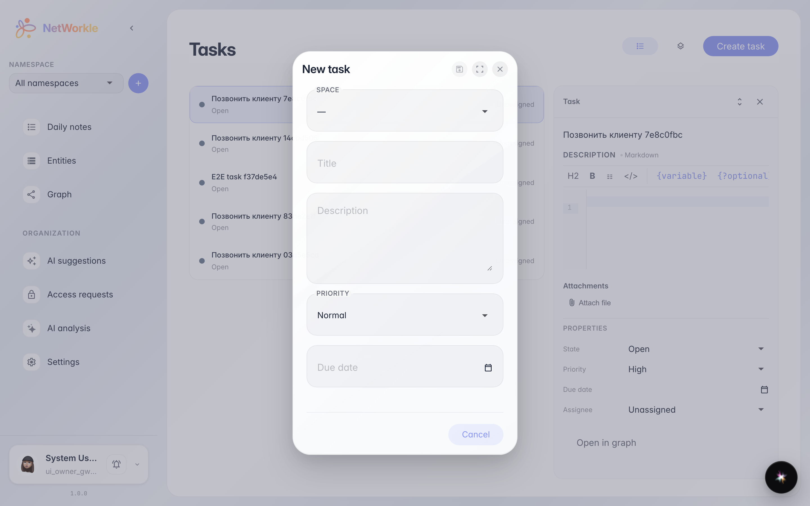

# Tasks inside NetWorkle

**Purpose:** assignments about customers and deals should not live apart from the card index — space tasks are visible right in the Tasks section.

**Problems solved:** a manager sees the company task list in one place: status, priority and creator — without switching to a separate tracker.

**Result:** the task is created and visible in the NetWorkle Tasks list, and the new-task form opens from the list.

## Step 1. Open the Tasks section

In the NetWorkle sidebar choose Tasks. The company task list opens: status, priority and assignee are visible here.

## Step 2. Open the task card

Each row is a separate task: title, status and priority. Clicking a row opens the card on the right: description, assignee, due date and the customer chat.

## Step 3. Create a task from the list

The Create task button opens a form: title, priority, assignee and due date. After saving, the task appears in the list and in the platform Tasks section.

**Summary.** Customer assignments are managed right inside NetWorkle.

