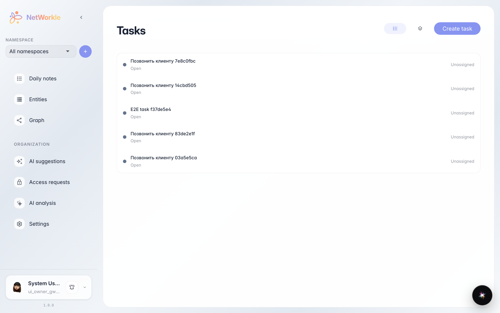
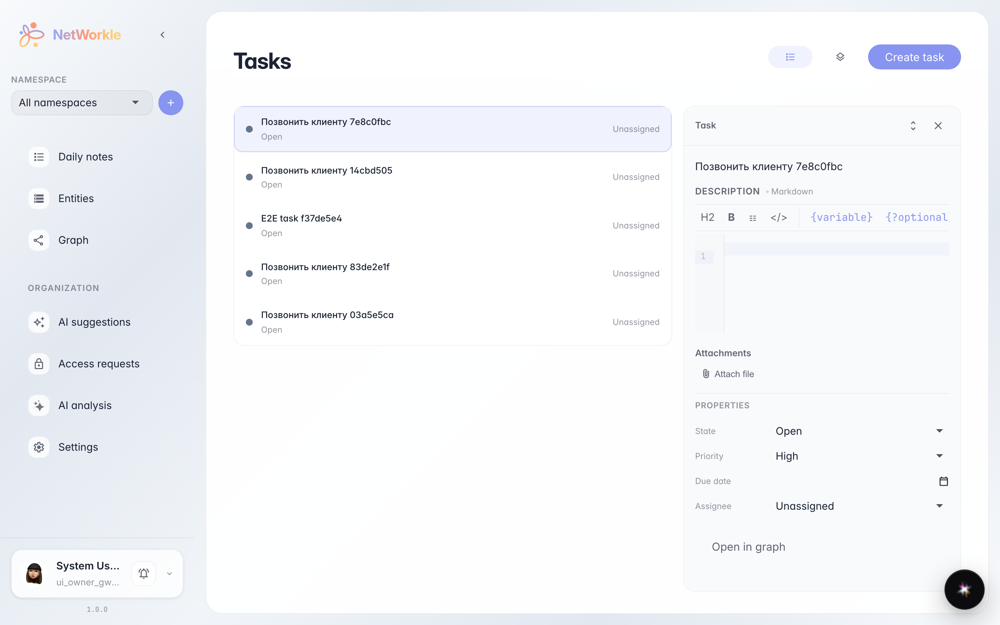
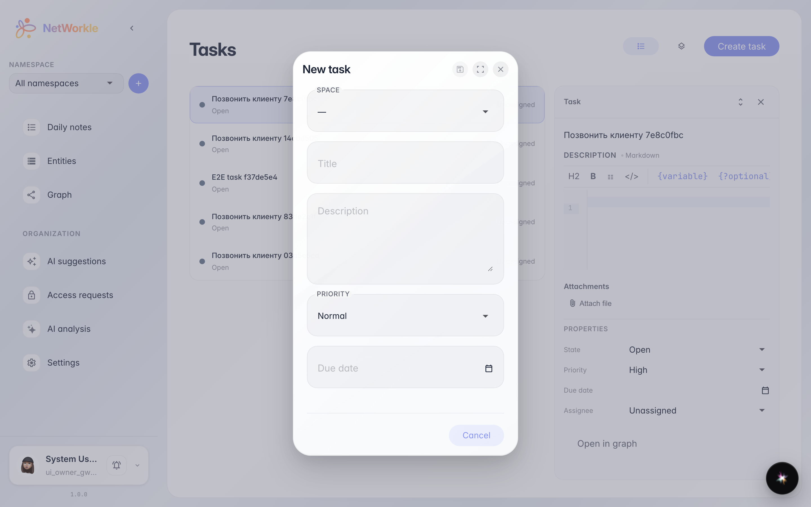

# Задачи внутри NetWorkle

**Для чего:** поручения по клиентам и сделкам не должны жить отдельно от картотеки — задачи пространства видны прямо в разделе «Задачи».

**Какие проблемы решает:** менеджер видит список задач компании в одном месте: статус, приоритет и постановщик — без перехода в отдельный таск-трекер.

**Результат:** задача создана и видна в списке «Задачи» NetWorkle, из списка открывается форма новой задачи.

## Шаг 1. Откройте раздел «Задачи»

В боковом меню NetWorkle выберите «Задачи». Откроется общий список поручений компании: здесь видны статус, приоритет и исполнитель.

## Шаг 2. Откройте карточку задачи

Каждая строка — отдельная задача: название, статус и приоритет. Клик по строке открывает карточку справа: описание, исполнитель, срок и чат с заказчиком.

## Шаг 3. Создайте задачу из списка

Кнопка «Создать задачу» открывает форму: название, приоритет, исполнитель и срок. После сохранения задача появляется в списке и в разделе «Задачи» платформы.

**Итог.** Поручения по клиентам ведутся прямо в NetWorkle.

