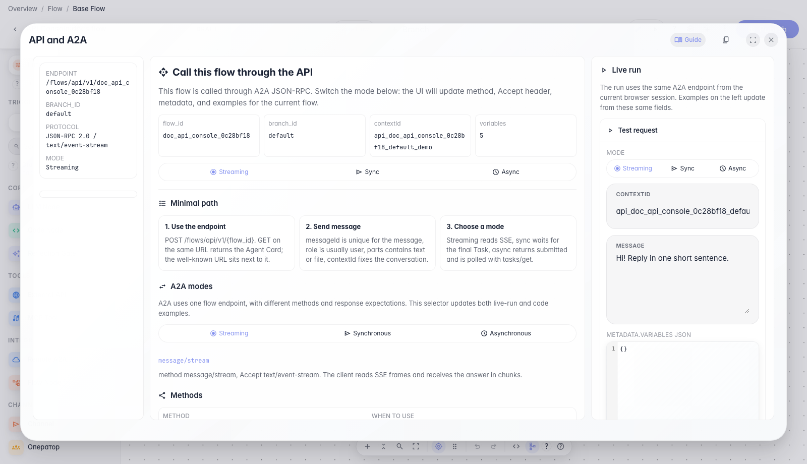
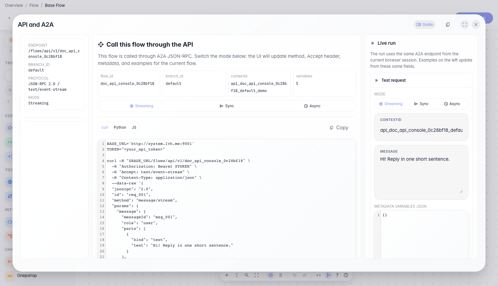
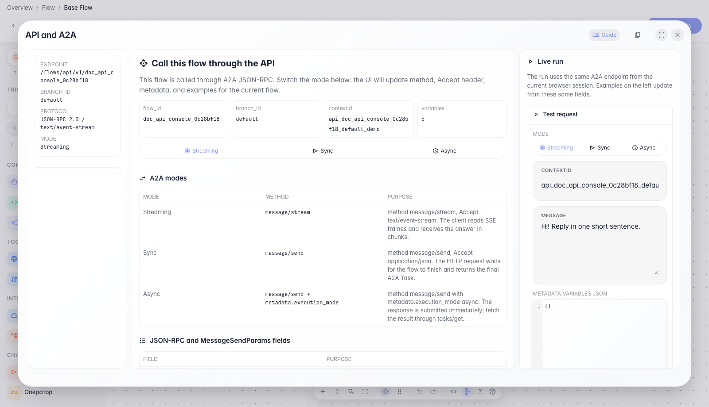
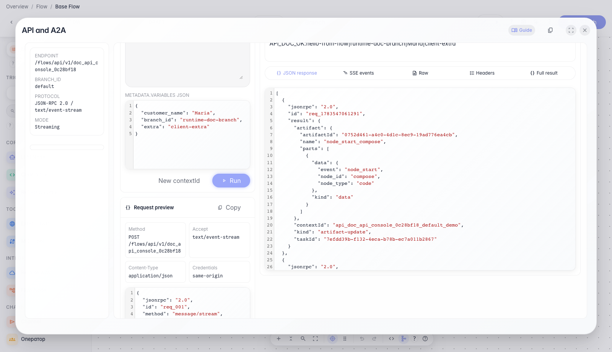
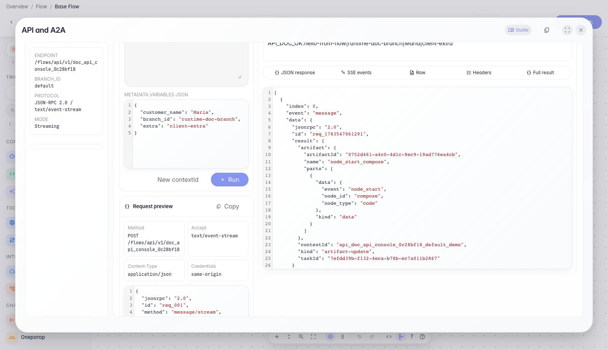
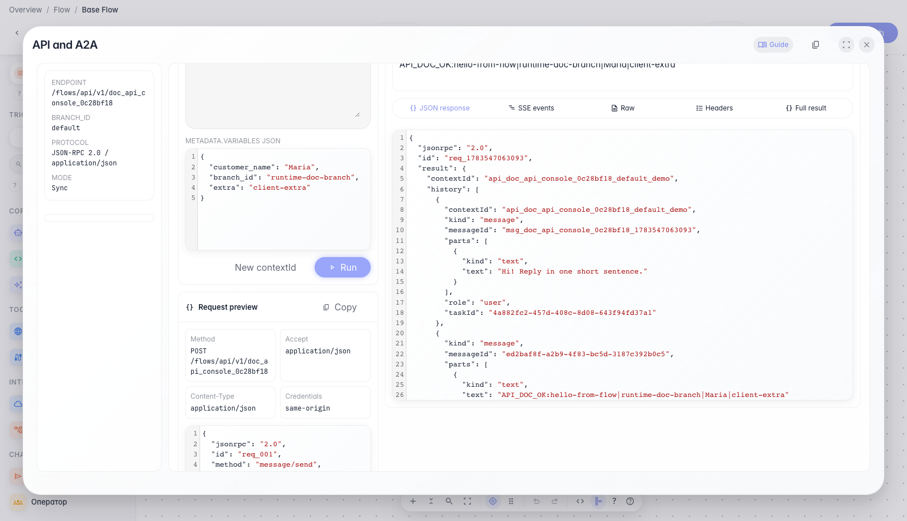
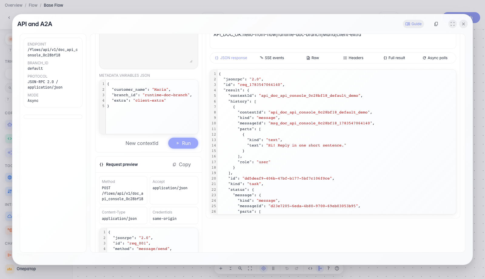

# Flows: API Console and A2A run

Complete guide for the API Console modal in the Flows editor: where to get the endpoint, how to read the A2A JSON-RPC body, how to run Streaming/Sync/Async, and how to inspect real API responses.

## Step 1. Open API Console from the flow editor

## Step 2. Read the Start tab and A2A modes

## Step 3. Use ready curl, Python, and JS examples

## Step 4. Check every A2A field and variables rule

## Step 5. Run Streaming and inspect the real API response

## Step 6. Open the response inspector: JSON, SSE, headers, raw, and full result

## Step 7. Test synchronous message/send mode

## Step 8. Test async submit and subsequent tasks/get polls

