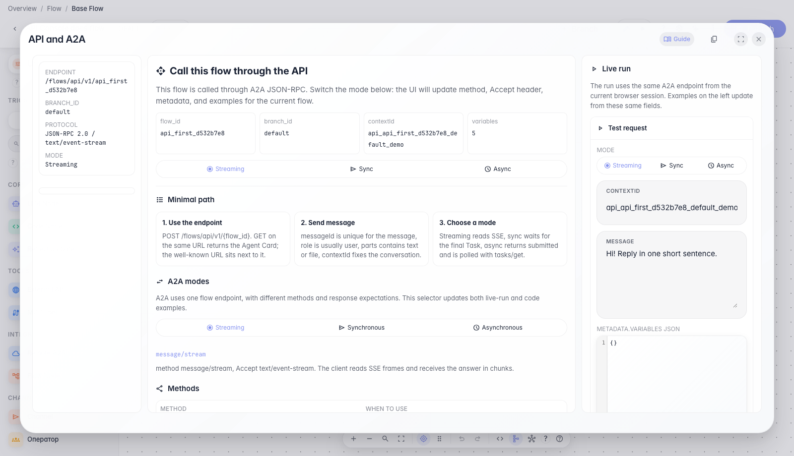
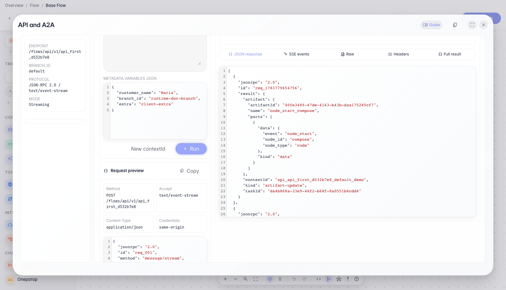

# First agent request through API Console

**What for:** this guide helps you send the first working request to an agent from the Flows editor and see a real API response.

**Problems it solves:** developers are unsure where to send the request, which JSON body is required, and how to verify the response without a separate client.

**Result:** you will send a streaming request from API Console and see the agent reply.

## Step 1. Open API Console in the editor

In the editor menu, choose API and A2A. A modal opens with the agent endpoint, guide tabs, and a run workbench — the main integration entry point without a separate Postman collection.

## Step 2. Review the Start tab

The Start tab shows where to send the first request: agent endpoint, selected branch, and a sample conversation id. The mode selector changes how the call works: streaming response, one synchronous response, or a background run with later status checks.

## Step 3. Run a streaming request and check the reply

**Result demonstration.** On the Run tab, send a message and wait for a reply with the verification text — this confirms API Console sent a real request to the agent.

**Summary.** You now know where to open API Console, what to read on the Start tab, and how to run your first streaming request.

