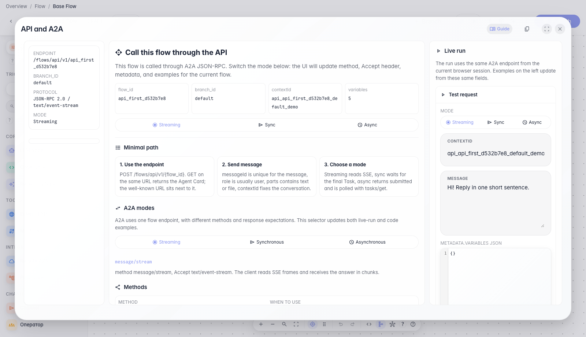
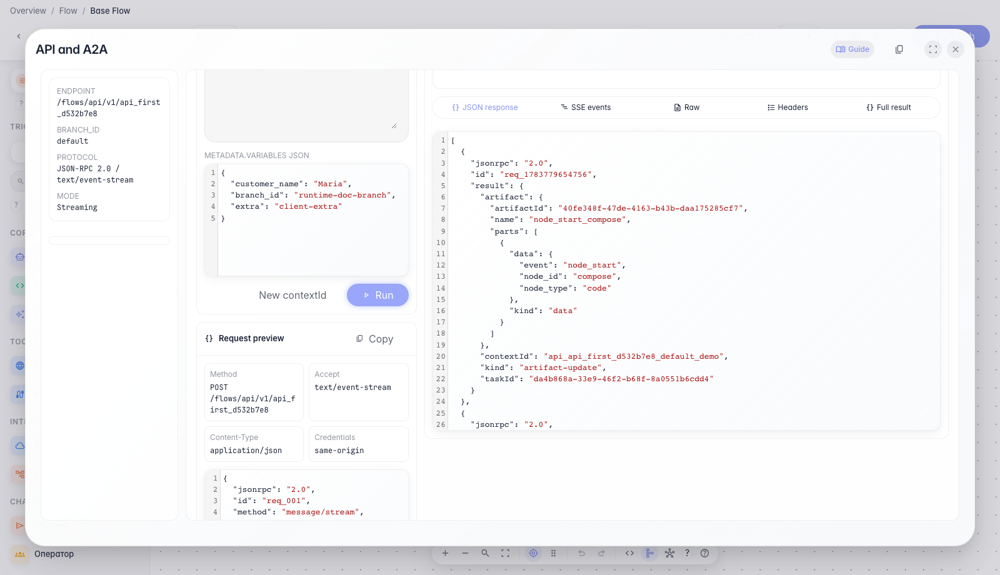

# Первый запрос к агенту через API Console

**Для чего:** эта инструкция поможет отправить первый рабочий запрос к агенту из редактора Flows и увидеть реальный ответ API.

**Какие проблемы решает:** разработчику непонятно, куда слать запрос, какой JSON нужен и как проверить ответ без отдельного клиента.

**Результат:** вы отправите потоковый запрос из API Console и увидите ответ агента.

## Шаг 1. Откройте API Console в редакторе

В меню редактора выберите «API и A2A». Откроется модальное окно с адресом агента, вкладками подсказок и рабочей зоной запуска — это главная точка интеграции без отдельного Postman.

## Шаг 2. Изучите вкладку «Старт»

На вкладке «Старт» видно, куда отправлять первый запрос: адрес агента, выбранную ветку и пример идентификатора диалога. Переключатель режима меняет способ вызова: потоковый ответ, один синхронный ответ или фоновый запуск с последующей проверкой статуса.

## Шаг 3. Запустите потоковый запрос и проверьте ответ

**Демонстрация результата.** На вкладке «Запуск» отправьте сообщение и дождитесь ответа с текстом проверки — это подтверждает, что API Console отправила реальный запрос к агенту.

**Итог.** Теперь вы знаете, где открыть API Console, что смотреть на вкладке «Старт» и как выполнить первый потоковый запрос.

