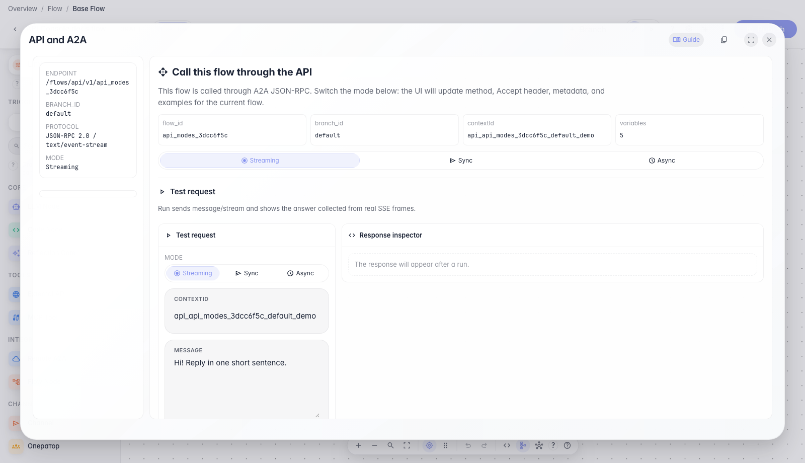
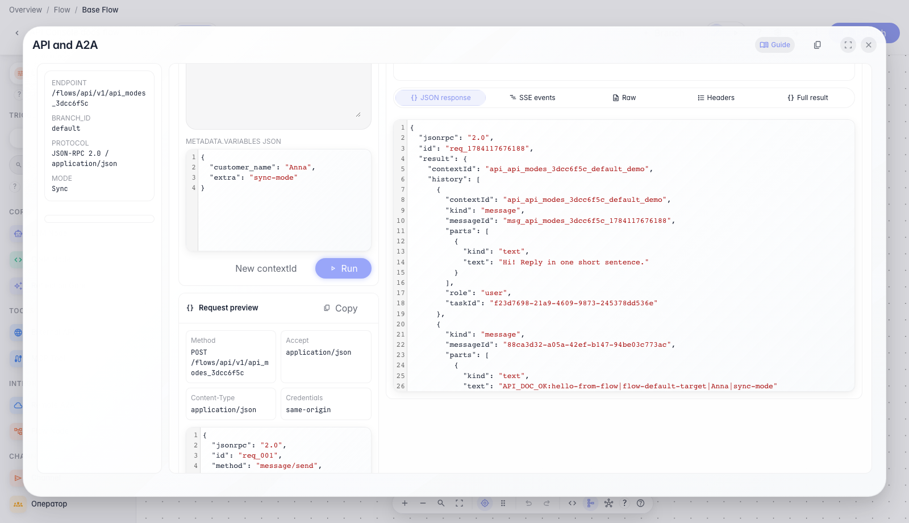
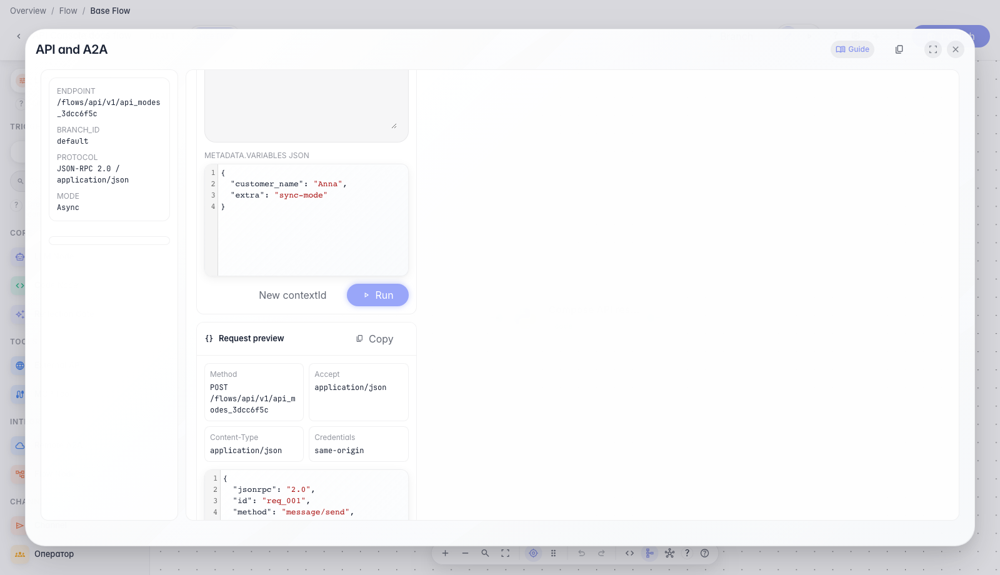
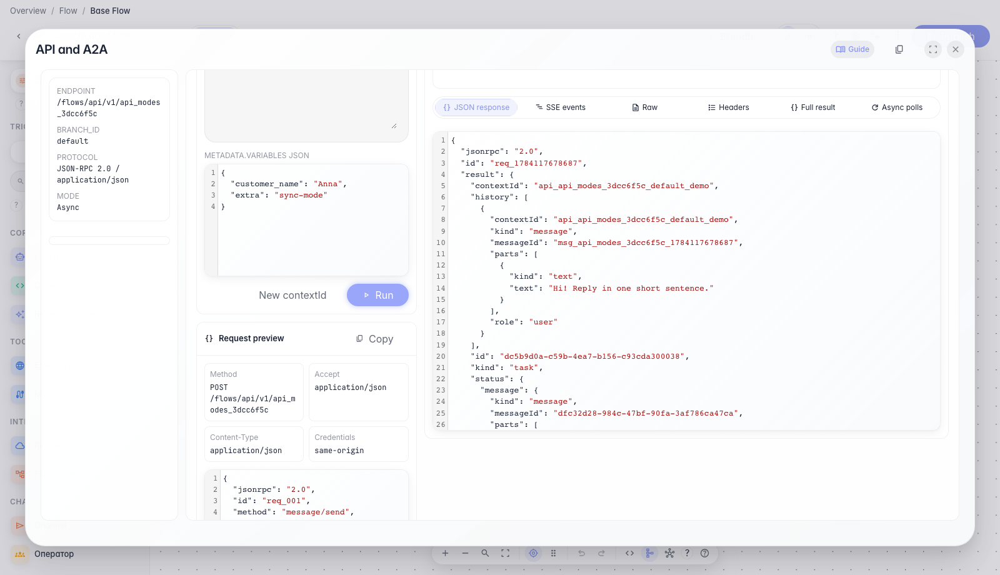

# Sync and async calls through API Console

**What for:** this guide shows how to call an agent with one HTTP response or in the background.

**Problems it solves:** it is unclear when Sync is better than Streaming and how to wait for a long-running task result.

**Result:** you will verify both message/send modes in the same API Console modal.

## Step 1. Open the Run tab

Switch to the Run tab. Here you can change mode, message text, and variables, then send a real request to the current agent.

## Step 2. Test sync mode

Sync mode sends one message and waits for a final JSON response without reading a stream of events. This is handy for short scenarios and backend-to-backend integrations.

## Step 3. Switch to async mode

Choose Async mode. The API returns a task immediately and you fetch the final reply with a separate status poll.

## Step 4. Test async mode

Async mode quickly returns a task id, and you can fetch the result with separate status requests. The modal shows which status checks were already performed.

**Result demonstration.** In Async mode you see a quick task response and the final result after status polling — both call styles work.

**Summary.** You can now switch Sync and Async in API Console and understand when to use each mode.

