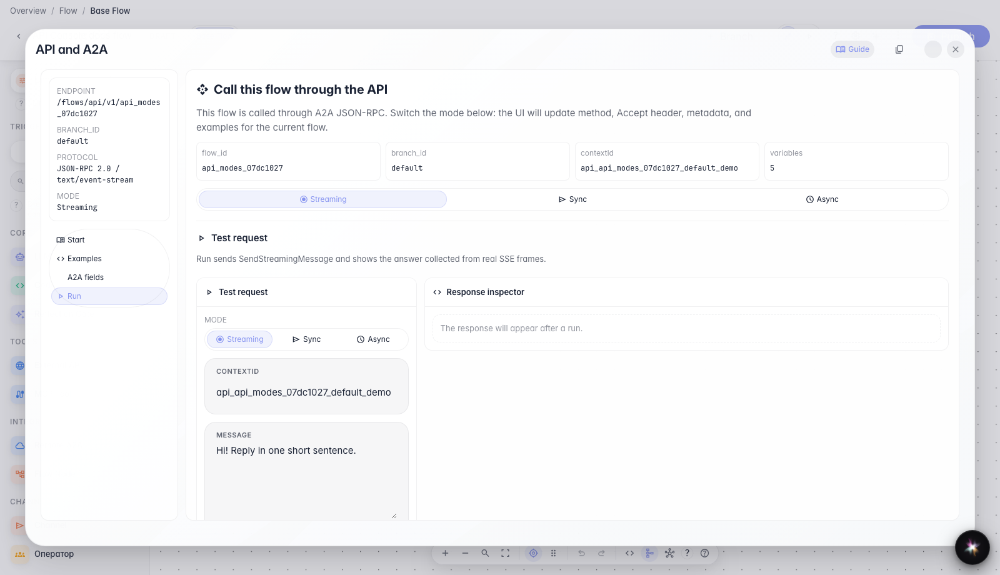
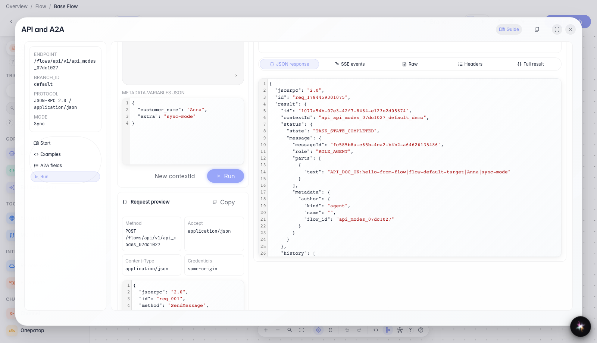
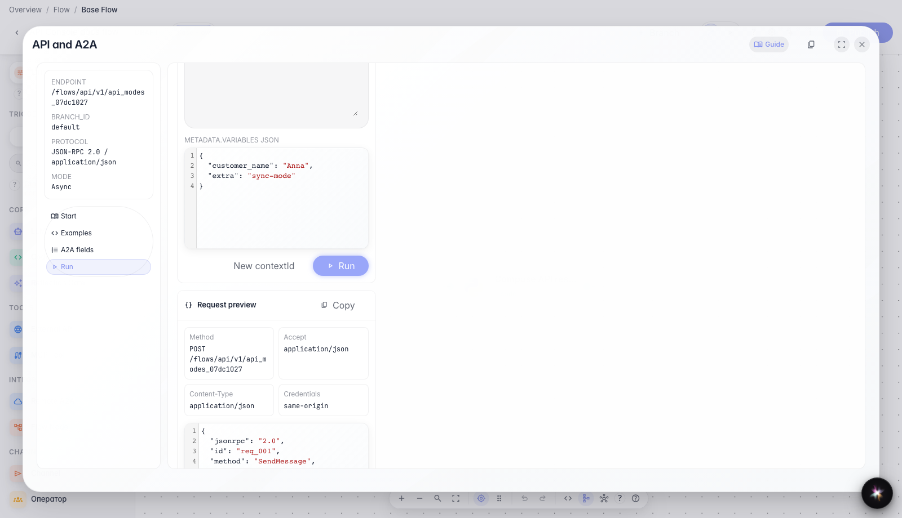
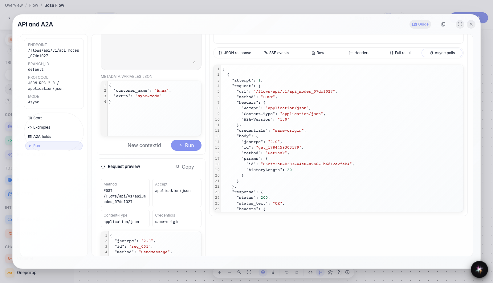

# Синхронный и асинхронный вызов через API Console

**Для чего:** эта инструкция покажет, как вызывать агента одним HTTP-ответом или в фоновом режиме.

**Какие проблемы решает:** неочевидно, когда нужен Sync вместо Streaming и как дождаться результата длинной задачи.

**Результат:** вы проверите оба режима SendMessage в одной модалке API Console.

## Шаг 1. Откройте вкладку «Запуск»

Перейдите на вкладку «Запуск». Здесь можно менять режим, текст сообщения и переменные, а затем отправлять настоящий запрос к текущему агенту.

## Шаг 2. Проверьте синхронный режим

Синхронный режим отправляет одно сообщение и ждёт финальный JSON-ответ без чтения потока событий. Так удобно проверять короткие сценарии и интеграции backend-to-backend.

## Шаг 3. Переключитесь на асинхронный режим

Выберите режим Async. В этом режиме API сразу возвращает задачу, а итоговый ответ можно получить отдельным опросом статуса.

## Шаг 4. Проверьте асинхронный режим

Асинхронный режим быстро возвращает идентификатор задачи, а результат можно дочитать отдельными запросами статуса. В модалке видно, какие проверки статуса уже выполнены.

**Демонстрация результата.** В режиме Async виден быстрый ответ с задачей и итоговый результат после опроса статуса — значит, оба способа вызова работают.

**Итог.** Теперь вы умеете переключать Sync и Async в API Console и понимаете, когда использовать каждый режим.

