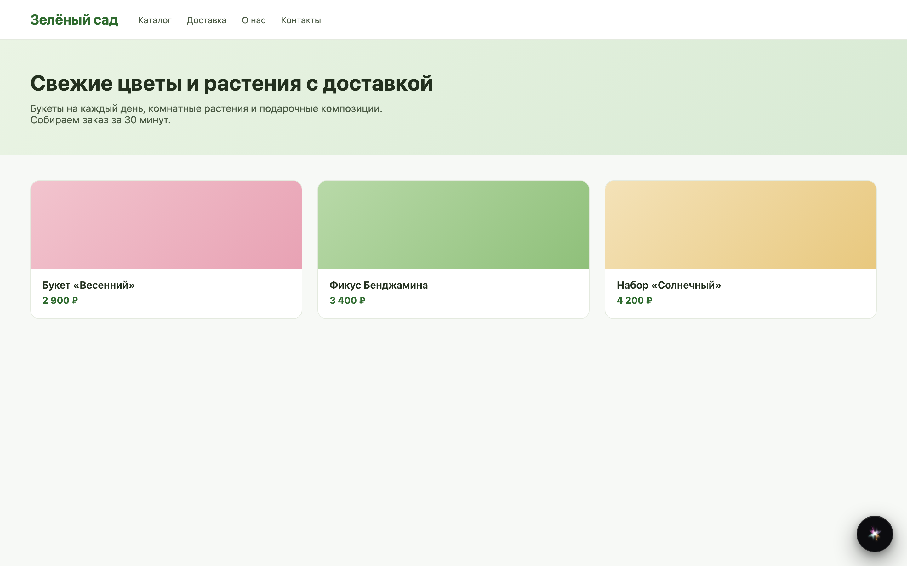
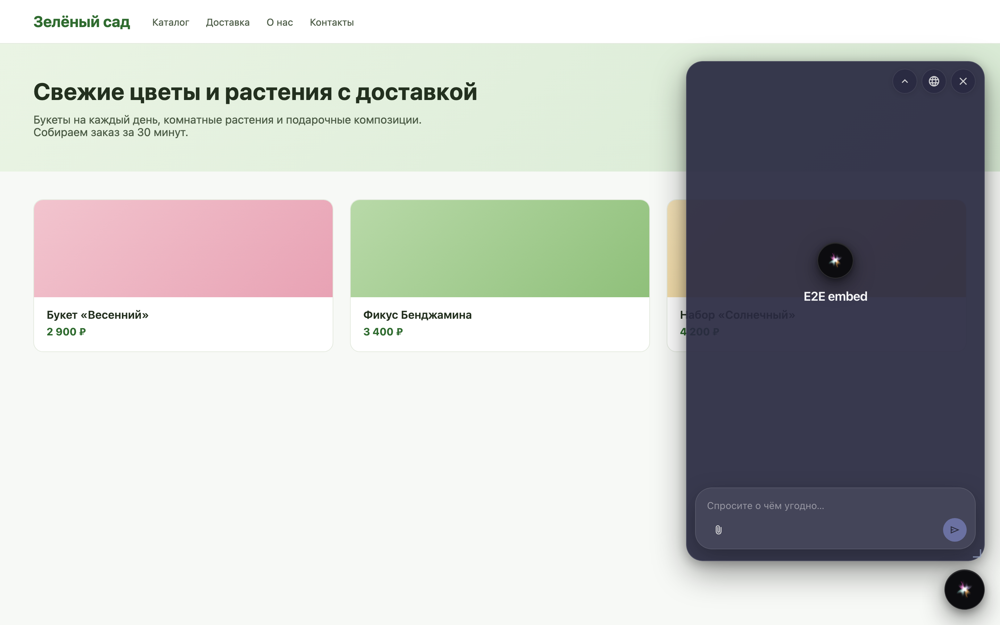
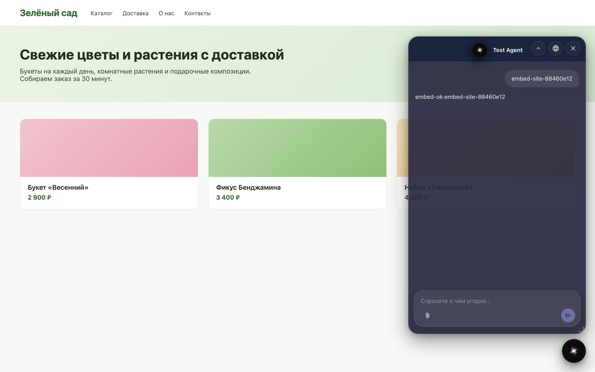

# Embed the agent on a site

**What for:** this guide shows how to place the agent chat on an external store site via an embed widget.

**Problems it solves:** a guest link opens a separate page, but you need chat on the Green Garden storefront itself.

**Result:** the site page shows the chat widget and receives an agent reply.

## Step 1. Create an embed config for the agent

In platform settings create an embed widget config and link it to the store agent. This is not the editor guest link — the widget lives on your site.

## Step 2. Prepare the site page with the script

Add the autoload script snippet with the widget id to the store site. Chat mounts on the external storefront page.

## Step 3. Open the chat widget on the site

The site page shows a chat button. Click it — the agent dialog opens on the storefront.

## Step 4. Get the agent reply in the embedded chat

**Result demonstration.** The customer writes on the store site and gets an agent reply in the embedded widget — this is embed, not a guest link.

**Summary.** You can create an embed config and verify chat on an external page.

