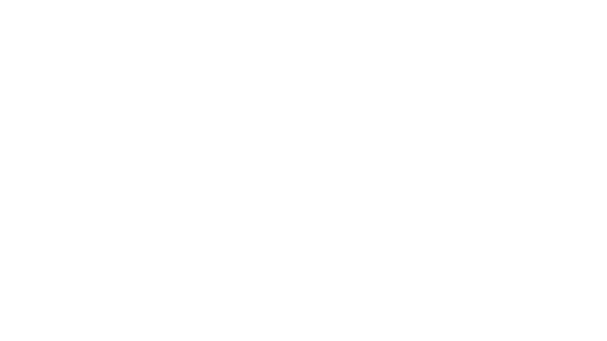
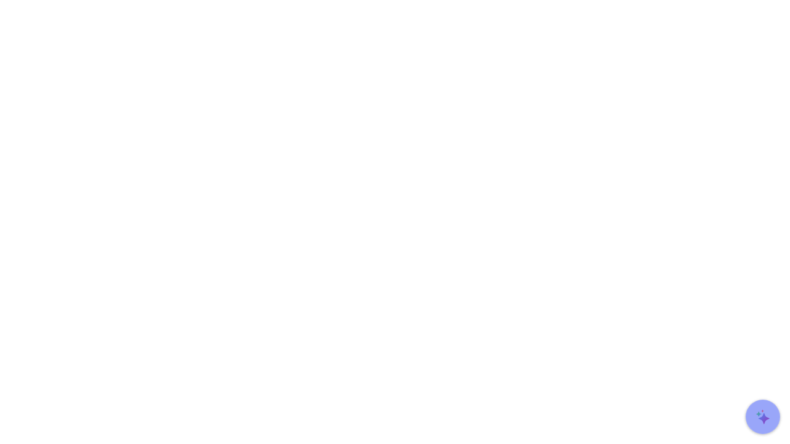
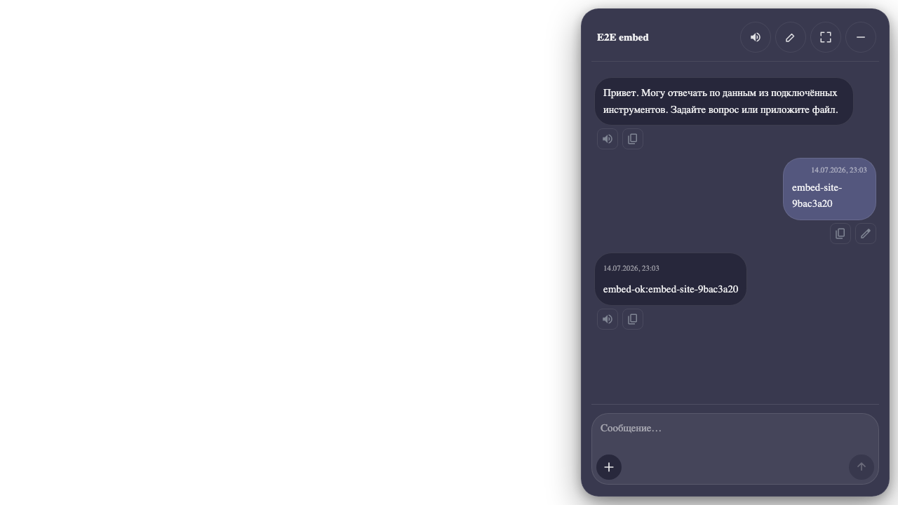

# Встраиваем агента на сайт

**Для чего:** эта инструкция покажет, как разместить чат агента на внешнем сайте магазина через embed-виджет.

**Какие проблемы решает:** гостевая ссылка открывает отдельную страницу, а нужен чат прямо на витрине «Зелёного сада».

**Результат:** на странице сайта открыт виджет чата и получен ответ агента.

## Шаг 1. Создайте embed-конфиг для агента

В настройках платформы создайте конфиг встраиваемого виджета и привяжите его к агенту магазина. Это не гостевая ссылка из редактора — виджет живёт на вашем сайте.

## Шаг 2. Подготовьте страницу сайта со скриптом

На сайт магазина добавьте snippet autoload-скрипта с id виджета. Чат смонтируется на внешней странице витрины.

## Шаг 3. Откройте виджет чата на сайте

На странице сайта видна кнопка чата. Нажмите её — откроется диалог с агентом прямо на витрине.

## Шаг 4. Получите ответ агента во встроенном чате

**Демонстрация результата.** Покупатель пишет на сайте магазина и получает ответ агента во встроенном виджете — это embed, а не гостевая ссылка.

**Итог.** Вы умеете создать embed-конфиг и проверить чат на внешней странице.

