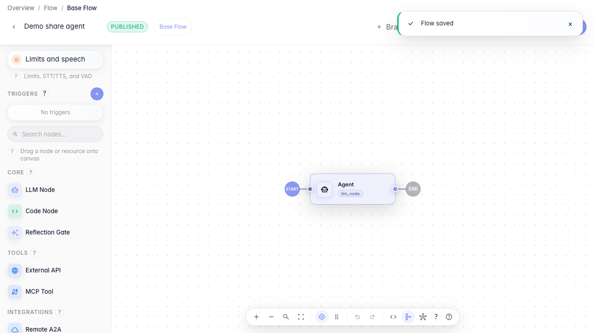
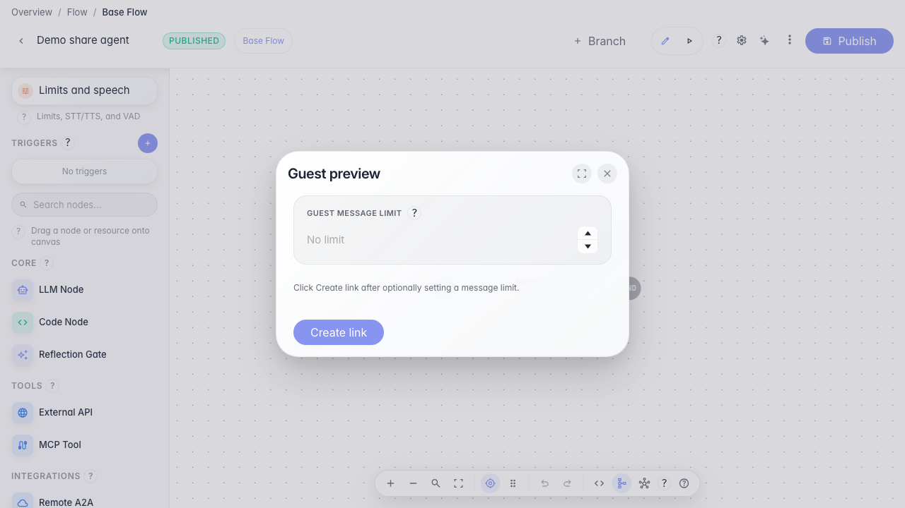
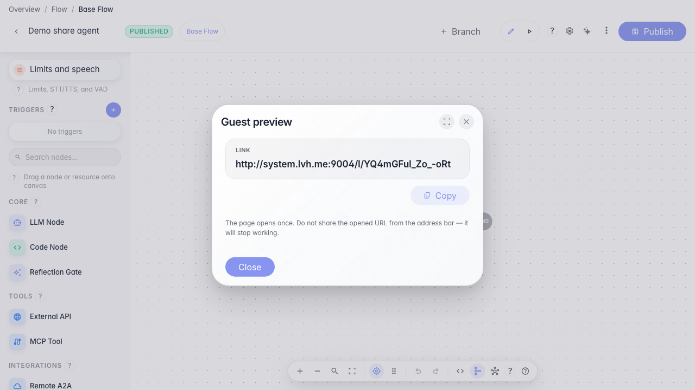

# Share an agent demo link

**What for:** this guide helps you show an agent to a colleague or stakeholder without account access.

**Problems it solves:** it is unclear how to quickly grant guest chat access and limit the number of messages.

**Result:** a guest link to the current agent demo chat is created.

## Step 1. Open the published agent editor

Publish the agent first so the guest link points to the current graph and settings.

## Step 2. Open guest preview

In the editor menu, choose Guest preview. Here you set a guest message limit and create a one-time chat link.

## Step 3. Create and copy the guest link

**Result demonstration.** After creation, a ready link appears on screen — you can send it to a guest to try the agent.

**Summary.** You can now issue a guest demo link with a message limit directly from the editor.

