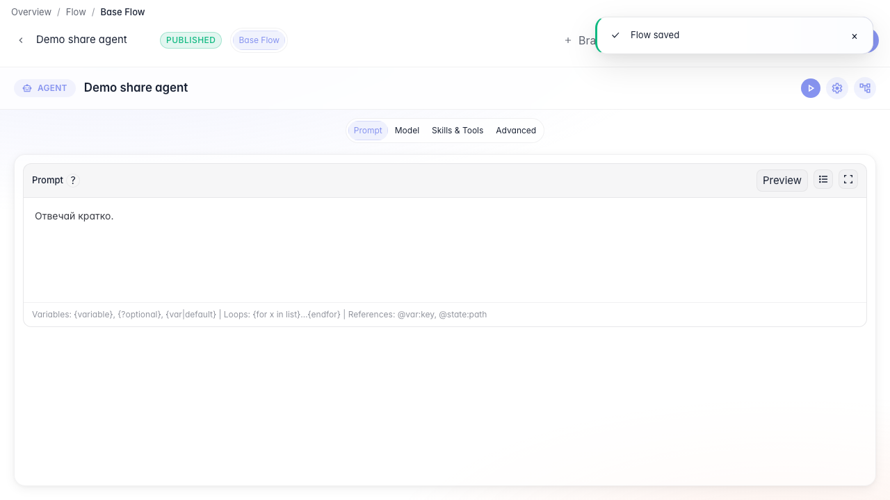
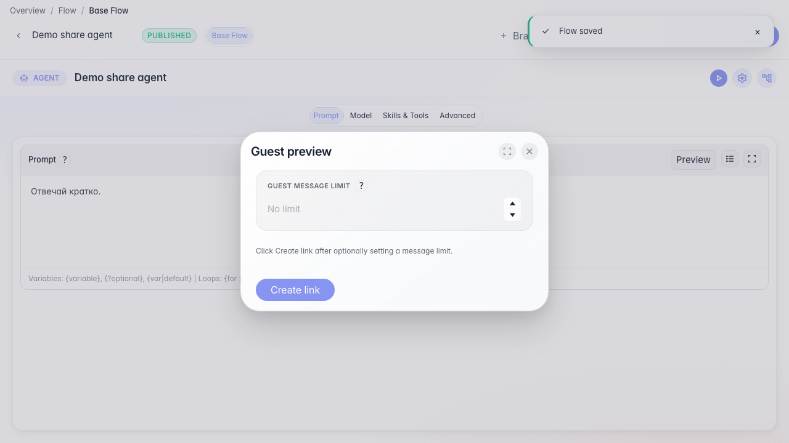
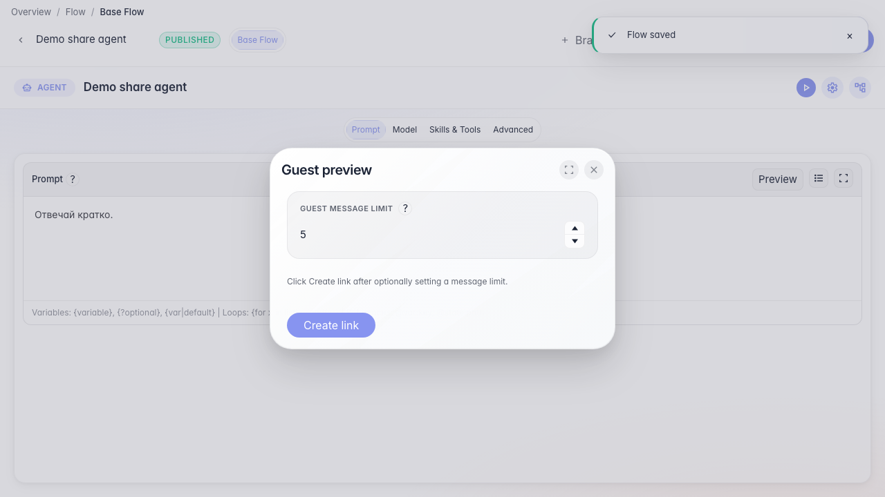
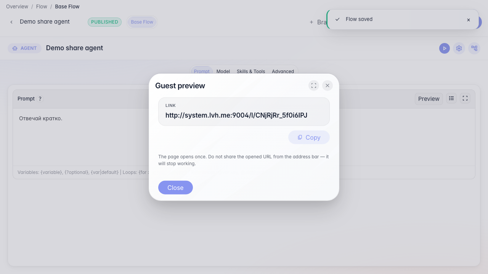

# Делимся демо агента по ссылке

**Для чего:** эта инструкция поможет показать агента коллеге или заказчику без доступа в аккаунт.

**Какие проблемы решает:** непонятно, как быстро выдать гостевой доступ к чату и ограничить число сообщений.

**Результат:** создана гостевая ссылка на демо-чат текущего агента.

## Шаг 1. Откройте редактора опубликованного агента

Сначала опубликуйте агента, чтобы гостевая ссылка вела на актуальную версию графа и настроек.

## Шаг 2. Откройте гостевой просмотр

В меню редактора выберите «Гостевой просмотр». Здесь задаётся лимит сообщений гостя и создаётся одноразовая ссылка на чат.

## Шаг 3. Задайте лимит сообщений для гостя

Укажите, сколько сообщений может отправить гость по ссылке — например 5. Так вы ограничиваете демо-чат без выдачи полного доступа к аккаунту.

## Шаг 4. Создайте и скопируйте гостевую ссылку

**Демонстрация результата.** После создания на экране появляется готовая ссылка — её можно отправить гостю для проверки агента.

**Итог.** Теперь вы умеете выпускать гостевую демо-ссылку с лимитом сообщений прямо из редактора.

