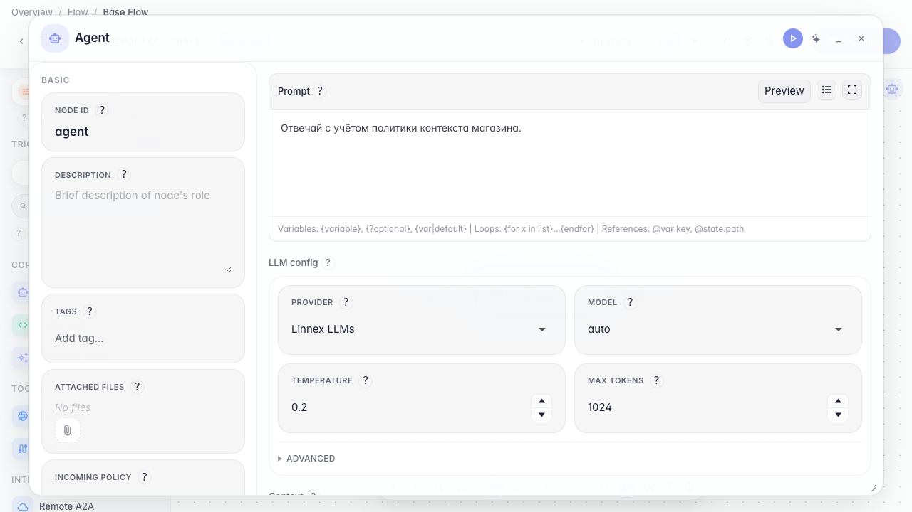
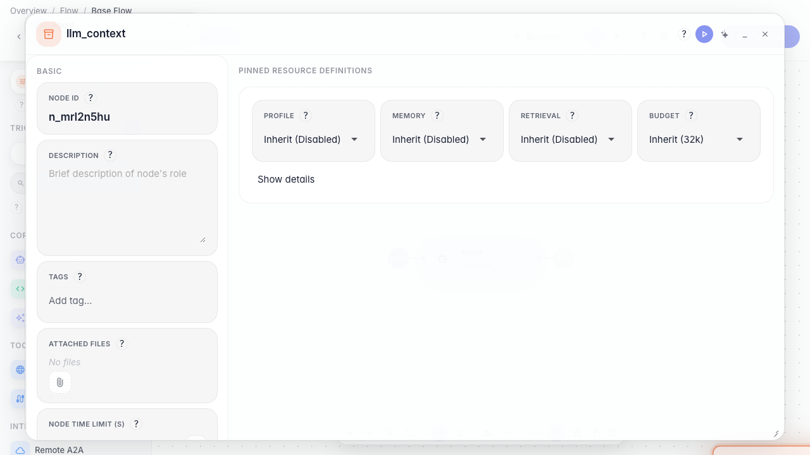
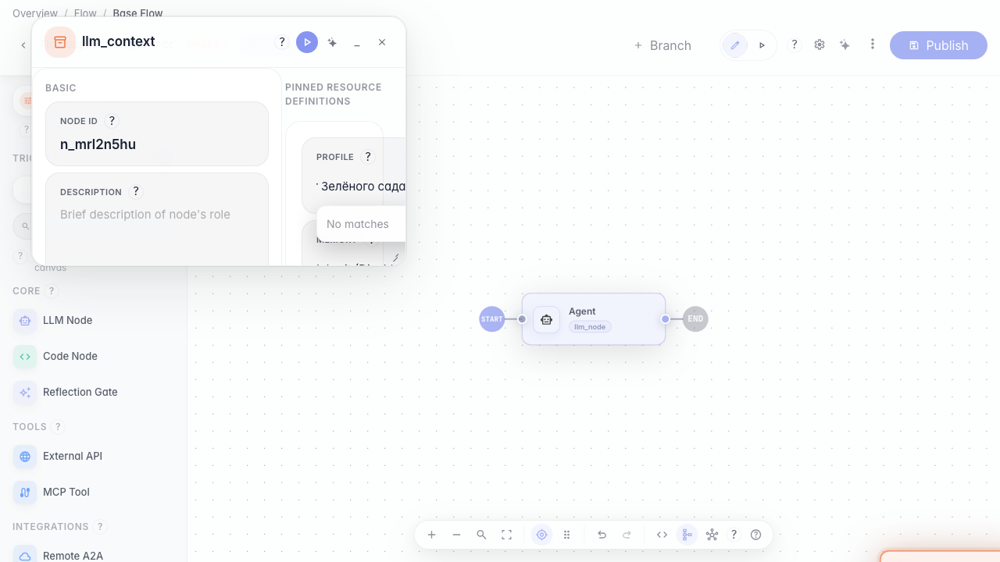
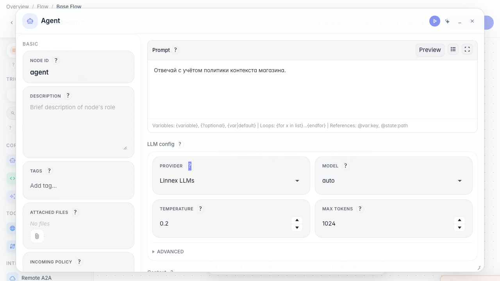
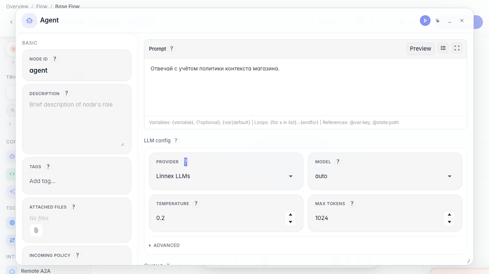

# Attach a model context resource

**What for:** this guide helps you define a shared model context resource and attach it to the answer node.

**Problems it solves:** window limits and context policies get copied into every node — one branch resource is cleaner.

**Result:** the agent uses the Green Garden context resource.

## Step 1. Open the agent on the canvas

Open the Green Garden Assistant on the canvas. The model context resource lives next to files and other branch resources.

## Step 2. Drop a context resource on the canvas

From the resources palette drag the model context type. A block appears for window and profile policies shared across nodes.

## Step 3. Name the resource and open the context editor

Set a name such as Green Garden context. Inside you see the context policy editor — configure the dialog window without editing every node.

## Step 4. Attach the resource to the answer node

Open the answer node and in the context block pick Green Garden context. The node then uses the shared policy explicitly.

## Step 5. Publish and verify the attachment

**Result demonstration.** After publish the node still has the context resource selected — the policy is saved on the agent.

**Summary.** You can add a model context resource and attach it to the answer node.

