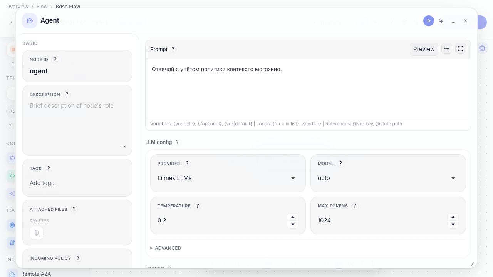
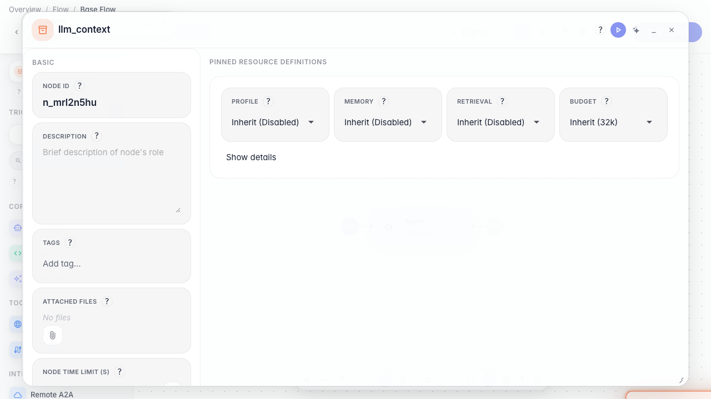
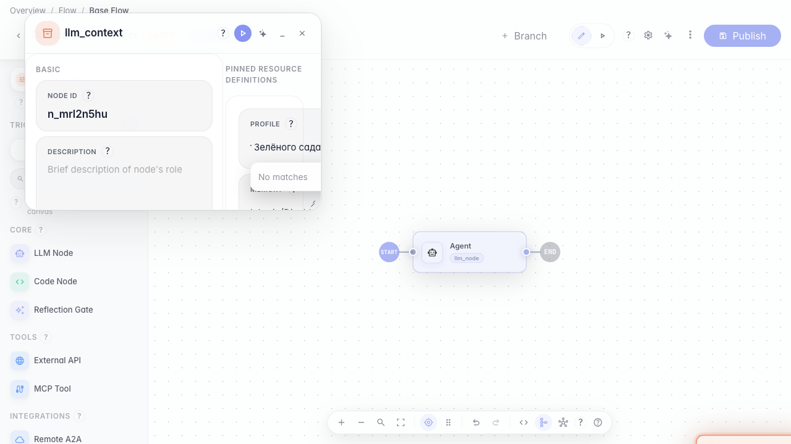
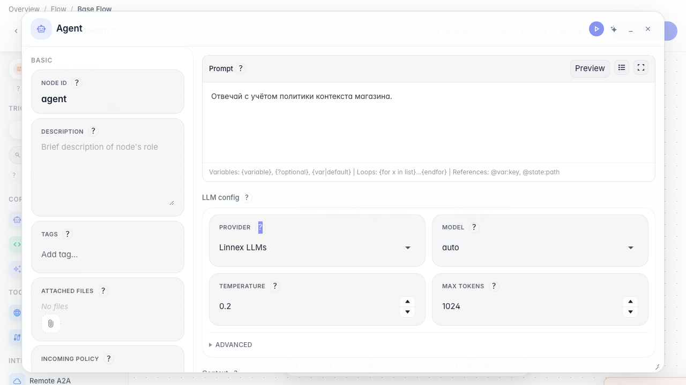
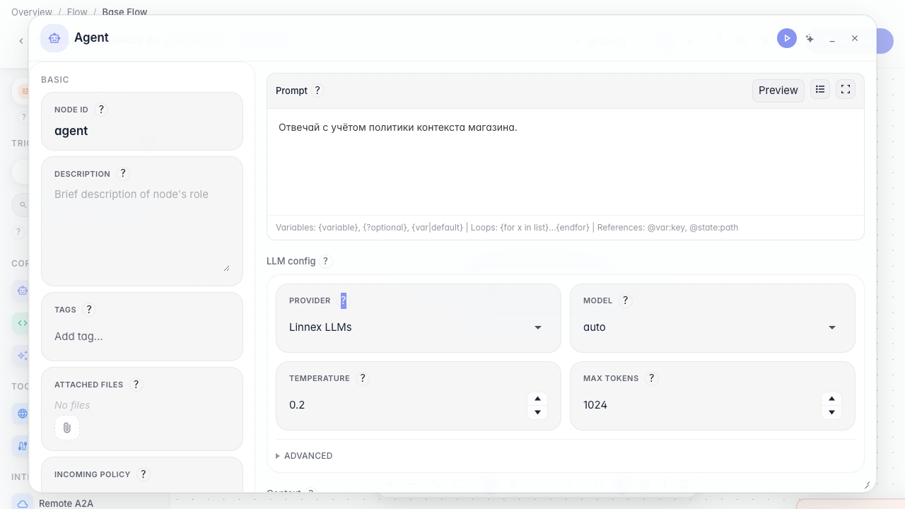

# Подключаем ресурс контекста модели

**Для чего:** эта инструкция поможет задать общий ресурс контекста модели и привязать его к ноде ответа.

**Какие проблемы решает:** лимиты окна и политики контекста копируют в каждую ноду — удобнее один ресурс на ветке.

**Результат:** у агента выбран ресурс контекста «Зелёного сада».

## Шаг 1. Откройте агента на схеме

Откройте «Помощника Зелёного сада» на канве. Ресурс контекста модели живёт рядом с файлами и другими ресурсами ветки.

## Шаг 2. Добавьте ресурс контекста на канву

В палитре ресурсов перетащите тип контекста модели. Появится блок, в котором задаются политики окна и профиля для нескольких нод.

## Шаг 3. Назовите ресурс и откройте редактор контекста

Задайте имя вроде «Контекст Зелёного сада». Внутри виден редактор политик контекста — здесь настраивают окно диалога без правки каждой ноды.

## Шаг 4. Привяжите ресурс к ноде ответа

Откройте ноду ответа и в блоке контекста выберите ресурс «Контекст Зелёного сада». Так нода явно использует общую политику.

## Шаг 5. Опубликуйте и проверьте привязку

**Демонстрация результата.** После публикации у ноды выбран ресурс контекста — политика сохранена в агенте.

**Итог.** Вы умеете добавлять ресурс контекста модели и подключать его к ноде ответа.

