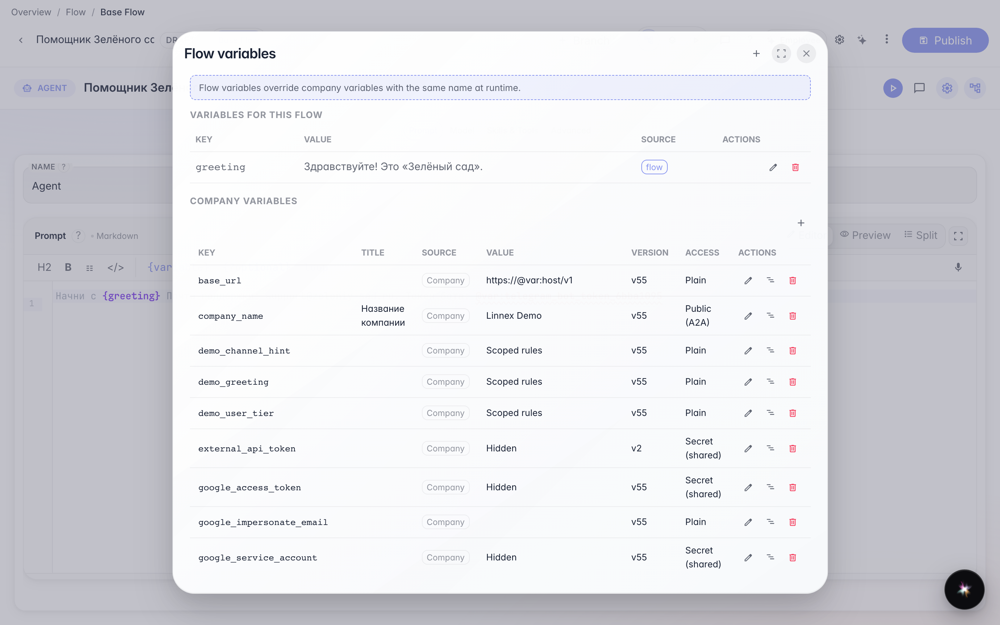
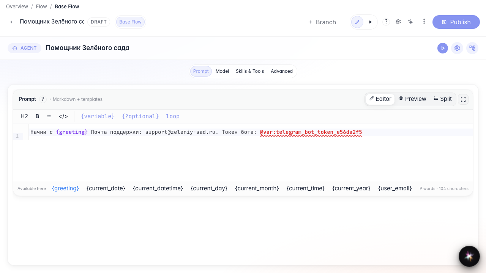
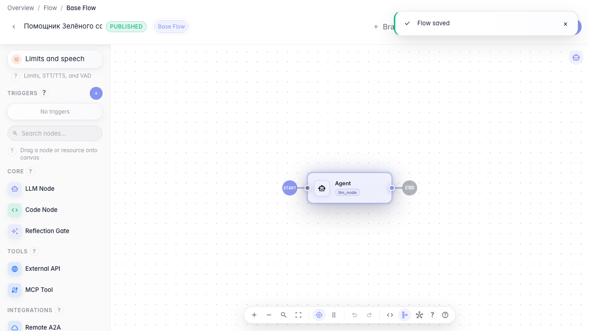

# Agent parameters and secrets

**What for:** this guide moves greeting and contacts into variables and secrets into protected storage.

**Problems it solves:** editing support email in every prompt is tedious — variables and @var: simplify maintenance.

**Result:** variables are set and referenced in the agent instruction.

## Step 1. Open agent variables

In the editor bottom bar click the variables icon. Here you define values available to the whole graph via {name} or @var:.

## Step 2. Verify the variable in the list

The greeting variable is already in the modal table. This confirms the value is available to the whole graph before editing the prompt.

## Step 3. Add variables and update the prompt

## Step 4. Publish the agent with variables

**Result demonstration.** The prompt references variables and a secret — at runtime the current company values are substituted.

**Summary.** You can open flow variables, store secrets via @var:, and use them in the agent instruction.

