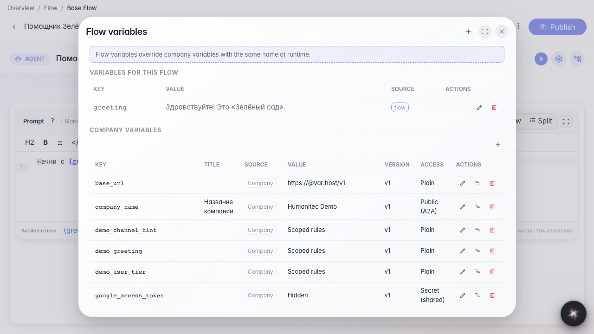
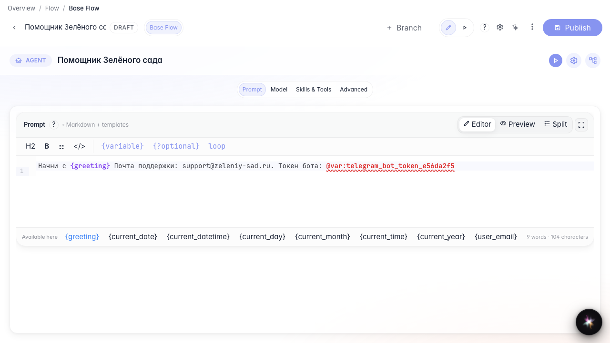
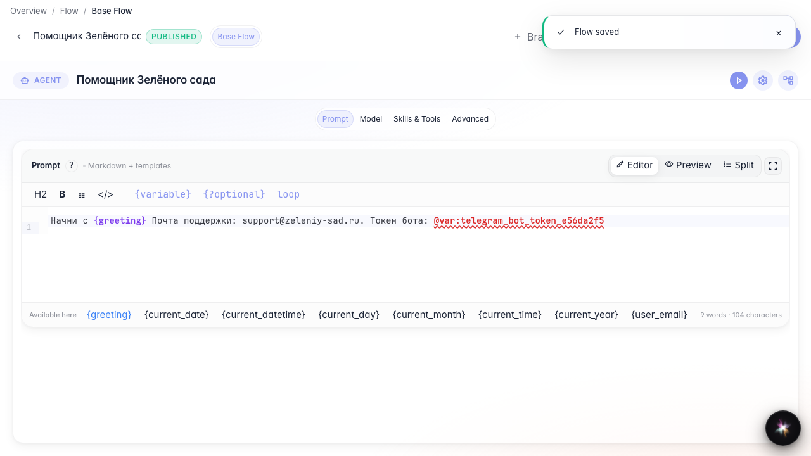

# Параметры и секреты агента

**Для чего:** эта инструкция вынесет приветствие и контакты в переменные, а секреты — в защищённое хранилище.

**Какие проблемы решает:** менять email поддержки в каждом промпте неудобно — переменные и @var: упрощают сопровождение.

**Результат:** переменные заданы и подставляются в инструкцию агента.

## Шаг 1. Откройте переменные агента

В нижней панели редактора нажмите иконку переменных. Здесь задаются значения, доступные всему графу через {имя} или @var:.

## Шаг 2. Проверьте переменную в списке

Переменная greeting уже есть в таблице модального окна. Так вы убеждаетесь, что значение доступно всему графу до правки промпта.

## Шаг 3. Добавьте переменные и обновите промпт

Создайте переменную greeting и впишите в промпт адрес support@zeleniy-sad.ru и секрет @var:telegram_bot_token_e56da2f5. Так контакты меняются без правки всего текста.

## Шаг 4. Опубликуйте агента с переменными

**Демонстрация результата.** Промпт содержит ссылки на переменные и секрет — при запуске подставятся актуальные значения компании.

**Итог.** Теперь вы умеете открывать переменные flow, хранить секреты через @var: и использовать их в инструкции агента.

