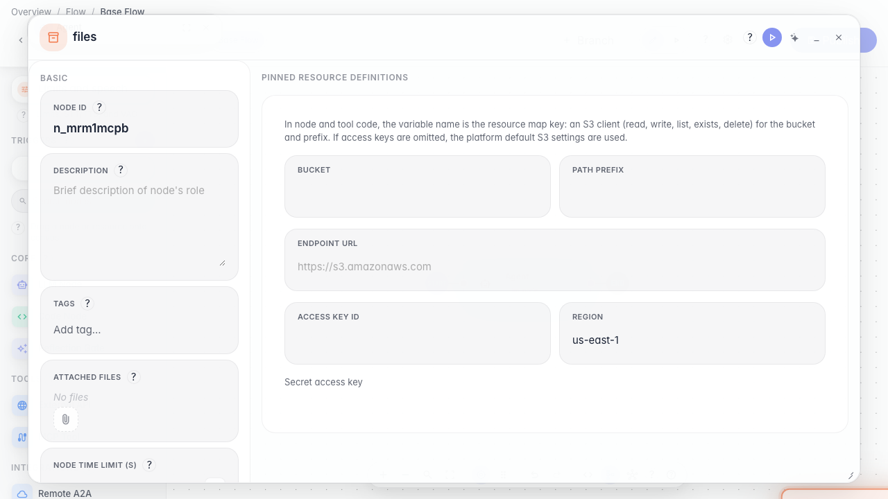
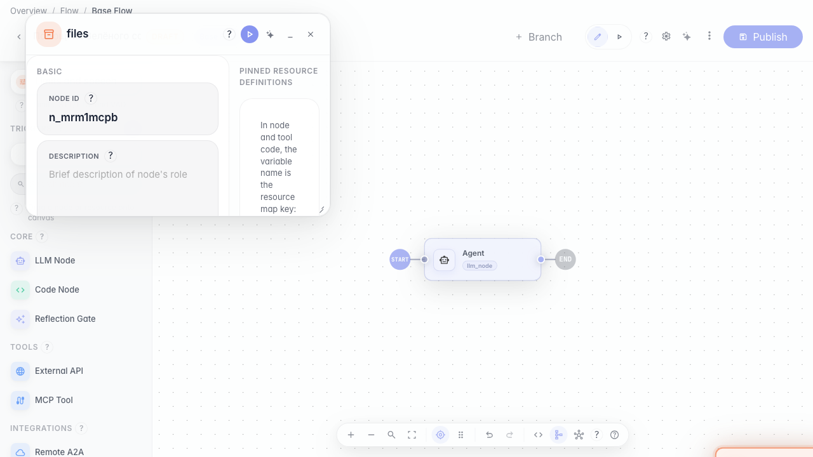
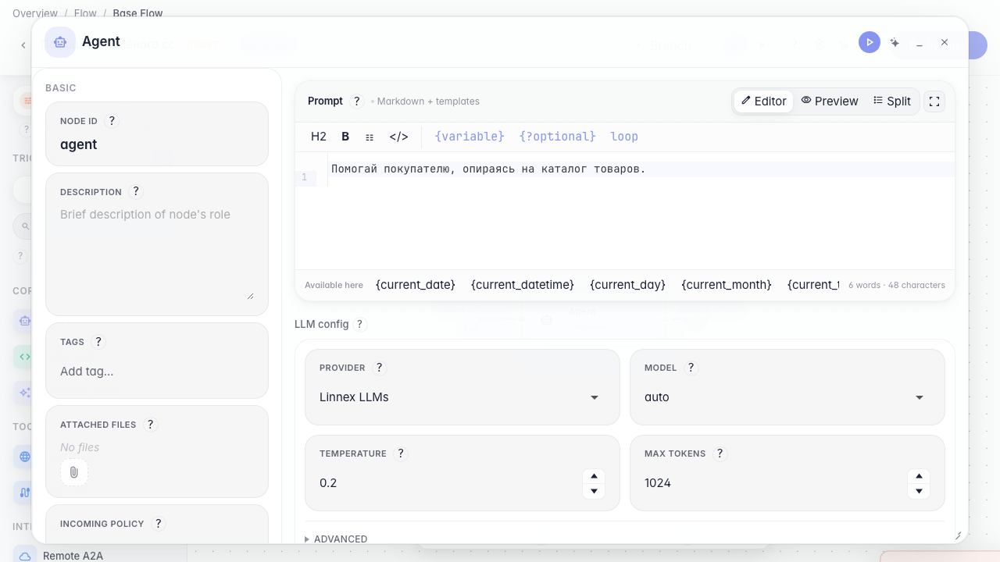
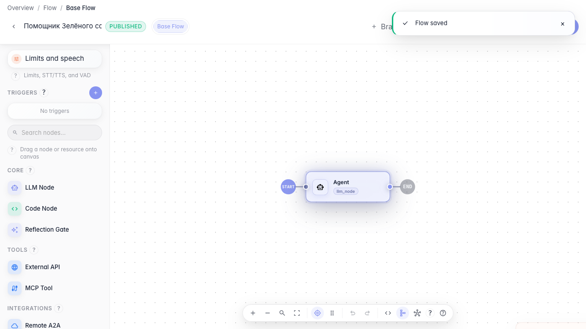

# Reuse settings and files with resources

**What for:** this guide attaches a shared files resource to the agent so you do not duplicate the catalog in every node.

**Problems it solves:** the same PDF catalog is needed in several graph steps — storing it as a resource is cleaner.

**Result:** a files resource is on the canvas and linked to the agent.

## Step 1. Drop a files resource on the canvas

In the left palette under Resources drag the files type onto the canvas. A shared branch files block appears — a PDF catalog can be reused across steps. The model context resource (llm context) is covered in a separate guide.

## Step 2. Configure the catalog storage

Open the resource properties and set the bucket to “green-garden-catalogs” and the prefix to “spring-2026”. These fields point the agent to the exact object-storage folder containing the current catalog.

## Step 3. Open the agent and review resources

Open the main agent node and find the resources block. Here you see which shared files and settings are attached to this graph branch.

## Step 4. Publish the agent with the resource

**Result demonstration.** The files block is saved on the graph branch — you can reuse it across nodes without re-uploading.

**Summary.** You can add a files resource to the canvas and attach shared materials to the agent.

