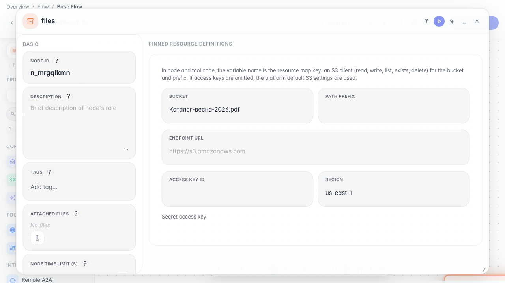
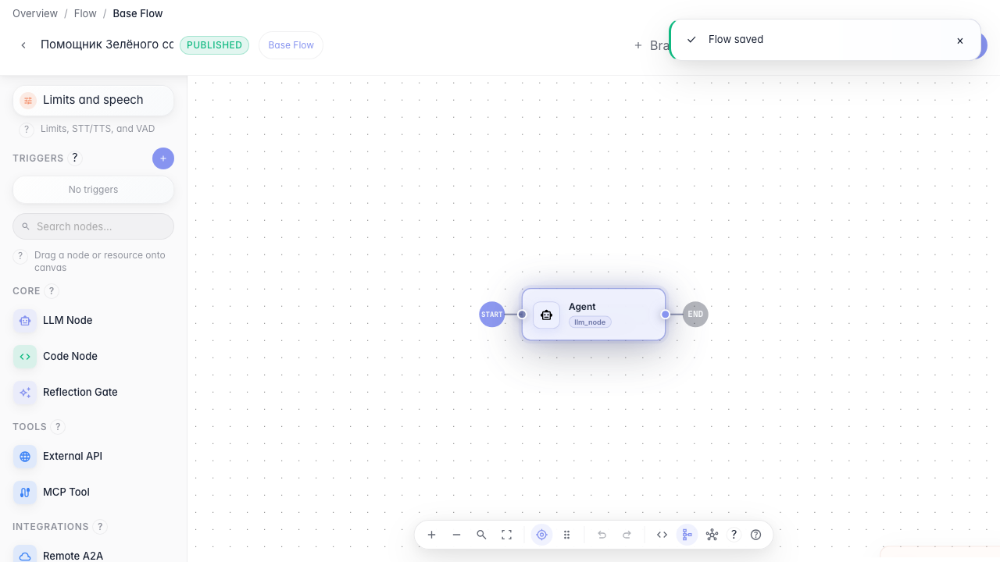

# Переиспользуем настройки и файлы

**Для чего:** эта инструкция подключит общий ресурс файлов к агенту, чтобы не дублировать каталог в каждой ноде.

**Какие проблемы решает:** один и тот же PDF-каталог нужен нескольким шагам графа — удобнее хранить его как resource.

**Результат:** ресурс files создан на канве и привязан к агенту.

## Шаг 1. Перетащите ресурс files на канву

В палитре слева в разделе «Ресурсы» перетащите тип files на канву. Появится resource-нода для общих файлов ветки.

## Шаг 2. Задайте имя ресурса каталога

Откройте свойства ресурса и задайте понятное имя — например «Каталог-весна-2026.pdf». Так в графе видно, какой файл подключён.

## Шаг 3. Опубликуйте агента с ресурсом

**Демонстрация результата.** Ресурс files сохранён в ветке графа — его можно переиспользовать в нескольких нодах без повторной загрузки.

**Итог.** Теперь вы умеете добавлять resource на канву и подключать общие файлы к агенту.

