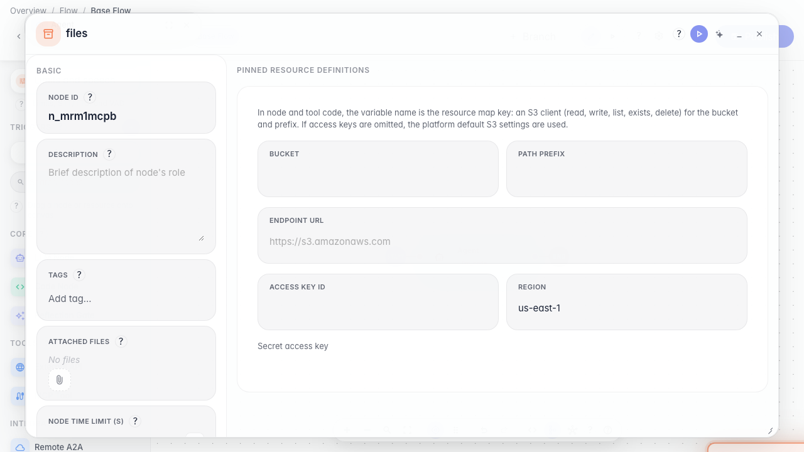
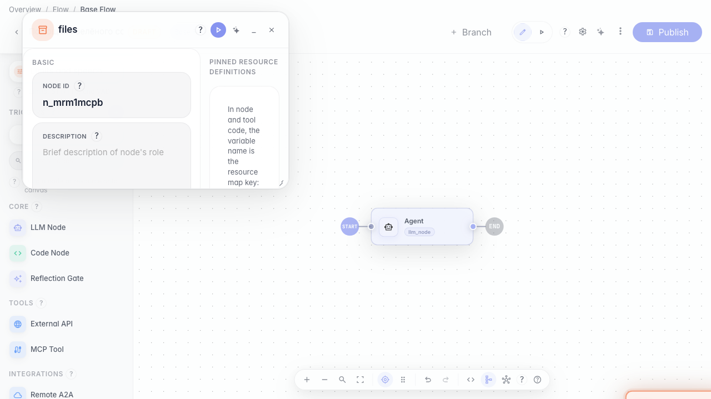
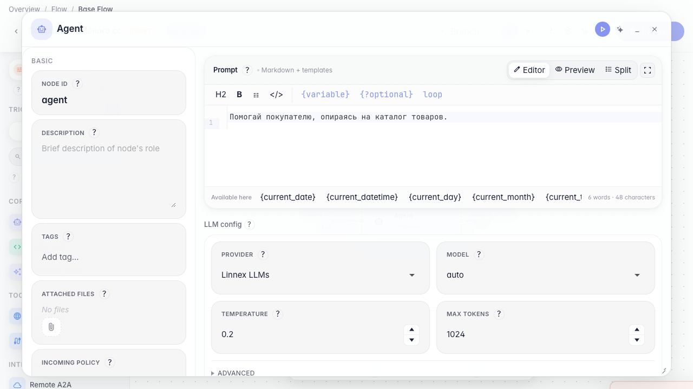

# Переиспользуем настройки и файлы

**Для чего:** эта инструкция подключит общий ресурс файлов к агенту, чтобы не дублировать каталог в каждой ноде.

**Какие проблемы решает:** один и тот же PDF-каталог нужен нескольким шагам графа — удобнее хранить его как resource.

**Результат:** ресурс files создан на канве и привязан к агенту.

## Шаг 1. Перетащите ресурс files на канву

В палитре слева в разделе «Ресурсы» перетащите тип файлов на канву. Появится блок общих файлов ветки — каталог PDF можно переиспользовать в нескольких шагах. Ресурс контекста модели (llm context) настраивается в отдельной инструкции.

## Шаг 2. Укажите хранилище каталога

Откройте свойства ресурса и укажите bucket «green-garden-catalogs» и префикс «spring-2026». Эти поля направляют агент к нужной папке объектного хранилища, где лежит актуальный каталог.

## Шаг 3. Откройте агента и проверьте ресурсы

Откройте главную ноду агента и найдите блок ресурсов. Здесь видно, какие общие файлы и настройки подключены к этой ветке графа.

## Шаг 4. Опубликуйте агента с ресурсом

**Демонстрация результата.** Блок файлов сохранён в ветке графа — его можно переиспользовать в нескольких нодах без повторной загрузки.

**Итог.** Теперь вы умеете добавлять ресурс файлов на канву и подключать общие материалы к агенту.

