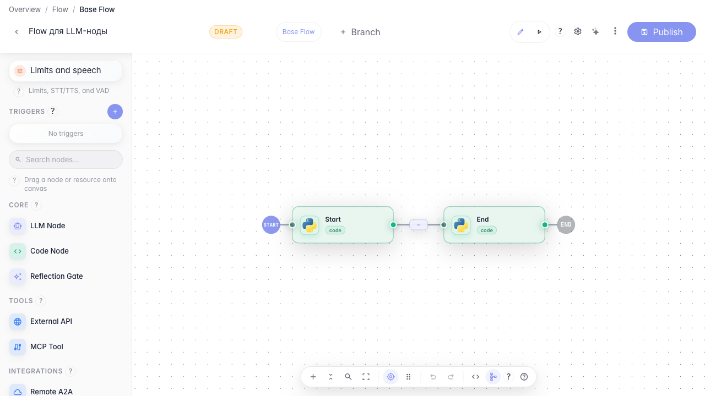
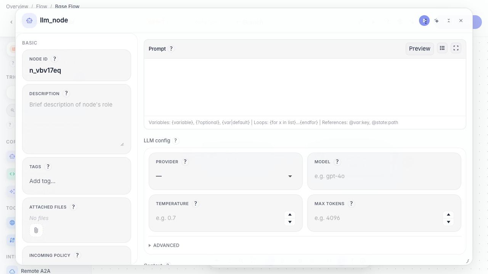
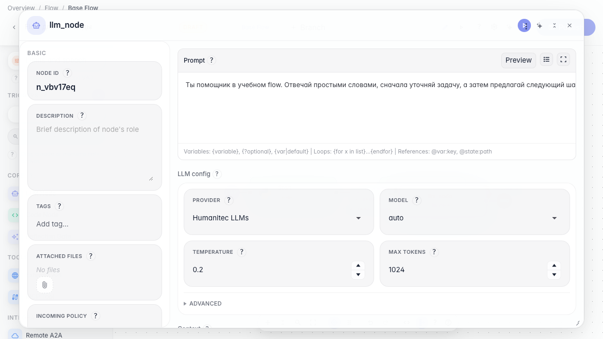
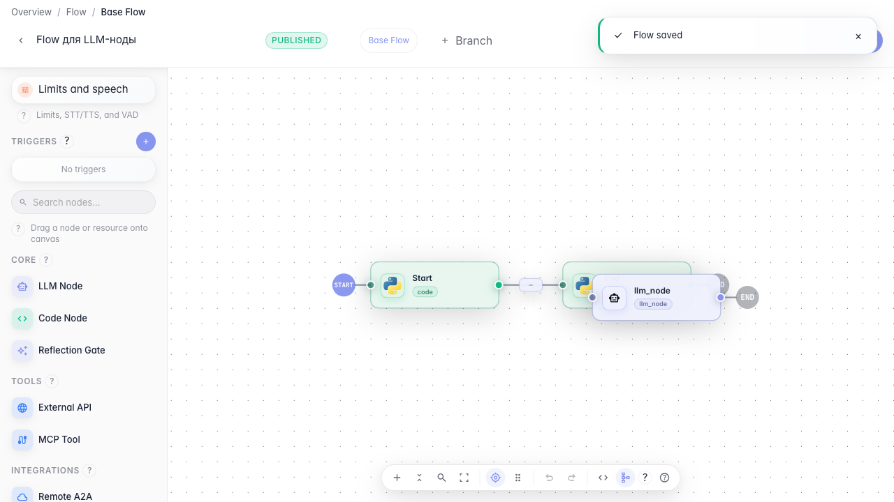

# Flows: adding an LLM node

Guide showing how to add an LLM Node to the canvas, open node settings, fill in the prompt, and choose an LLM profile.

## Step 1. Open the flow editor. The node palette is on the left and the canvas is in the center.

## Step 2. Drag an LLM Node from the palette onto the canvas. Node settings open on the right.

## Step 3. Fill in the prompt and LLM settings. The prompt tells the agent how to behave with the user.

## Step 4. Click Publish. This saves the draft so you can run the flow or keep editing later.

